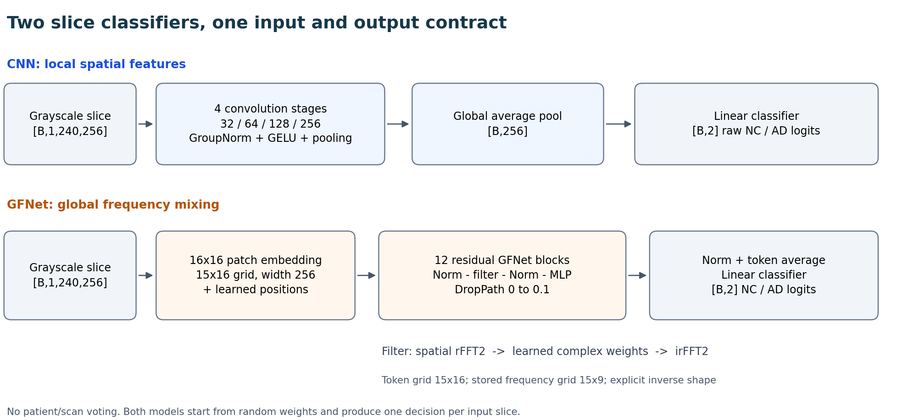
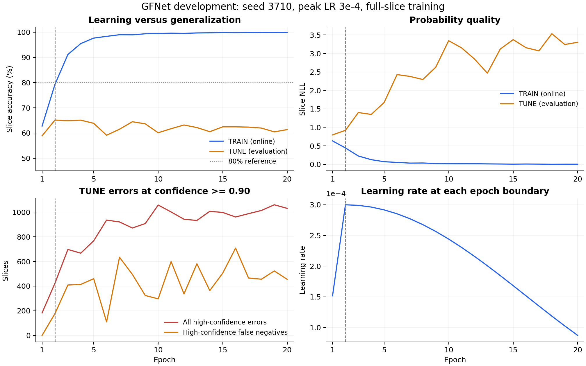
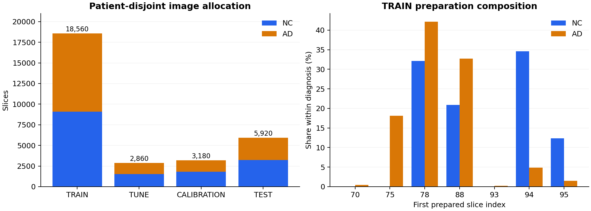

# GFNet and CNN for confidence-aware ADNI slice classification

COMP3710 · s4984179. **V2 develops one slice, one
prediction, equal-slice training and TUNE accuracy selection.** The numerical
80% assessment target concerns all TEST slices. Confidence reliability,
high-confidence mistakes and failure analysis remain central research outcomes.
No new V2 TEST result is claimed here.

The V1 record is retained to explain the choices, measurements and rejected
assumptions that led to V2. Its scan/patient prediction aggregation is historical
and is absent from the current production files. The version sections identify
which data unit and selection rule produced each reported result.

## V1 development: superseded patient sampling and aggregated selection

### Recover actual patients and audit the supplied image folders

The source contains 30,520 grayscale JPEG slices from 1,526 acquisitions and
680 patients. Each acquisition contributes twenty prepared slices. The number
before the filename's underscore identifies an acquisition, not a patient;
the `ADNI_..._S_...` token in source metadata supplies the actual patient ID.
Labels map NC to 0 and AD to 1 (the source's AD metadata value is 2).

The supplied train/test folders share 216 patients even though their scan IDs
do not overlap. Different visits from the same person therefore cannot be
assumed independent. The inventory checks diagnosis consistency, dimensions
and recoverable identities before deciding how to divide the data. Folder
names remain provenance and are never model inputs. These counts come from
the saved inventory audit; no clinical diagnosis is inferred from a filename.

### Separate patients into four reproducible data roles

Patients, rather than images or acquisitions, define the partition boundary.
Sorted AD and NC patient strata use one private PCG64(2026) stream. The fixed
AD allocation is 133/22/22/44 and NC is 275/46/46/92 across TRAIN, TUNE,
CALIBRATION and TEST. All visits and slices inherit their patient's role.

This gives 408/68/68/136 patients and 18,560/2,860/3,180/5,920 slices.
TRAIN updates weights, TUNE guides development, CALIBRATION fits probability
or rejection parameters, and TEST measures the declared final procedure.
Keeping all four roles in a manifest prevents a later model from quietly
using a different population. Correlated slices still do not become thousands
of independent patients merely because the network consumes individual images.

### Load native grayscale slices without resizing

The observed image canvas is width 256, height 240. The loader returns
float32 tensors `[1,240,256]` by dividing grayscale values by 255, preserving
native resolution, aspect ratio and the supplied brain preparation. Converting
to RGB would repeat information, while square resizing would alter geometry.
Neither is required for a scratch model.

Only the image enters the network. Labels, patient IDs and relative paths
remain separate metadata for accounting and analysis. The manifest fixes
labels and partition membership; path resolution stays under the caller's
data root. No pretrained normalization, cropping or augmentation is introduced
in this initial baseline, so their effects cannot be confused with architecture.

### Sample one acquisition per patient for the initial training design

The initial rationale is to prevent frequent visitors from dominating the
training stream. For every epoch, choose one acquisition per TRAIN patient,
retain its twenty slices, and shuffle the concatenated slices. Independent
PCG64 streams determine visit choice and slice order from seed and epoch.
Reconstructing the sampler therefore does not consume the model's RNG.

This choice gives 8,160 presentations and 128 batch-64 updates, including a
final partial batch. It gives patients equal opportunity rather than giving
all supplied slices equal opportunity. That distinction is a hypothesis with
consequences for class and visit weighting, not an automatic improvement over
ordinary image sampling. Evaluation loaders keep every declared slice.

### Define scan probability means and patient-weighted metrics

V1 extends image probabilities into an acquisition summary by averaging its
twenty AD probabilities. A patient with V acquisitions gives each scan weight
1/V, making each patient contribute total mass one. The weighted scan NLL is
then intended to measure probability reliability without letting repeated
visits dominate the metric.

This operation has a different statistical unit from slice accuracy. Averaging
can cancel a confident error against other slices, and applying NLL after an
average is not the same as averaging slice NLL. The code keeps that weighted
objective explicit rather than calling it image accuracy. This distinction
will later become central to deciding whether V1 answers the assessment task.

### Build local CNN stages with small convolution kernels

The CNN provides a simple spatial baseline. Each stage uses two padded 3×3
convolutions, GroupNorm and GELU, then 2×2 max pooling. Two small kernels add
nonlinear processing while expanding local context gradually; pooling reduces
later computation. GroupNorm avoids depending on large per-device batch
statistics and has the same inference behavior with a short final batch.

Four stages use 32, 64, 128 and 256 channels. Global spatial averaging and a
256-to-2 linear head give raw NC/AD logits, with no softmax inside the model.
The 1,173,154 parameters are much fewer than GFNet's later configuration, so
this is a practical baseline, not a parameter-matched isolation of one operator.

### Implement Fourier filtering on the rectangular patch grid

A 240×256 image divided into 16×16 patches has a 15×16 grid, not a square.
The GlobalFilter reshapes tokens to that explicit grid, applies orthonormal
rfft2 over its two spatial axes, multiplies learned complex coefficients,
then uses irfft2 with the original spatial size. The real FFT has a 15×9
frequency grid; real and imaginary parameters are stored separately.

The operation filters learned features, not MRI acquisition k-space. Taking
sqrt(token_count) from a square-image reference would give the wrong geometry.
FP32/complex64 and explicit axes make the mathematical adaptation inspectable.
The implementation follows Rao et al.'s global-filter mechanism, with task
adaptations for grayscale input and rectangular dimensions.

### Embed slices and add residual global-filter blocks

A stride-16 convolution projects each patch into 256 channels. Learned
positional embeddings distinguish patch locations. Twelve independent blocks
use the reference single residual path: normalization, global filter,
normalization and a channel MLP expanding 256→1024→256 with GELU.

Stochastic depth increases from zero to 0.1 across blocks, dropping whole
residual branches per example during training. Evaluation disables it. The
final LayerNorm, mean over the 240 within-image tokens and two-class head
produce one prediction per slice. This token mean is an internal feature
operation; it is distinct from averaging predictions from different slices.

### Complete the scratch GFNet classifier and tensor-flow explanation

The complete scratch model has 7,276,802 real trainable scalars. Linear and
positional parameters use truncated-normal initialization; LayerNorm starts
with unit scales and zero offsets. There is no class token, external encoder
or pretrained checkpoint. Native rectangular geometry reaches the classifier
without an image resize.



The diagram shows implemented tensor sizes rather than an unmodified RGB
paper figure. CNN emphasizes local spatial processing; GFNet mixes patch
features globally. Differences in capacity and regularization remain part of
the complete-system comparison and prevent a single-factor causal claim.

### Configure AdamW and complete effective-batch updates

The optimizer uses AdamW with betas (0.9,0.999), weight decay 0.01 for matrices
and complex filters, and zero decay for biases, norm vectors and positional
embeddings. Cross-entropy consumes raw logits and integer NC/AD targets.
Global gradient norm clipping at 1.0 limits finite spikes; clipping frequency
is diagnostic and is not itself proof of divergence or a smaller AdamW LR.

The effective batch is 64. A short final batch uses its actual size, and
sample-weighted epoch loss avoids giving the final small batch the same
influence as a full batch. Python, NumPy and Torch seeds are explicit so model
initialization and sampling can be compared under a stated configuration.

### Save compact epoch boundaries and reproducible random state

A complete boundary needs more than model weights: optimizer moments, global
update cursor, epoch, selected best state, patience and Python/NumPy/Torch/CUDA
RNG states determine continuation. A separate selected checkpoint supports
inference without applying optimizer or training RNG state. Temporary-file
replacement avoids publishing a half-written file as a completed boundary.

The compact representation keeps scientific continuation state and readable
configuration/history. Repeated validation scripts and operational submission
receipts are not part of the learning algorithm. Historical training results
remain associated with their saved execution sources; simplifying the code
here does not rerun those experiments or prove byte-equivalent checkpoints.

### Establish allocated A100 execution and initial resource feasibility

Native FP32/complex64 execution uses an actual allocated A100 and deterministic
operations with TF32 disabled. Hardware is identified from the visible device,
not inferred from a partition label. Runtime records include software, device
identity and thread settings; reproducibility remains scoped to that setup.

Saved job 624327 passed the initial GPU phases. Batch 64's allocated training
peaks were 8.697 GiB for CNN and 2.603 GiB for GFNet, against 39.081 GiB
initially free. The preliminary batch-of-twenty inference benchmark measured
median/p95 8.257/8.450 ms for CNN and 8.005/8.181 ms for GFNet. It included
forward, softmax and probability mean, excluding image decode and transfer;
it was not single-slice end-to-end latency or trained-model accuracy.

### Record five-epoch pilots and exact boundary continuation

Saved job 625831 completed five control epochs and a fresh-process continuation
for each model. The saved model/optimizer/RNG/progress comparisons matched
exactly. New ADNI work was 1,536 updates, 97,920 TRAIN and 34,320 TUNE
presentations, counting only newly executed work rather than inherited histories.

The measured steady epoch medians were 43.74 seconds for CNN and 42.37 seconds
for GFNet under the sampled training recipe. Typical 60-epoch extrapolations
were 43.93 and 42.59 minutes, with larger cautious estimates; they were not
completed formal-fit durations. These results support native batch-64 execution
and boundary resume, while classification capability and confidence reliability
remain separate research questions.

### Explain feasibility, research priorities and measured limits

The feasibility review joins four considerations: patient-disjoint data,
rectangular architecture implementation, measured A100 resources, and testable
classification/reliability questions. The evidence supports an executable
prototype; it does not support a clinical claim or an 80% accuracy guarantee.

Confidence must be examined alongside correctness, including confident wrong
predictions and false negatives. Classification, calibration, selective
prediction, real error examples and computational cost should jointly inform
an engineering recommendation. The one-page review and later tutor clarification
are evidence documents, not a reason to call unfinished experiments complete.

### Define a global cosine schedule and explicit NLL stopping policy

The formal horizon is 60 sampled epochs, 7,680 updates. Warmup uses 640
updates, followed by cosine decay to 1% of peak. The global update index,
rather than the process's local epoch count, prevents resume from restarting
the schedule. Candidate peaks are 1e-4, 3e-4 and 1e-3.

Strict-best weighted scan NLL selects checkpoints. A separate patience anchor
requires an improvement of at least 1e-4; small strict-best improvements do
not continually reset patience. Stop after at least thirty epochs with twelve
non-improving epochs, or at sixty. This makes selection and stopping reproducible,
but it does not establish that weighted scan NLL is the right assessment target.

### Integrate training, full TUNE evaluation and continuation

The integrated fit reconstructs the patient's visit sampler for each epoch,
updates on its 8,160 slices, and evaluates every one of the 2,860 TUNE slices
with fixed weights and no gradients. TUNE records then produce both raw-slice
diagnostics and the declared aggregated selection statistic.

Resume restores the last completed boundary, optimizer, RNG, schedule cursor
and controller rather than creating a replacement seed or fit. An invocation
may run only a segment of the global horizon. This distinction matters when
Slurm wall-time or storage limits require segmentation; a saved history must
not be counted as new training when it is loaded again.

### Record native A100 continuation of the formal training core

Saved job 629388 passed six phases and four learning invocations on A100.
It executed 768 new updates with 48,960 TRAIN and 17,160 TUNE presentations.
Saved CPU comparisons found exact functional continuation; the recovery did
not repeat learning to manufacture a successful comparison.

CNN/GFNet maximum allocated memory remained about 8.697/2.603 GiB. Recorded
complete epoch times included checkpoint persistence and differed from the
earlier pilot timings. This is why the cost discussion separates measured
scopes and avoids treating one preliminary median as a guaranteed full-fit
or inference latency.

### Reserve development fits and predeclare the LR selection barrier

The experiment plan reserves six development fits: two architectures × three
peaks with seed 3710. Only after all six finish does V1 select each model's
minimum best weighted scan NLL, breaking exact ties by the declared LR order.
Four conditional fits add seeds 3711 and 3712 at those selected peaks.

The winning seed-3710 fit is reused, limiting the total to ten fits rather
than retraining the favorable run. Patient populations and schedules must be
consistent between candidates, including their complete declared horizons.
These controls prevent accidental candidate replacement, but the scientific
validity of the selection objective still needs examination.

### Expose one direct fit command with explicit pause and resume

The executable training entry chooses model, LR, seed and output directory,
reads the fixed manifest and initializes its allocated runtime before model
construction. Fresh output directories prevent silently mixing histories.
The same command with resume continues the saved experiment and global horizon.

The compact interface expresses one fit rather than embedding a scheduler
framework inside the trainer. Cluster submission scripts, queues and recovery
records stay external. A command that exits after a requested segment can
leave an active paused fit; that is not a terminal training result and must
not be treated as a completed LR candidate.

### Fit scan temperature and a fixed rejection policy on CALIBRATION

V1 fits one positive temperature per model/seed on CALIBRATION scan means,
using the fixed 201-point geometric grid from 0.05 to 20 plus 1. The chosen
value minimizes weighted NLL; exact ties prefer closeness to one, then smaller
temperature. This changes probability scale, not the learned feature extractor.

The highest confidence threshold reaching at least 80% patient-weighted scan
coverage is then frozen, including all exact-confidence ties. Exact rational
1/V masses avoid changing eligibility through floating-point summation.
Evaluation applies the same temperature/threshold without refitting. Coverage
is a retained-prediction proportion, not an accuracy requirement, and scan
calibration does not establish calibrated slice probabilities.

### Report classification denominators and raw confidence explicitly

Raw slice accuracy is correct images divided by all images. Additional V1
views average probabilities within scans and then patients, making their
extra aggregation assumptions visible. Confusion matrices, class recalls,
macro-F1 and AUROC reveal failures concealed by a single accuracy value.

Raw confidence is the larger class probability. NLL, Brier score, reliability
bins, high-confidence error/FN counts and confidence-based error detection
address whether confidence is useful. ECE depends on binning and can look good
for an uninformative classifier, so no one score substitutes for capability.
The legacy V1 bins and clipped probability NLL remain identified with their
saved results rather than being silently relabelled as a later metric recipe.

### Define paired patient-cluster bootstrap comparisons

The bootstrap resamples patients within diagnosis strata using shared
PCG64(9001) draws for all six model/seed outputs. Each draw keeps a patient's
visits and slices together, preserves multiplicity and applies fixed fitted
policies. Slices from one patient therefore do not count as independent people.

Two thousand replicates provide percentile intervals for individual seeds,
mean-over-seeds results and paired GFNet-minus-CNN differences. Undefined
replicates invalidate incomplete intervals rather than becoming zeros. These
intervals are conditional on fitted models, calibration and this cohort; they
do not include all retraining uncertainty or external-population shift.

### Predeclare deterministic failure cases rather than choosing flattering examples

Five sequential seed-3710 slots request GFNet false negatives, false positives,
a near-boundary error, GFNet-wrong/CNN-correct, and the reverse disagreement.
Once a patient is selected, all their visits are excluded from later slots.
Exact score ties use patient and scan IDs; an unavailable category triggers
its fallback immediately rather than being silently replaced later.

The both-wrong fallback ranks GFNet's within-scan slice-probability population
SD. Other error fallbacks rank the incorrect model's calibrated confidence.
Raw decisions define errors; rounded calibrated decisions do not rewrite them.
This rule makes examples reproducible, but model uncertainty does not establish
that a case is medically ambiguous without clinical annotation.

### Describe preparation confounding without claiming causal disease features

The prepared slices have different index-start groups. A sensitivity report
shows full support, individual start groups and the common 78/88 subset,
keeping the fitted calibration policy fixed. Included visit counts determine
subset patient weights; the original metadata are not overwritten.

Per-class support and patient counts accompany results because a group with
many NC images can have high overall accuracy for an unhelpful classifier.
Subjects can appear in several preparation groups, so group counts are not
additive independent cohorts. Neither a subgroup difference nor its disappearance
proves that scanner/preparation confounding has been removed.

### Load selected weights and materialize complete slice predictions

Inference loads the selected best model, not the latest training boundary,
and never applies optimizer or training RNG state. Evaluation/inference mode
disables DropPath and gradients. The final partial batch remains included.
Each output record contains one slice path, label, patient metadata, AD margin,
probability, predicted class and raw confidence.

Saving these records allows metrics, figures and statistical analysis to
reuse the same model outputs without another image read or forward pass.
Margins preserve ranking when probabilities saturate near zero or one.
The prediction API initially accepts TUNE and CALIBRATION; an ordinary prediction
flag does not automatically authorize a later final TEST evaluation.

### Bind calibration records to the model and population that produced them

A fitted temperature/threshold is meaningful only for its chosen model, seed,
checkpoint and population. The calibration result therefore carries these
identities separately from the provenance of a later evaluation. A temperature
estimated for a scan mean is not transferred to individual slices by renaming it.

The policy can be applied repeatedly to saved records without fitting again.
Checks of table consistency establish arithmetic relationships, not that a
model actually produced the table. Genuine allocated inference remains a
separate source of evidence. This prevents a successful synthetic validator
from being presented as a completed real-data calibration experiment.

### Separate raw slice confidence from calibrated scan confidence

The teacher's accuracy clarification makes the complete image denominator
explicit: each input is one 2D slice. A high-confidence slice error is therefore
an incorrect individual classification with raw confidence at least 0.90,
including false negatives that remain confidently labelled NC.

V1's raw-slice report exposes this assessed unit even though its older trainer
still selects through weighted scan NLL. Calibration of scan means cannot be
used as evidence that these raw slice confidences are reliable. This unresolved
mismatch is retained in the record rather than hidden behind a calibrated
aggregate or a favorable accepted subset.

### Compose saved-output analysis without retraining or refitting

The final analysis combines classification, confidence, fixed-policy selective
performance, paired intervals, deterministic error candidates and preparation
sensitivity from saved prediction tables. It materializes a stable keyed join
once so input ordering cannot change the population or duplicate observations.

Scientific composition remains distinct from model authentication. A pure
report can be checked synthetically without Torch execution, but those checks
do not establish genuine checkpoint inference or generalization. Saved real
results must identify their own data role, model selection and calibration
history before they support an engineering recommendation.

### Allow the available A100 partitions while checking actual hardware

The usable A100 partitions are a100, a100-grind, a100-test and comp3710.
The star displayed by sinfo marks the default partition and is not part of
the name a100-test. Longer fits exclude a100-test's twenty-minute QoS.
Partition eligibility and current availability are separate scheduling facts.

The runtime retains Slurm's assigned device and verifies an actual A100.
Allocation names, selected-first partition lists and stored provenance must
agree. Parser repairs concern operational metadata, not a scientific reason
to loosen GPU policy or infer a device from a queued scheduling forecast.

### Expose prediction and calibration interfaces without a permanent test framework

The compact project is organized around data loading, model definitions,
training, prediction/analysis and the report. Public functions document input
shapes, data units and outputs; non-obvious Fourier, weighting and threshold
operations have local explanations and references. Operational reports and
model payloads stay outside the source directory.

A direct prediction command saves reusable records, while a report command
works from existing JSON on CPU. Calibration is a separate explicit operation,
not a side effect of reporting. Meaningful functional commits explain these
boundaries; large generated logs and repeated verification infrastructure do
not improve the scientific presentation.

### Freeze the initial ten-fit recipe and same-process thread configuration

The first formal recipe fixes native grayscale input, no augmentation, both
scratch architectures, three LR candidates, AdamW decay 0.01, batch 64,
patient/scan sampling and weighted scan NLL selection. Winning seed-3710 fits
are reused before training seeds 3711/3712. A fixed plan limits opportunistic
changes but cannot rescue an unsuitable statistical objective.

The same process that constructs and trains the model must set two intra-op
and two inter-op Torch threads. A launcher that merely sets environment variables
or runs a separate setup process does not guarantee that state. A100 execution
and epoch segmentation were verified separately from final training accuracy.

### Record the first completed CNN fit and its selected boundary

CNN seed 3710 at LR 1e-4 stopped by patience at epoch 41. V1 selected epoch
29 with weighted scan TUNE NLL 0.2800864185. Cumulative work was 5,248
updates, 334,560 TRAIN and 117,260 TUNE presentations. These counts describe
sample consumption, not independently instrumented JPEG decodes.

The fit continued across allocations from saved complete boundaries. It
establishes one completed development candidate, not an LR winner, a robust
seed comparison or TEST success. Keeping best and latest separate matters
because the selected model is earlier than the terminal training boundary.

### Compare a second CNN learning rate before selecting a winner

CNN seed 3710 at LR 3e-4 stopped at epoch 39, selecting epoch 27 with
weighted scan TUNE NLL 0.2634022764. It executed 4,992 updates, 318,240
TRAIN and 111,540 TUNE presentations. Its lower selected scan NLL is a
candidate comparison under V1, not evidence that all slice-level measures improve.

All three peaks and both architectures still need to complete before the
predeclared barrier can choose additional-seed learning rates. Selecting early
from two favorable candidates would change the plan and underestimate the
uncertainty in architecture and optimization choices.

### Retain scientific progress while simplifying checkpoint storage

A failed wrapper left the third CNN candidate safely paused at epoch ten;
the child training had completed but subsequent CPU authentication failed.
Inspection traced the external failure to conflicting TorchDynamo guard-object
registration, not an observed nonfinite training update or GPU execution fault.

Repairing authentication preserves the existing fit and distinguishes completed
learning from postprocessing. Storage constraints also motivate retaining the
latest resumable and selected-best payloads while keeping compact histories.
A 40 GB A100 is VRAM, not home-directory disk capacity. Operational cleanup
must not silently erase the only state required for continuation or inference.

### Complete ten formal fits and retain three seeds per architecture

All six development and four additional fits completed. The V1 rule selected
LR 3e-4 for both models; seed 3710's winning fits were reused alongside seeds
3711 and 3712. CNN additional fits stopped at epochs 54 and 45, selecting
42 and 33; GFNet's three selected fits all favored epoch one under scan NLL.

This pattern is an early warning: a technically completed workflow is not a
successful classifier. GFNet's later training can fit TRAIN while its declared
validation probability metric deteriorates. The completed roster makes later
comparisons well-defined, but no architecture is declared superior merely
because all jobs and checkpoint handoffs finished.

### Record real TUNE prediction and CALIBRATION execution

Job 685251 completed six selected-model TUNE predictions and six CALIBRATION
calls, totaling 36,240 presentations: 17,160 TUNE and 19,080 CALIBRATION.
All saved runtimes used A100-PCIE-40GB on a100-8 with 2/2 threads. Per-call
elapsed times include authentication and I/O, not just model forwards.

Both seed-3710 integration gates passed before the later calls. Frozen
calibration references and selected-checkpoint identities reconciled. This
supports genuine execution of the V1 interfaces, but fitting a scan policy
still does not establish slice calibration or attainment of slice accuracy.

### Require an explicit six-model release for the final TEST evaluation

A final TEST call identifies all six selected checkpoints and their already
fixed calibration policies. It verifies the manifest and model/seed slot before
construction; ordinary TUNE/CALIBRATION inference remains a separate interface.
This makes a final evaluation an explicit action rather than a convenient flag
used during development.

Historical calibration provenance is kept apart from the new inference
provenance. Repeated analysis reuses saved outputs rather than repeating TEST
for a more favorable model or seed. Release plumbing controls execution, but
does not make an inappropriate selection objective scientifically appropriate.

### Record the first six-model TEST inference without calling it success

Job 687977 completed six calls of 5,920 TEST slices, totaling 35,520
presentations. Each used A100-PCIE-40GB on a100-5 with 2/2 threads. The
saved elapsed times were about 753–779 seconds per call and included
authentication and I/O; no independently measured decode count was recorded.

Execution success only establishes that the released models produced the
saved outputs. The next step is to evaluate the declared classification and
confidence questions. Repeating training, changing a threshold or selecting
one favorable seed after seeing TEST would answer a different procedure.

### Analyze TEST accuracy together with overconfidence and selective errors

CPU job 688685 analyzed the saved six-model outputs. CNN TEST slice accuracies
were 82.40%, 79.49% and 81.17% (mean 81.02%); GFNet gave 54.39%, 58.70%
and 54.75% (mean 55.95%). All six evaluations share the same 136 patients.
CNN therefore did not consistently exceed 80%, and GFNet failed the target.

CNN still made 515–851 high-confidence slice errors, including 347–558 false
negatives, per seed. V1's fixed scan policies had CNN selective risk about
11.33–12.36% versus GFNet 25.38–27.85%, at different observed coverages.
These supplementary scan values cannot substitute for assessed slice accuracy.
The evidence supports neither clinical use nor calling the project complete.

### Diagnose objective mismatch before proposing more training

The sampled TRAIN stream has AD share 32.60%, versus 51.08% across all TRAIN
slices. Patient-uniform sampling therefore changes class and within-class visit
weights. V1's weighted scan objective also differs from the task's image
accuracy. Both can affect decisions without any model implementation bug.

Partial histories support overfitting concerns, but missing trajectories must
not be invented. A completed CUDA job, falling TRAIN loss and a low aggregated
NLL do not show that the network classifies individual held-out images well.
The next diagnostic is to read saved histories, not to assume that more epochs
or a larger model will fix every failure.

### Use all ten histories to separate fitting from generalization failure

The saved-history inspection covered all ten fits without rerunning inference.
GFNet learned TRAIN strongly; retrospective best TUNE slice accuracy was only
62.87–67.94%, while final wrong-prediction confidence reached 95.8–97.4%.
This supports a held-out generalization/overconfidence failure, not an untrained
network, a universal single-class state or demonstrated FFT-axis defect.

CNN seed 3711 illustrates selection mismatch: V1 chose epoch 42 with 80.70%
slice accuracy and 288 high-confidence false negatives; retrospective epoch
33 had 82.24% and 146. That is a TUNE diagnosis, not a changed old selection
or a claimed TEST improvement. The run already reached a low-LR phase, so
simply calling for longer training is weakly supported.


### Reject a narrower GFNet screen as an insufficient solution

A controlled width-128 GFNet screen completed fifteen sampled blocks, 1,920
updates, 122,400 TRAIN and 42,900 TUNE presentations. Its highest TUNE slice
accuracy was 63.99% at block three; its minimum NLL was 0.6894 at block two
with 62.10% accuracy. No single checkpoint met its capability/continuation gate.

Reducing width alone therefore did not solve the problem under that recipe.
The checkpoints' best accuracy and best NLL cannot be combined into a fictional
model. A CNN weight-decay probe was submitted separately; no result is invented
here. The evidence favors correcting the task alignment and designing controlled
new experiments rather than extending a failed configuration by default.

## V2 development: equal-slice training and selection

### V2.0 Replace the task-misaligned V1 objective and start fresh

The instructor defines accuracy as correctly classified 2D test images divided
by all test images. A scan or patient decision requires an additional voting
or probability-aggregation rule and is outside this task. V1's weighted scan
NLL therefore selects for a different output unit, despite its sound motivation
to handle repeated visits and examine probability quality.

The saved results show why that distinction matters. Patient-uniform sampling
changes TRAIN's AD share from 51.08% to 32.60%; aggregated NLL can improve
while individual-slice accuracy or AD recall worsens. CNN is not stable above
80% across seeds, and GFNet remains far below it. Additional operational
validation cannot correct that objective mismatch, so V1 is abandoned as the
production training/evaluation design.

V2 retains actual patient-disjoint partitions, native geometry and the two
scratch architectures. It replaces visit sampling with complete-slice epochs,
selects by complete TUNE slice accuracy with a slice-NLL tie break, and starts
new fits with fresh weights and optimizer/RNG state. Old results remain labelled
V1; they neither become V2 measurements nor disappear because code is rewritten.
Confidence reliability stays a research priority, measured at the same image
unit alongside classification rather than used to justify a substituted denominator.

The same patient-disjoint manifest is retained. New code and fresh weights do
not create a new independent cohort: V1 already evaluated its TEST population.
V2 results must identify this earlier exposure and must not be described as
a first-ever evaluation of previously unseen study patients.

### Traverse every TRAIN slice once and retain all evaluation images

The V2 loader samples every one of the 18,560 TRAIN slices once per epoch,
using a private generator seeded by training seed plus epoch for order. It
retains final partial batches in every role. There are 290 batch-64 updates
per full TRAIN epoch instead of V1's 128 sampled updates.

The change aligns training exposure with the assessed image population.
Patients with more images now contribute more slices, as the image-level
objective entails; patient IDs continue to prevent partition overlap. There
is no patient or scan voting, probability averaging or patient-weighted loss.
Native grayscale scaling remains [0,1] at this starting point, so the sampling
change is not bundled with resizing, augmentation or pretrained normalization.

### Align the trainer, schedule and selected checkpoints with slice accuracy

The trainer now consumes complete-slice epochs and selects the maximum number
of correct TUNE images out of the same 2,860 slices. Lower ordinary slice NLL
breaks exact accuracy ties; a tie-only NLL improvement does not reset accuracy
patience. The default ceiling is thirty full epochs, two warmup epochs, minimum
twenty epochs and eight epochs without strict accuracy improvement.

Thirty full epochs permit 556,800 TRAIN presentations, versus V1's 489,600
at its sixty sampled-epoch ceiling. Epoch counts alone therefore do not compare
training effort. The global schedule cursor still survives continuation.
Separate latest/best payloads retain compact reproducible learning state.

The predictor and trainer use the new slice checkpoint format, keeping V1
weights out of these fresh runs. Legacy aggregation, scan calibration, scan
rejection and their report composition are removed from production. Patient
cluster resampling may later quantify uncertainty of slice metrics, but it
must not create patient predictions or silently reintroduce a different
selection denominator.

### Preserve one reusable prediction record per individual slice

Selected-best loading is retained with the V2 checkpoint identity. Inference
returns one image record, preserving patient ID only as metadata. A nonnegative
AD-minus-NC logit margin predicts AD; raw margins remain available when a
probability rounds near one. This supports classification and confidence
analysis from a single saved inference pass.

The production inference entry accepts TUNE and CALIBRATION. No V2 TEST
result follows from having an executable predictor, and final TEST evaluation
is not enabled by a convenient partition flag. The record schema, complete
population and fixed model state make later scientific comparison easier to
read than repeated ad hoc inference commands.

`predict_slices` runs inference mode over every image, including a short last
batch. Each record contains path, patient ID, label, predicted class, AD logit
margin, AD probability and raw confidence. Paths/IDs remain metadata. Margins
preserve ordering when probabilities round near 0 or 1. `infer` accepts TUNE
or CALIBRATION, checks manifest identity and can save these records as JSON.
Plots and metrics can then reuse predictions without reading images again.
Final TEST execution is not enabled by this interface.

### Evaluate class balance and full-coverage slice performance

Accuracy alone can conceal a model that preferentially predicts NC. V2 retains
per-class precision/recall/F1, macro-F1, AD AUROC, a confusion matrix and stable
logit-based NLL. The denominator always includes the complete supplied slice
population, including difficult images and the last short batch.

Undefined class ratios remain null. The 80% target is checked from correct
and total image counts, not rounded display percentages, rejected-subset
accuracy, scan votes or a caller assertion of grading success. These metrics
support interpretation of a trained model; their availability does not prove
that the target has been met.

### Use slice confidence diagnostics and ten explicit reliability bins

V2 evaluates raw slice confidence against actual image correctness. Brier,
NLL, confidence on mistakes and high-confidence false negatives expose
failures that higher accuracy can conceal. Uncertainty-based error detection
uses negative absolute margin; it does not change the classification threshold.

Reliability uses ten equal-width bins from 0.5 to 1, with sample-weighted ECE
and explicit empty-bin support. This differs from the legacy V1 binning, so
ECE values from the two reporting recipes must not be treated as directly
identical measures. Neither raw confidence nor a smaller ECE establishes
clinical reliability or an accuracy improvement.

`reliability_report` uses ten equal-width confidence bins on `[0.5,1]`; lower
edges are included, and the final bin includes 1. Empty means are null. ECE is
the sum of `(bin_count / N) * abs(bin_accuracy - bin_mean_confidence)`.
Sample weights prevent sparse bins from receiving equal influence to common
ranges. `plot_reliability` draws the observed reliability and bin support from
saved statistics, without another inference run. ECE depends on bin choice,
so it accompanies NLL/Brier rather than replacing them. See
[Guo et al., On Calibration of Modern Neural Networks](https://proceedings.mlr.press/v70/guo17a.html).

### Record native A100 replay and batch-64 feasibility for V2

The 24 October full-slice implementation check used two continuous updates and
a separate one-plus-one resumed arm for each model on A100-PCIE-40GB, FP32 and
2/2 threads. Eight updates consumed 512 TRAIN and 512 TUNE presentations.
Both comparisons matched exactly. These are small implementation checks,
not accuracy estimates or a new experiment performed to write this report.

| Model | Peak allocated GiB | Peak reserved GiB | Allocated / initially free |
|---|---:|---:|---:|
| CNN | 8.697 | 13.891 | 22.25% |
| GFNet | 2.593 | 2.834 | 6.89% |

These measurements support batch 64 under the tested runtime. Allocator
reservation differs from live tensor allocation. Neither establishes inference
latency, clinical reliability or that every configuration will fit.

### Record the first full-slice GFNet result and its remaining failure

Job 693083 trained seed 3710, LR 3e-4, decay 0.01, batch 64 on all 18,560 TRAIN
slices and evaluated every 2,860 TUNE slices. Accuracy patience stopped at
epoch 20: 5,800 updates, 371,200 TRAIN and 57,200 TUNE presentations. These
counts are not independently measured decodes. The saved result is distinct
from the patient-sampled reference histories above.

| Boundary | Online TRAIN accuracy | TUNE correct/total | TUNE NLL | HC errors / FNs |
|---|---:|---:|---:|---:|
| Epoch 1 | 62.76% | 1,684/2,860 (58.88%) | 0.796 | 183 / 1 |
| Selected epoch 2 | 79.32% | 1,863/2,860 (65.14%) | 0.920 | 424 / 178 |
| Final epoch 20 | 99.91% | 1,755/2,860 (61.36%) | 3.303 | 1,030 / 455 |



NLL was lower at epoch 1, but accuracy-first selection chose epoch 2. Wrong
prediction confidence rose from 82.13% at selection to 97.84% at the end.
Learning TRAIN almost perfectly did not produce adequate TUNE discrimination
or reliable confidence. The 80% target remains unmet; the curve is not TEST
evidence. The run stopped before the 30-epoch cosine horizon, so it does not
prove that every longer or different recipe would fail. Recorded epoch loops
totalled 12.78 minutes including loading/metrics, excluding checkpoint saves
and queue time; this is not pure inference latency.

### Explain the active code interfaces and implemented mathematical choices

The current submission uses five source/report files. `dataset.py` loads the
manifest and images; `modules.py` defines CNN and GFNet; `train.py` owns the
fit and boundary state; `predict.py` owns selected inference and saved-output
analysis; this README explains decisions and evidence. Images, models, raw
outputs and temporary verification scripts stay outside the source tree.

The code headers identify purpose and inputs/outputs. Public functions state
shape and unit contracts; comments explain the rectangular FFT, optimizer
groups, sample-weighted losses and schedule cursor rather than narrating every
Python statement. Related papers/implementations are cited next to their use.
This addresses the recurring presentation feedback: readable working principles,
concrete commits, interpretable diagrams and honest measured outcomes matter
more than a large test or defensive-programming framework.

#### Manifest loading

`dataset.py` reads the existing CSV and selects TRAIN, TUNE, CALIBRATION or TEST.
NC is 0 and AD is 1; the original AD metadata code 2 maps to classifier index 1.
Rows retain patient IDs and relative paths. Duplicate images, conflicting
patient partitions and invalid labels are rejected before image loading.
These direct checks prevent a data error from being interpreted as a learning
failure. The split is reused rather than regenerated for every experiment.
The former metadata-audit test entry point is removed; it is not a prediction
driver or a required part of the compact implementation.

#### Native image geometry

The loader returns float32 images `[1,240,256]`, labels, paths and patient IDs.
Source JPEGs are grayscale with PIL width/height `(256,240)`. Dividing by 255
scales the encoded pixels to `[0,1]`; no fitted statistics or RGB replication
are needed. Preserving geometry avoids stretching a rectangular brain image
to a square and keeps interpolation out of the initial model comparison.
Unexpected image geometry is reported instead of silently transformed.

This is a controlled starting point, not evidence that normalization or
augmentation cannot help. JPEG intensities are not quantitative MRI values.
The native dimensions also determine the GFNet patch grid introduced below.

#### Sampling: match the assessed slice population

`make_loader` shuffles every TRAIN slice once per epoch, without replacement.
A private generator uses `seed + epoch`, separating data order from model RNG.
Other partitions keep their order; all loaders retain the final partial batch.
At batch 64, 18,560 TRAIN slices require 290 updates, with 64 slices in the last
batch. TUNE's 2,860 slices require 45 batches, with 44 slices in its final batch.

A saved patient/visit-sampling diagnosis found that AD's share of presented
TRAIN examples changed from the full-slice 51.08% to approximately 32.60%.
Uniform patient sampling was intended to reduce repeated-visit influence,
but it changed class and visit weights relative to image-level assessment.
The current loader therefore uses equal slice weights. This observation
motivates the population choice; it does not prove that sampling alone caused
the earlier performance deficit. Full epochs here are not comparable in work
to the earlier 8,160-presentation training blocks.



Preparation ranges differ in class composition. Patient separation addresses
identity overlap, but does not establish that models learn disease anatomy
rather than visual preparation cues. No scan-level classification is needed
to recognize this confounding limitation.

#### GFNet patch geometry

`PatchEmbed` uses a one-channel convolution with kernel and stride 16. Both
native dimensions divide exactly: 240/16=15 and 256/16=16. The output is a
15×16 grid, flattened in row-major order to `[B,240,256]` tokens. Carrying the
explicit grid prevents an inherited square-input assumption from reshaping
rectangular features incorrectly.

Patch size 8 would give 30×32=960 tokens, four times as many at a fixed width;
patch size 16 gives 240. A no-padding size-32 projection would not cover the
entire height. Size 16 is thus a geometry/resource compromise, not a proven
accuracy optimum. We retain grayscale and native aspect ratio rather than
copying RGB/square preprocessing from a reference implementation.

#### GFNet block: normalization, residual path and regularization

The block follows `x + DropPath(MLP(norm2(filter(norm1(x)))))`: one residual
connection encloses the filtering/MLP branch. The MLP expands feature width
fourfold, applies GELU, then projects back. The residual preserves a direct
signal path while LayerNorm controls feature scales. Adding a second,
Transformer-style residual would change this reference architecture.

DropPath samples one branch gate per example during training and rescales
survivors by their keep probability. Evaluation disables the gate. Its purpose
is regularization, not a claim that uncertainty estimates follow from a
single deterministic prediction. The implementation follows the
[timm stochastic-depth operation](https://github.com/huggingface/pytorch-image-models).

#### Optimization settings and reproducibility

`train.py` combines explicit configuration, model construction, random seeds,
AdamW and complete-slice learning with epoch boundaries. A configuration
records model/LR, seed 3710, decay 0.01 and batch 64, together with the declared
epoch horizon and stopping settings. A model is built from scratch after
seeding Python, NumPy and Torch. Repeated seeds measure variation later; a
fixed seed alone is not evidence of stable performance.

AdamW uses betas `(0.9,0.999)`. Weight matrices receive decay; biases,
normalization vectors and positional embeddings do not. Decoupling decay
from adaptive gradient scaling makes its regularization role explicit.
The decay 0.01 is a starting strength, not an experimentally established best.
The optimizer grouping covers each trainable parameter exactly once.

Saved histories showed falling TRAIN loss alongside worsening held-out NLL
and confident errors, especially for GFNet. That motivates checking
generalization and regularization rather than assuming that another optimizer
step or a wider model must improve accuracy. It does not identify a single
cause or prove that the current optimizer is optimal.

Reference: [Loshchilov and Hutter, Decoupled Weight Decay Regularization](https://arxiv.org/abs/1711.05101).

#### Checkpoint selection matches the assessment unit

Select the largest number of correct TUNE slices; break an exact accuracy tie
with lower slice NLL, then keep the earlier epoch. NLL-only tie improvements
can select weights but do not reset accuracy patience. Stop after at least
20 epochs when eight epochs give no strict accuracy improvement, or at the
30-epoch ceiling. These are declared starting limits, not optimality claims.
Aggregated scan/subject NLL and filtered-subset accuracy are excluded from
selection. Probability quality remains a central research outcome even when
it conflicts with this accuracy-first selection rule.

#### Compact training boundaries

A fresh `fit` saves `latest.pt` and `best.pt`, plus configuration, history and
a small result summary. Latest includes optimizer/progress/RNG and the selected
best state; best exports the selected model for later inference. Temporary-file
replacement avoids publishing a partially written file. Keeping all epoch
payloads had unnecessary storage cost; a 40 GB GPU does not provide 40 GB of
home-directory storage. Source and manifest identities associate weights with
their recipe without introducing a receipt or orchestration framework.

#### Resume the same experiment

Resume reads latest and restores model, AdamW, Python/NumPy/Torch/CUDA RNG,
complete epoch, selected-best state and patience. Recreating the next loader
with the saved epoch preserves its shuffle seed; the LR cursor also continues.
`--epochs N` limits additional complete epochs in one invocation without
changing the global `--max-epochs` horizon. This is continuation, not another
fresh initialization. Saved CPU/A100 small-run comparisons support exact replay
within the tested setup; cross-device bitwise equality is not established.

### Document direct training, prediction and saved-report commands

The interfaces follow the data flow: train on TRAIN/TUNE inside an A100
allocation, load the selected checkpoint for inference, then analyze the saved
records on CPU. Clear commands and output roles let the reader understand
what an experiment does without following a separate orchestration framework.

`dataset.py` loads slices, `modules.py` defines models and `train.py` fits them.
Data, weights and outputs live outside the source directory. Use a fresh empty
output directory or add `--resume` with the same configuration and manifest.
Run the command inside an allocated A100 job; it sets the runtime before model
construction. The measured runtime uses Python 3.11.15, Torch 2.13.0+cu130,
NumPy 2.4.6 and Pillow 12.3.0.

```bash
python train.py --model gfnet --lr 0.0003 --seed 3710 \
  --manifest /path/to/split_manifest.csv \
  --data-root /home/groups/comp3710/ADNI --output /path/to/run
```

```bash
python predict.py predict --checkpoint /path/to/best.pt \
  --manifest /path/to/split_manifest.csv --data-root /home/groups/comp3710/ADNI \
  --partition tune --output /path/to/results/tune.json

python predict.py report --input /path/to/results/tune.json \
  --output /path/to/results/tune-report.json \
  --figure /path/to/results/tune-reliability.png
```

Prediction initializes the allocated A100 and 2/2 threads before construction.
Reporting reads saved JSON on CPU and optionally exports PNG/PDF, without
model execution. The reported setup uses Matplotlib 3.9.4. Use the same bins
when comparing reliability. Correlated slices are not independent patients;
diagnosis labels do not prove every slice visibly contains disease evidence.
No completed calibration, rejection study, final TEST result or clinical
recommendation is asserted by the availability of these commands.

### Compare the completed full-slice CNN and GFNet development fits

All four seed-3710 development jobs completed with exit 0 and accuracy patience.
They share full-slice sampling and the same patient-disjoint TUNE population;
these are V2 development results, not TEST results or multi-seed stability.

| Model / peak LR | Job | Terminal / selected epoch | Correct / 2,860 | TUNE accuracy | TUNE NLL | HC errors / FNs |
| --- | --- | --- | --- | --- | --- | --- |
| gfnet-3710-lr3e-4 | 693083 | 20 / 2 | 1863 / 2,860 | 65.14% | 0.9195 | 424 / 178 |
| cnn-3710-lr3e-4 | 693387 | 22 / 14 | 2414 / 2,860 | 84.41% | 0.5368 | 245 / 154 |
| gfnet-3710-lr1e-4 | 693388 | 27 / 19 | 1910 / 2,860 | 66.78% | 2.7912 | 892 / 372 |
| cnn-3710-lr1e-4 | 693389 | 22 / 14 | 2337 / 2,860 | 81.71% | 0.4581 | 175 / 113 |

CNN's LR-3e-4 candidate has the highest TUNE accuracy, while LR 1e-4 has
better NLL and fewer confident errors. GFNet's lower LR gains only 47 correct
images while worsening NLL and high-confidence errors. Thus neither changing
LR nor perfect TRAIN fitting establishes a reliable GFNet classifier.

The next question is whether input scale, regularization or positional
sensitivity limits generalization. The baseline is retained rather than
quietly replaced. Any promising recipe still requires additional seeds and
final image-level evaluation; a single favorable TUNE score is not completion.

### Add controlled centering and mild TRAIN geometry experiments

Reference-code comparison found no obvious missing residual or incorrect FFT
axes in the current plain GFNet. It also found meaningful recipe differences:
the reference uses stronger decay and different input processing. Its nominal
LR is scaled by global batch/512, so copying a displayed LR without that step
would not reproduce the optimization setting. Peer reports use different
splits, preprocessing and sometimes scan aggregation; their reported 80%
is not evidence of 80% under this slice protocol.

V2 adds a fixed [-1,1] option as `2*x-1` and a separate mild TRAIN transform:
rotation within ±5° and translation within ±2% per axis, bilinear interpolation
and black fill. Each option is a hypothesis; neither is called a missing
mandatory preprocessing step. The default [0,1] loader remains the baseline.
Four TRAIN previews at transform limits showed no obvious brain clipping in
those examples, which is not a population-wide diagnostic guarantee.

### Bind experiment preprocessing to training, resume and prediction

Input scaling and TRAIN augmentation are stored in the fit configuration and
selected checkpoint. TUNE uses the same deterministic intensity scaling with
geometry disabled; prediction reads that saved scaling. An older slice
checkpoint without the new field keeps [0,1]. This prevents evaluating a
centered-input model with the baseline input by accident.

Exactly one factor changes in each new fit: GFNet-A centers input, GFNet-B
raises decay 0.01→0.05, GFNet-C adds mild geometry, and CNN-A raises decay.
All use LR 3e-4, seed 3710, batch 64 and the same 30-epoch schedule/stopping.
Local and Rangpur focused checks each passed ten cases, including full slice
coverage and exact continuous-versus-resumed synthetic learning with augmentation.
Those implementation checks are not new real-data accuracy findings.

### Submit four independent A100 optimization fits

All four jobs were submitted once on 25 October. They are independent,
allowing the scheduler to use whichever authorized A100 allocation becomes
available. Each requests one GPU, two CPUs and two hours, excluding the
twenty-minute a100-test partition.

| Experiment | Job | Change | Saved 09:21 Brisbane observation |
| --- | --- | --- | --- |
| GFNet-A | 695012 | [0,1] → [-1,1] | Running, A100 on a100-5 |
| GFNet-B | 695013 | decay 0.01 → 0.05 | Running, A100 on a100-8 |
| GFNet-C | 695014 | TRAIN geometry only | Pending |
| CNN-A | 695015 | decay 0.01 → 0.05 | Pending |

Selection still uses complete TUNE slice accuracy, then ordinary NLL for
exact ties. Class recalls and confident errors accompany the result. These
are historical launch observations; later work may advance independently.
No performance gain or completed epoch count is established by submission.
Promising individual changes should be confirmed before combining them, and
three-seed stability remains required before claiming a robust recipe.

### Evaluate the first four controlled optimization fits

All four jobs completed on A100 GPUs. Each row describes the single checkpoint
selected by complete TUNE slice accuracy, with NLL breaking exact ties; metrics
from different epochs are not combined.

| Experiment | Job | Terminal / selected epoch | TUNE accuracy | Ordinary NLL | Confidence ≥0.90 errors / FNs |
| --- | --- | --- | --- | --- | --- |
| GFNet-A: centered input | 695012 | 20 / 4 | 65.91% | 1.3415 | 681 / 346 |
| GFNet-B: decay 0.05 | 695013 | 20 / 12 | 64.51% | 2.9296 | 932 / 620 |
| GFNet-C: mild TRAIN geometry | 695014 | 30 / 23 | 69.62% | 2.3910 | 734 / 414 |
| CNN-A: decay 0.05 | 695015 | 29 / 21 | 83.32% | 0.9516 | 362 / 176 |

Mild geometry improves GFNet by 4.48 percentage points over the matching
65.14% baseline, but increases ordinary NLL and confident errors. Centering
has little accuracy benefit; higher decay does not improve either model.
These findings suggest that invariance helps GFNet, while overconfidence
remains unresolved. They do not establish that the Fourier implementation is
incorrect or that a particular architectural change will solve generalization.

The next development round therefore retains CNN's decay-0.01 recipe and
checks seeds 3711 and 3712 against the existing 84.41% seed-3710 result. GFNet
uses the mild-geometry recipe as its comparison: one experiment changes the
input feature extractor, and another independently smooths training labels.
Every result remains TUNE development evidence; final TEST performance and
three-seed robustness cannot be inferred from the best individual score.

### Test overlapping local features before global filtering

GFNet-D replaces only the non-overlapping 16x16 input projection with four
3x3 stride-two convolutions, each followed by GroupNorm and GELU. Channels
increase 1→32→64→128→256 while spatial sizes follow
240x256→120x128→60x64→30x32→15x16. Padding one pixel preserves the full image
canvas. Small overlapping kernels let neighboring structures interact before
Fourier mixing; this tests a local-feature hypothesis suggested by CNN's
stronger generalization, rather than assuming an FFT defect.

The final 240 tokens still have width 256, so position embeddings, twelve
Fourier blocks, stochastic depth and the classifier remain comparable. This
variant has 7,599,330 parameters versus 7,276,802 for the patch baseline and
is identified explicitly as GFNet with a convolutional stem. It retains mild
TRAIN geometry, [0,1] pixels, LR 3e-4 and decay 0.01 from GFNet-C.
`--gfnet-embedding conv` selects the variant; the checkpoint records the
choice and prediction reconstructs it. Older checkpoints default to patch
embedding. Native-size CPU checks confirmed the grid, finite gradients through
both the stem and Fourier filters, and exact prediction after saved-weight
reload; these checks establish executability rather than accuracy improvement.

### Isolate label smoothing from architectural changes

GFNet-E retains the patch input layer and mild TRAIN geometry of GFNet-C,
adding only `--label-smoothing 0.05`. For two classes, the target distribution
becomes 0.975 for the labelled class and 0.025 for the other class. This reduces
the incentive for arbitrarily large training logits, a hypothesis motivated by
the augmented baseline's 734 confident errors and NLL 2.3910. It is not a
calibration procedure and does not guarantee either higher accuracy or honest
confidence on new patients.

Smoothing applies only to TRAIN cross-entropy. TUNE evaluation and checkpoint
selection continue to use ordinary equal-slice accuracy and unsmoothed NLL;
raw TRAIN NLL is also retained separately from the smoothed training loss.
The default is zero, so the CNN seed checks keep their existing objective.
The chosen smoothing amount is stored in checkpoints and checked on resume.

Five temporary synthetic checks passed locally: native stem shape, gradients
and selected-weight reload; legacy patch-checkpoint loading; option validation;
independent smoothed-loss arithmetic with an unsmoothed final partial TUNE
batch; and exact continuous-versus-resumed learning with TRAIN augmentation
and smoothing. The checks use synthetic fixtures and establish implementation
behavior, not real-data performance. Their scripts remain outside submission.

### Launch independent seed, local-feature and smoothing experiments

The four fits were submitted independently on 25 October, so an eligible
A100 can run any available experiment. Each requests one A100, two CPUs and
a two-hour limit; the production entry sets deterministic FP32 and 2/2 Torch
threads. Both CNN fits use the original decay 0.01 and no geometry. Each GFNet
fit uses mild geometry and changes one further factor relative to GFNet-C.

| Experiment | Job | Seed | Distinguishing configuration | Saved 10:49 Brisbane status |
| --- | --- | --- | --- | --- |
| CNN baseline repeat | 695228 | 3711 | Original CNN recipe | Running, A100 on a100-3 |
| CNN baseline repeat | 695229 | 3712 | Original CNN recipe | Running, A100 on a100-5 |
| GFNet-D | 695230 | 3710 | Convolutional stem, no smoothing | Running, A100 on a100-8 |
| GFNet-E | 695231 | 3710 | Patch embedding, smoothing 0.05 | Pending |

The common settings are LR 3e-4, batch 64, 30 maximum epochs, two warmup
epochs, minimum 20 epochs and accuracy patience eight. Every completed epoch
uses 18,560 TRAIN and 2,860 TUNE slices, with 290 updates and final partial
batches retained. TUNE accuracy determines selected weights; ordinary NLL
breaks exact ties. Compare accuracy, class recalls and confident errors from
the same selected checkpoint rather than choosing separate favorable epochs.

Five focused checks passed on both local and Rangpur CPU runtimes before
submission, including the new native-size model and exact synthetic resume.
The three allocated processes recorded A100-PCIE-40GB and 2/2 threads; the
pending fit had no established GPU. No complete epoch was present in this
initial snapshot, so running work was not quantified. These are submission
observations, not completed results. CNN repeats will test development-set
seed stability; GFNet variants will test the two hypotheses, without assuming
that either reaches 80% or fixes confidence reliability.

### Distinguish generalization gains from increasing confidence

The four follow-up jobs completed on A100s with normal accuracy-patience
termination. Each row uses the same selected checkpoint for all its metrics.

| Experiment | Job | Terminal / selected epoch | Correct / 2,860 | TUNE accuracy | Ordinary NLL | Confidence ≥0.90 errors / FNs |
| --- | --- | --- | --- | --- | --- | --- |
| CNN seed 3711 | 695228 | 26 / 18 | 2321 | 81.15% | 0.7542 | 344 / 144 |
| CNN seed 3712 | 695229 | 24 / 16 | 2368 | 82.80% | 0.8817 | 342 / 193 |
| GFNet-D: convolutional stem | 695230 | 27 / 19 | 2141 | 74.86% | 1.8350 | 654 / 460 |
| GFNet-E: label smoothing | 695231 | 25 / 17 | 1983 | 69.34% | 0.8991 | 635 / 422 |

CNN's fixed recipe now exceeds 80% for seeds 3710–3712 on TUNE (84.41%,
81.15%, 82.80%; mean 82.79%). This supports seed consistency within this
split, while confident errors and final TEST performance remain unresolved.
It is reasonable to preserve this baseline while focusing the next fits on
GFNet rather than changing both models again without a specific hypothesis.

Convolutional embedding improves GFNet by 5.24 percentage points over the
mild-geometry patch model, supporting the usefulness of local features in
this run. However, epoch 11 already classifies 2131 slices correctly (74.51%)
with NLL 1.3205 and 327 confident false negatives. Selected epoch 19 adds
only ten correct slices, with NLL 1.8350 and 460 confident false negatives.
Final online TRAIN accuracy reaches 99.91%. More fitting is therefore not
sufficient evidence of better generalization or more trustworthy confidence.

Smoothing lowers the patch model's NLL from 2.3910 to 0.8991 but leaves its
accuracy near 69%. Its interaction with the convolutional stem remains
unknown. The next comparison asks whether retaining the local features but
reducing the Fourier/MLP capacity, smoothing the targets, or lowering LR can
improve this trade-off. Accepted selections above remain unchanged; trajectory
comparisons motivate new experiments rather than retrospectively replacing
checkpoints. GFNet still needs 147 additional correct TUNE slices to reach
80%, and any promising recipe will require further seeds before final use.

### Reduce Fourier-block capacity without changing the token representation

GFNet's local stem is retained because its controlled comparison improved
TUNE accuracy. The next capacity experiment changes the number of Fourier/MLP
blocks from twelve to six while retaining width 256, the 15x16 grid, input
stem, position embeddings, normalizations and classifier. Construction gives
4,025,058 parameters for six blocks versus 7,599,330 for twelve. Reducing the
number of repeated transformations tests whether the current model memorizes
the available training subjects more readily than it learns transferable
features; it does not assume that the smaller model must be better.

`--gfnet-depth` controls construction and is saved in configuration and both
checkpoint forms. Prediction reconstructs the saved depth; missing fields in
older selected checkpoints mean twelve. DropPath still increases from zero
to 0.1 across the selected depth, avoiding an accidental reduction of maximum
regularization when the layer count changes. The default remains twelve;
seeded patch and convolutional defaults matched the previous implementation's
state tensors exactly in CPU checks.

Eight focused local checks passed, including native six- and twelve-block
forward/backward execution, finite stem/Fourier gradients, exact selected-
weight reload, legacy loading, CLI argument forwarding, ordinary TUNE loss
with label smoothing enabled for TRAIN, and exact synthetic augmented resume.
Changed-depth resume is rejected by the existing configuration comparison.
Temporary tests stay outside the submission; these checks establish execution
and reproducibility, not a new accuracy result.

### Separate depth, smoothing and learning-rate effects

The next four fresh fits use the convolutional stem, mild TRAIN geometry,
[0,1] pixels, seed 3710, batch 64 and weight decay 0.01. They retain the same
30-epoch horizon, two warmup epochs, minimum 20 and accuracy patience eight.

| Fit | Fourier blocks | TRAIN smoothing | Peak LR | Main comparison |
| --- | --- | --- | --- | --- |
| GFNet-F | 12 | 0.05 | 3e-4 | Existing D: add smoothing to the stem model |
| GFNet-G | 6 | 0 | 3e-4 | Existing D: reduce depth only |
| GFNet-H | 6 | 0.05 | 3e-4 | G: smoothing effect; F: depth effect |
| GFNet-I | 12 | 0.05 | 1e-4 | F: lower LR only |

Existing D together with F/G/H forms a two-by-two depth/smoothing comparison,
so D does not need to be repeated. H tests whether a smaller representation
benefits differently from soft targets. I checks a lower LR on the smoothed
stem model; the plain patch model's earlier LR result cannot determine the
effect after these architectural and objective changes. Separate comparisons
make a negative result informative rather than attributing a combined change
to whichever explanation appears attractive afterward.

All fits start with new weights. Complete equal-slice TUNE accuracy still
selects the checkpoint, with ordinary NLL breaking exact ties. The target is
2,288 correct of 2,860 slices for at least 80%, or 2,289 for strictly above
80%. AD/NC recall and confident errors must accompany that score. Lowering
confidence alone does not prove better error identification; matched-coverage
risk and calibration require their own later evaluation. A promising recipe
will need seeds 3711/3712. If this bounded comparison remains inadequate, a
hierarchical GFNet architecture is a separate next hypothesis rather than an
unlimited expansion of the present parameter grid.

### Submit the bounded capacity and regularization comparison

The four fresh GFNet fits were submitted once on 25 October after the same
eight focused checks passed on Rangpur CPU as well as locally. Source copies,
manifest identity, batch arguments and shell syntax were checked before
submission. Each job requests one A100, two CPUs and two hours across the
eligible comp3710, a100 and a100-grind partitions. Jobs are independent, so
actual execution order depends on available allocations rather than a chained
training dependency.

| Experiment | Job | Blocks / smoothing / peak LR | Saved 13:30 Brisbane status |
| --- | --- | --- | --- |
| GFNet-F | 695715 | 12 / 0.05 / 3e-4 | Pending; nodes unavailable/reserved |
| GFNet-G | 695716 | 6 / 0 / 3e-4 | Pending; priority |
| GFNet-H | 695717 | 6 / 0.05 / 3e-4 | Pending; priority |
| GFNet-I | 695718 | 12 / 0.05 / 1e-4 | Pending; priority |

No allocation, GPU identity, epoch or metric existed at this observation;
forecast node/start values do not establish actual execution. The maximum
budget is 30 complete epochs per fit, with 18,560 TRAIN and 2,860 TUNE slices
and 290 updates per epoch. Early stopping can reduce that work. Submission
itself does not establish improvement. The intended decision remains whether
capacity reduction and/or smoothing improve the stem model's slice accuracy
and reliability sufficiently to justify multi-seed confirmation.

### Capacity reduction helps, but the flat representation still overfits

All four capacity-round jobs completed normally through accuracy patience.
The comparisons below use each run's selected checkpoint over the same 2,860
TUNE slices; high confidence means a raw maximum probability of at least 0.90.

| Fit | Job | Terminal / selected epoch | Correct | Slice accuracy | NLL | AD recall | Confident errors / FNs |
| --- | --- | --- | --- | --- | --- | --- | --- |
| F: twelve blocks, smoothing 0.05 | 695715 | 25 / 17 | 2157 | 75.42% | 0.7882 | 57.42% | 584 / 477 |
| G: six blocks, no smoothing | 695716 | 20 / 7 | 2168 | 75.80% | 0.9047 | 66.82% | 409 / 299 |
| H: six blocks, smoothing 0.05 | 695717 | 29 / 21 | 2102 | 73.50% | 0.8652 | 54.70% | 635 / 509 |
| I: twelve blocks, smoothing 0.05, LR 1e-4 | 695718 | 21 / 13 | 2122 | 74.20% | 0.7742 | 63.86% | 511 / 341 |

G improves on the preceding twelve-block unsmoothed D by 27 correct slices,
0.94 percentage points, and 161 fewer confident false negatives. It remains
120 correct slices short of exactly 80%. Its selected epoch seven has online
TRAIN accuracy 94.02% and TUNE accuracy 75.80%; at epoch twenty these become
99.45% and 70.63%. TUNE NLL increases from 0.9047 to 2.5903 and confident
false negatives from 299 to 569. Online augmented training and fixed-weight
validation differ, but this direction across epochs supports overfitting and
confidence deterioration rather than assuming that more fitting is enough.

Smoothing substantially improves D's NLL when used in F, yet AD recall falls
and confident false negatives increase from 460 to 477. Smoothing the smaller
model, H versus G, reduces accuracy and increases confident errors. I's lower
LR also does not improve accuracy over F. These controlled, single-seed
results do not support adopting smoothing or a lower LR indiscriminately.

The earlier overlapping stem gained 5.24 percentage points, whereas reducing
Fourier depth added less than one point. The next hypothesis is therefore to
process finer spatial features before all four downsampling operations have
finished. A compact hierarchical GFNet can alternate Fourier processing and
local downsampling. This is a new architecture study, not evidence that the
current rectangular FFT is incorrect. The source comparison found no obvious
FFT-axis or residual-path defect, and hierarchy is not guaranteed to reach 80%.
CNN's three-seed TUNE recipe is retained while its confident errors and final
TEST performance remain unresolved. The known prior TEST exposure also remains
a limitation of this reused cohort, regardless of newly initialized weights.

### Process fine spatial structure before hierarchical downsampling

The new `GFNetPyramid` is a compact three-stage adaptation of the reference
GFNetPyramid. The original uses four stages; this version retains native
240x256 grayscale images and stops at a 15x16 grid, avoiding a fourth
512-channel stage and an odd-height merge. It reuses the overlapping 3x3,
stride-two convolution/GroupNorm/GELU components. Two convolutions create a
60x64 grid, Fourier processing follows, and subsequent convolutions and
Fourier stages produce 30x32 and 15x16 grids.

| Stage | Spatial grid | Width | Compact / extended block counts |
| --- | --- | --- | --- |
| Fine features | 60x64 | 64 | 2 / 2 |
| Intermediate features | 30x32 | 128 | 2 / 2 |
| Coarse features | 15x16 | 256 | 2 / 4 |

Early widths 64/128 limit the cost of processing finer grids, while final
width 256 retains the previous classifier scale. The two variants contain
2,926,562 and 4,118,498 trainable parameters. Each block keeps spatial
orthonormal FFT, explicit inverse dimensions and the existing single residual
branch. Per-channel LayerScale starts at 0.001, following the reference
Pyramid constructor, and DropPath increases across all stages from zero to
0.1. The final within-image token mean produces two class logits. No operation
combines different slices or turns patient metadata into a prediction.

This changes hierarchy, width distribution and residual scaling together;
a comparison with the flat G model evaluates the architectural package, not
the isolated causal contribution of each component. The next controlled
comparison varies only the final-stage depth and LR within this architecture.
Reference: [GFNetPyramid source](https://github.com/shakes76/GFNet/blob/a0c7aefaf7109ceed284df77b415046466e5bc38/gfnet.py).

Temporary local CPU checks exercised both native-size variants with two
synthetic slices each: stage shapes, finite backward gradients through every
Fourier filter and LayerScale, deterministic evaluation, and zero-scale
residual identity passed. Seeded state tensors and stochastic-depth schedules
of the existing patch12, conv12 and conv6 models matched the previous source.
These checks used no optimizer or real images and do not establish accuracy.

## Artificial Intelligence Usage Disclosure

OpenAI Codex assisted with implementation, code organization, interpretation
of saved experiment records and documentation. Model choices and results remain
the author's responsibility. Saved measurements are identified by their run or
job; writing or simplifying code does not reproduce those experiments.

## References

- Rao et al., *Global Filter Networks for Image Classification*, NeurIPS 2021.
  [Paper](https://arxiv.org/abs/2107.00645), [reference code](https://github.com/shakes76/GFNet).
- Wu and He, *Group Normalization*, ECCV 2018.
  [Paper](https://arxiv.org/abs/1803.08494).
- Loshchilov and Hutter, *Decoupled Weight Decay Regularization*, ICLR 2019.
  [Paper](https://arxiv.org/abs/1711.05101).
- Guo et al., *On Calibration of Modern Neural Networks*, ICML 2017.
  [Paper](https://proceedings.mlr.press/v70/guo17a.html).
