# Reading the Brain: Do Global Features Make Predictions More Trustworthy?

**GFNet and CNN for Alzheimer’s MRI Slice Classification**

**Xingyu Wang** · Student ID: s4984179

COMP3710 · Final Project Report · 2026

The University of Queensland

## Abstract

[Alzheimer's disease (AD)](https://health.nih.gov/health-topics-a-z/alzheimers-disease)
progressively affects memory and everyday independence, placing a lasting
burden on patients and caregivers. Brain MRI supports the study of
disease-associated structural changes, motivating image classifiers that can
recognize these patterns and indicate when their predictions are unreliable.
Because AD-related changes can involve separated brain regions, GFNet's
global feature mixing offers an appealing alternative to the local feature
hierarchy of a CNN.

This project compares GFNet and a four-stage CNN on individual ADNI MRI
slices, examining confidence reliability, selective prediction,
classification accuracy and computational cost. Both models are trained
from scratch on patient-disjoint partitions and evaluated across three
training seeds. Retaining the most confident 80% of predictions gave a mean
error rate of **12.54% for CNN, compared with 23.95%
for GFNet**. It also exceeded 80% TEST slice accuracy in all three seeds,
averaging **81.80%; GFNet averaged 71.66%**. Temperature scaling improved
both models' probability quality, although confident AD misses remained.
GFNet used less GPU memory and had faster forwards.

Adding a convolutional stem produced GFNet's clearest architectural gain,
suggesting that useful local features were a bottleneck before global mixing
could help. A temperature-calibrated CNN is the stronger choice for this
task. Future work could add a lightweight Fourier branch to its local
feature hierarchy, testing whether global relationships become more useful
once those features are established.

### Report Guide

<pre>
Report
├── Motivation and Design
│   ├── <a href="#research-motivation-ad-imaging-patterns-and-global-feature-modelling">Research motivation</a>
│   ├── <a href="#data-partitioning-preventing-patient-leakage">Data partitioning</a>
│   ├── <a href="#model-design-for-native-mri-slices">Model design</a>
│   └── <a href="#training-and-model-selection">Training and selection</a>
├── Experiments and Evaluation
│   ├── <a href="#development-from-patient-balancing-to-slice-level-learning">Experimental development</a>
│   └── <a href="#evaluating-confidence-and-selective-prediction">Evaluation methods</a>
├── Findings and Recommendation
│   ├── <a href="#results">Results</a>
│   │   ├── <a href="#confidence-reliability">Confidence reliability</a>
│   │   ├── <a href="#selective-prediction">Selective prediction</a>
│   │   ├── <a href="#full-coverage-slice-classification">Classification accuracy</a>
│   │   ├── <a href="#failure-cases-and-preparation-sensitivity">Failure cases and preparation sensitivity</a>
│   │   └── <a href="#computational-cost">Computational cost</a>
│   ├── <a href="#conclusions-and-engineering-recommendation">Conclusions and recommendation</a>
│   └── <a href="#further-development">Further development</a>
└── Code and Supporting Material
    ├── <a href="#files-and-reproduction">Files and reproduction</a>
    ├── <a href="#feasibility-review">Feasibility review</a>
    ├── <a href="#artificial-intelligence-usage-disclosure">AI disclosure</a>
    └── <a href="#references">References</a>
</pre>

## Research Motivation: AD Imaging Patterns and Global Feature Modelling

Structural MRI studies associate **Alzheimer's disease (AD)** with a distributed
pattern of regionally selective atrophy. For example,
[Dickerson et al. (2009)](https://pmc.ncbi.nlm.nih.gov/articles/PMC2638813/)
identified cortical thinning across medial temporal, temporoparietal and
precuneus regions. AD-related classification may depend on both local
structural features and their spatial relationships within the image.

**Global Filter Networks (GFNet)**, proposed by
[Rao et al. at NeurIPS 2021](https://arxiv.org/abs/2107.00645), offer a direct
mechanism for global spatial mixing. A two-dimensional FFT transforms learned
features into the frequency domain, trainable complex filters adjust the
frequency responses, and an inverse FFT returns them to the spatial grid.
By the convolution theorem, the filter acts as a per-channel circular
convolution spanning that grid. An MLP then combines channels through
nonlinear processing. FFT gives the spatial mixing operation log-linear
scaling in the number of positions.


*GFNet's patch-based architecture and global filter operation. Original animation
from the [authors' repository](https://github.com/raoyongming/GFNet).
Copyright © 2021 Yongming Rao; [MIT license](figures/gfnet_intro.LICENSE.txt).*

A **CNN** provides a useful baseline because its convolutional kernels emphasize
relationships between neighbouring locations. Local patterns are combined
through successive layers into larger-scale representations. GFNet instead
mixes spatially separated features directly within each global filter layer.
Within an MRI slice, direct global mixing could combine separated anatomical
features when a local region alone is ambiguous.

The working hypothesis was that **directly combining separated anatomical
cues would help GFNet resolve ambiguous slices and give more informative
confidence**. The comparison tests this through classification, error
recognition and selective prediction, alongside computational cost.

## Data Partitioning: Preventing Patient Leakage

**216 of the 331 patients in the supplied test folder also appear in the
training folder: 65.3% of the original test patients.** The filenames identify
acquisitions; ADNI subject identifiers in the source metadata link different
acquisitions to the same person.

Scans from one person share anatomical characteristics. Recognizing a familiar
patient could inflate accuracy and confidence on their other scans, giving an
optimistic impression of performance on new patients.

I split **patients first**, keeping every acquisition and slice
from a patient together. The complete dataset of 680 patients, 1,526
acquisitions and 30,520 slices is retained; only partition membership changes.

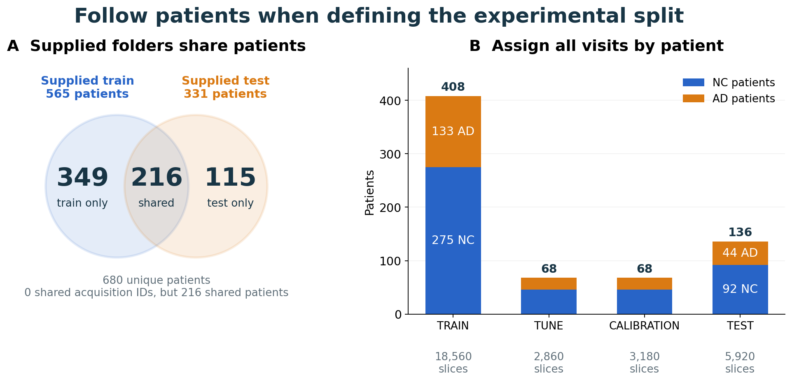

*Left: 216 patients occur in both supplied folders. Right: each patient is
assigned to one experimental role, together with all their scans and slices.*

TRAIN learns model weights; TUNE supports architecture and checkpoint
selection. CALIBRATION fits confidence scaling and rejection thresholds
after selection. TEST compares the resulting models and policies.

A **60/10/10/20 patient allocation** gives most of the cohort to learning
while supporting these three evaluation tasks. Patients are stratified by
diagnosis with seed 2026, and the same assignment is used for both
architectures and every training seed.

| Partition | Purpose | Patients (AD / NC) | Acquisitions | Slices |
| --- | --- | ---: | ---: | ---: |
| TRAIN | Learn model weights | 408 (133 / 275) | 928 | 18,560 |
| TUNE | Compare recipes and select checkpoints | 68 (22 / 46) | 143 | 2,860 |
| CALIBRATION | Fit temperature and rejection thresholds | 68 (22 / 46) | 159 | 3,180 |
| TEST | Compare selected models and policies | 136 (44 / 92) | 296 | 5,920 |
| **Total** | | **680 (221 / 459)** | **1,526** | **30,520** |

The data inventory also showed a strong association between preparation
windows and diagnosis. Each acquisition supplies twenty slices, but their
starting source indices differ. Across the complete dataset, windows starting
at **75 were 99.2% AD**, compared with **12.6% AD** for windows starting at 94.

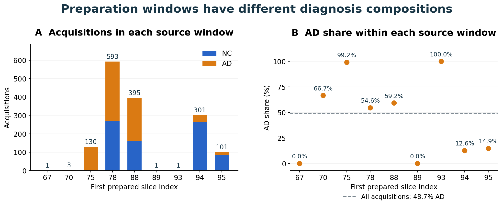

*Whole-dataset inventory: acquisition counts by first prepared slice index
(left), and the AD proportion within each group (right).*

These imbalances raised the possibility that image preparation could provide
class-related cues alongside anatomy. I retained the window start and each
slice's position within its twenty-slice acquisition to examine whether
classification and confident errors varied across these groups in the final
evaluation.

## Model Design for Native MRI Slices

Both models take a **240 × 256 single-channel image**, scaled to `[0,1]`.
Adapting the paper's 224 × 224 RGB design to this native grayscale rectangle
preserves the aspect ratio and avoids interpolation or redundant colour
channels.

### CNN: A Compact Local Feature Hierarchy

Each stage contains two padded **3 × 3 convolutions**, followed by 2 × 2 max
pooling. Stacking small kernels expands local context while adding a second
nonlinear transformation, following the design principle used in
[VGG (Simonyan and Zisserman, 2015)](https://arxiv.org/abs/1409.1556).
Two stride-one 3 × 3 layers cover a 5 × 5 neighbourhood before pooling.
Four stages reduce the native image to a 15 × 16 feature map. Channels
increase from 32 to 256 as that grid shrinks, adding feature capacity where
it costs less than widening the early, high-resolution layers.

| Stage | Output channels | Spatial size |
| --- | ---: | --- |
| Input | 1 | 240 × 256 |
| CNN block 1 | 32 | 120 × 128 |
| CNN block 2 | 64 | 60 × 64 |
| CNN block 3 | 128 | 30 × 32 |
| CNN block 4 | 256 | 15 × 16 |
| Global average pooling | 256 | 1 × 1 |
| Linear head | 2 | NC / AD logits |

Convolutions use **GroupNorm with eight groups and GELU**. GroupNorm computes
statistics within each example, keeping normalization independent of batch
composition ([Wu and He, 2018](https://arxiv.org/abs/1803.08494)). Eight groups
divide all four channel widths. GELU keeps the basic activation choice
consistent with GFNet's MLP.

Global average pooling keeps the classifier compact, following the approach
introduced in [Network in Network (Lin et al., 2014)](https://arxiv.org/abs/1312.4400).
The final 256-to-2 head has **514 parameters**, compared with 122,882 for a
flattened 15 × 16 × 256 feature map connected directly to two outputs. The
complete CNN has **1,173,154 parameters**.

### GFNet: Adapting Global Filtering to a Rectangular Grid

The initial GFNet projects non-overlapping **16 × 16 patches** into 256
channels. This patch size divides both image dimensions exactly, producing
a **15 × 16 grid of 240 tokens**. It retains the paper's patch size but adapts
the original 14 × 14 grid to the native MRI dimensions. An 8 × 8 patch would
quadruple the token count; a stride-32 projection would need padding or cropping
to cover height 240. Patch 16 covers the image exactly with a compact grid,
whose dimensions are carried through the Fourier layer.

A real FFT reduces the stored frequency grid to **15 × 9**, with a learned
complex response for each frequency and channel. The core implementation in
[GlobalFilter](modules.py) is:

```python
grid = tokens.reshape(tokens.shape[0], height, width, self.dim)
spectrum = torch.fft.rfft2(grid, dim=(1, 2), norm="ortho")
weight = torch.view_as_complex(self.complex_weight.contiguous())
grid = torch.fft.irfft2(
    spectrum * weight, s=(height, width), dim=(1, 2), norm="ortho",
)
```

The transform operates on the two spatial axes. The inverse uses the original
height and width, so the tokens return to their rectangular layout. Learned
responses let different layers and channels emphasize different frequency
patterns. These filters are learned across training images and shared at
inference, rather than recomputed for each input as attention weights are.
The authors' visualization below shows this learned specialization.

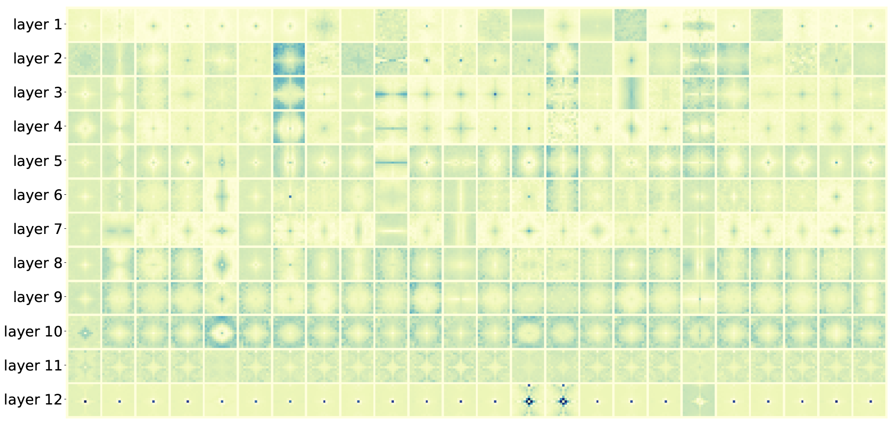

*Learned filters from the authors' GFNet-XS model, arranged by layer.
Source: [official GFNet repository](https://github.com/raoyongming/GFNet#visualization).
Copyright © 2021 Yongming Rao; [MIT license](figures/gfnet_intro.LICENSE.txt).*

Each flat block retains the paper's single residual branch. Its core forward
path in [GFNetBlock](modules.py) is:

```python
branch = self.mlp(self.norm2(self.filter(self.norm1(tokens))))
return tokens + self.drop_path(branch)
```

LayerNorm controls feature scale before filtering and channel processing.
The MLP expands **256 → 1,024 → 256** with GELU, giving each globally mixed
token a nonlinear channel representation. Learned position embeddings retain
location information. DropPath increases from 0 to 0.1 across the blocks as
training regularization; final normalization, token averaging and a linear
head produce the class logits.

### From the Initial Architecture to the Selected Model

The starting point used twelve GFNet blocks and width 256, matching
**GFNet-Ti**, the paper's smallest flat variant
([Table 2](https://arxiv.org/pdf/2107.00645)). With only 408 patients available
for TRAIN, this smaller variant was a more manageable starting point than
the wider ImageNet models.

Later experiments favoured a **convolutional stem and six blocks**. The stem
applies four overlapping 3 × 3 stride-two convolutions with 32, 64, 128 and
256 channels. It builds local features before global filtering and reaches
the same 15 × 16 token grid. Compared with the paper's non-overlapping patch
projection, it lets neighbouring regions interact before the Fourier layers.

Reducing depth lowers capacity while retaining width 256 and MLP ratio 4.
DropPath reaches 0.1 as added regularization, compared with 0 for the paper's
GFNet-Ti ([Appendix B](https://arxiv.org/pdf/2107.00645)).

| Configuration | Input embedding | GFNet blocks | Width / MLP ratio | Parameters |
| --- | --- | ---: | --- | ---: |
| Initial GFNet | 16 × 16 patch projection | 12 | 256 / 4 | 7,276,802 |
| Selected GFNet | Four-layer convolutional stem | 6 | 256 / 4 | 4,025,058 |


## Training and Model Selection

### Learn from the Slice Distribution

Each epoch shuffles all **18,560 TRAIN slices once**, giving every image
equal weight in cross-entropy. AD accounts for **51.08%** of these slices,
so ordinary sampling already provides near-balanced class exposure.
Patient-balanced sampling changes that distribution because patients
contribute different numbers of scans; its consequences are examined in
the development section.

### Learning Rate and Regularization

Falling TRAIN loss alongside stalled TUNE performance motivated separate
comparisons of learning rate, regularization and input representation.
[AdamW](https://arxiv.org/abs/1711.05101) keeps weight decay separate from
adaptive gradient updates, allowing its strength to be tested directly.
The settings below describe the final recipes; the development section
explains the comparisons behind them.

| Setting | Final recipe |
| --- | --- |
| Optimizer | AdamW; peak learning rate 3e-4; weight decay 0.01 |
| Batch size | 64 |
| Schedule | Two warm-up epochs, then cosine decay to 1% of peak |
| Training limit | 30 epochs; early stopping from epoch 20 |
| Patience | Eight epochs without improved TUNE accuracy |
| Loss | Cross-entropy, without label smoothing or MixUp |
| TRAIN augmentation | CNN: none; GFNet: rotations ±5°, translations ±2% |
| Training seeds | 3710, 3711, 3712 |

Memory measurements supported batch 64 for both models. The thirty-epoch
ceiling permits about **14% more TRAIN presentations** than V1's sixty sampled
epochs while keeping the comparison manageable. Warm-up limits early updates;
cosine decay reduces later ones. A twenty-epoch minimum avoids stopping fits
during their early learning period.

### Accuracy and Confidence Can Favour Different Models

Checkpoint selection follows the slice-accuracy assessment criterion: choose
the highest TUNE accuracy, with lower slice NLL breaking ties. Confidence
reliability remains the central research question, evaluated alongside
classification performance.

An accuracy gain can come with poorer probabilities, so NLL, class recall
and confident errors remain part of the comparison. Training seeds
**3710–3712** test whether gains persist across initializations, using one
common recipe per architecture.

## Development: From Patient Balancing to Slice-Level Learning

### Repeated Scans Motivated Patient-Balanced Sampling

AD patients contributed **3.56 scans each in TRAIN, compared with 1.65 for
NC controls**: just over twice as many. Repeat scans are fine; the model
does not need to hand out loyalty points. V1 sampled one acquisition per
patient each epoch, retaining its twenty slices. Each of the 408 TRAIN
patients contributed equally, producing **8,160 images per epoch**.

The intention was to limit the influence of frequently scanned patients.
The overlooked consequence was a change in class exposure: AD made up
**51.08% of all TRAIN slices but only 32.60% of the sampled stream**.
Balancing patients had also made the image-level training population
NC-heavy. Patient independence was needed between partitions; equal patient
contributions within TRAIN were a separate choice.

### Confidence Was Evaluated at the Wrong Unit

With reliability as the research focus, V1 selected checkpoints using NLL.
It first averaged the twenty slice probabilities in each scan, then weighted
scans so each patient contributed equally. This favoured confident, correct
scan averages, although the network was asked to classify individual images.

Averaging can hide a wrong slice prediction among stronger predictions from
the same scan. Improving those averages could select a checkpoint that
misclassified more individual images.

V1 compared peaks of **1e-4, 3e-4 and 1e-3** for each model, then trained two
additional seeds at the selected 3e-4 rate. Across those ten fits, every
GFNet run selected epoch one under the aggregated NLL rule.

### Training Loss Fell While TUNE Errors Became More Confident

GFNet's TRAIN cross-entropy fell to **0.0076–0.0143** across the five fits.
Retrospective best TUNE slice accuracy remained **62.87–67.94%**, and mean
confidence on TUNE mistakes reached **95.8–97.4%** by the final epoch.
It was fitting the training images while becoming more certain about wrong
predictions on other patients.

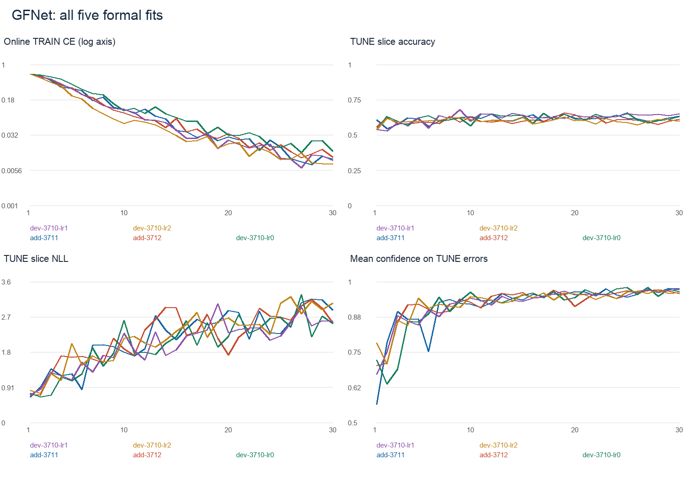

*Five V1 GFNet fits: three learning rates at seed 3710, plus seeds 3711 and
3712 at 3e-4. The falling TRAIN loss contrasts with rising TUNE NLL and
confidence on errors. In the legend, lr0/lr1/lr2 denote 1e-4/3e-4/1e-3.*

A **high-confidence AD false negative** is an AD slice classified as NC with
at least **0.90 confidence in that NC prediction**.

CNN learned a stronger classifier, but its probability quality also worsened
late in training. For seed 3711, the original rule selected epoch 42, with
**80.70% TUNE slice accuracy**. Looking back at the same history, epoch 33 had
**82.24% accuracy and about 49% fewer high-confidence AD misses**.
The scan-NLL rule selected a later checkpoint with
lower slice accuracy and more confident AD misses.

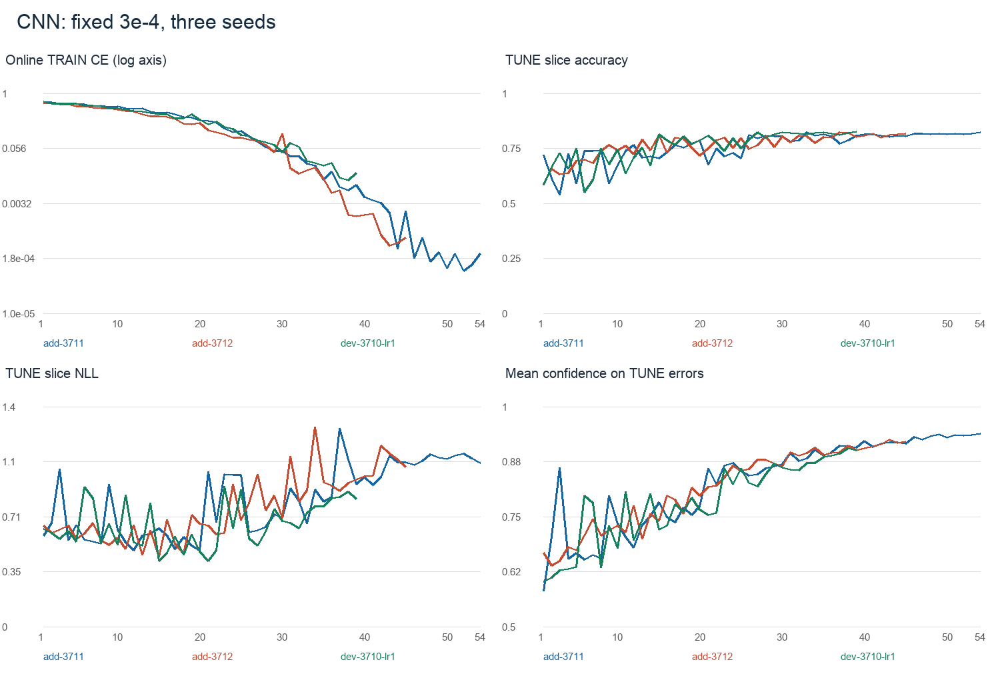

*CNN at 3e-4 across three seeds. TRAIN fitting continues after TUNE accuracy
levels off, while TUNE NLL and confidence on mistakes rise. The epoch-33
comparison above is a retrospective TUNE diagnosis.*

The original selected models produced these TEST slice accuracies:

| V1 model | Seed 3710 | Seed 3711 | Seed 3712 | Mean |
| --- | ---: | ---: | ---: | ---: |
| CNN | 82.40% | 79.49% | 81.17% | 81.02% |
| GFNet | 54.39% | 58.70% | 54.75% | 55.95% |

CNN's mean concealed a seed below 80%; GFNet was far below the target.
The NC-heavy stream and scan-based selection both worked against the slice
objective. GFNet's retrospective best TUNE epochs also stayed below 68%
while TRAIN loss kept falling, making more training an unpromising remedy.
CNN's stronger performance under the same sampling scheme pointed towards
GFNet's input representation and capacity as further problems to investigate.

A smaller **width-128 GFNet** tested the capacity hypothesis before the
redesign. Over fifteen sampled epochs, its maximum TUNE accuracy was only
**63.99%**, within the range already seen in the wider model. Reducing width
had not improved the best observed TUNE accuracy.

### V2 Aligned Learning and Selection with Individual Images

V2 retained the patient-disjoint split, native grayscale geometry and initial
CNN/GFNet architectures. Training restarted from random weights with all
TRAIN slices included each epoch. Selection moved to TUNE slice accuracy,
using slice NLL to break ties. Confidence analysis also moved to individual
images.

| Decision | V1 | V2 |
| --- | --- | --- |
| TRAIN exposure | One scan per patient each epoch | Every TRAIN slice once per epoch |
| Images / updates per epoch | 8,160 / 128 | 18,560 / 290 |
| AD share of TRAIN stream | 32.60% | 51.08% |
| Checkpoint selection | Patient-weighted scan NLL | Slice accuracy, then slice NLL |
| Training ceiling | 60 sampled epochs | 30 full-slice epochs |
| Confidence evaluation | Scan-aggregated policies alongside slice diagnostics | Slice probabilities and slice errors |

### GFNet Still Struggled After Full-Slice Training

The first V2 comparison used the patch-based twelve-block GFNet and the
unchanged CNN, testing two learning rates without augmentation. All values
below are measured at the selected TUNE checkpoint.

| Model | Peak LR | TUNE accuracy | Slice NLL | High-confidence errors / AD false negatives |
| --- | --- | ---: | ---: | ---: |
| CNN | 3e-4 | 84.41% | 0.5368 | 245 / 154 |
| CNN | 1e-4 | 81.71% | 0.4581 | 175 / 113 |
| GFNet | 3e-4 | 65.14% | 0.9195 | 424 / 178 |
| GFNet | 1e-4 | 66.78% | 2.7912 | 892 / 372 |

*High confidence means raw predicted-class probability ≥0.90.*

CNN achieved higher accuracy at 3e-4 but lower NLL at 1e-4. GFNet still
showed a large gap between fitting and generalization: at 3e-4, TRAIN
accuracy reached **99.91%**, while final TUNE accuracy fell to **61.36%**.
Full-slice training and accuracy-based selection had not closed that gap.
Lowering the learning rate gained only **1.64 percentage points in accuracy**
and more than doubled high-confidence errors. I used 3e-4 as the reference
for the next comparisons, aiming to improve its image representation without
starting from the lower rate's much poorer probability quality.

### Small Position Changes Helped More Than Centering or Stronger Decay

GFNet fitted TRAIN almost perfectly, while TUNE accuracy stayed near 65%.
The reference recipe uses normalized natural images; these grayscale slices
were scaled to [0,1]. I tested [-1,1] input to see whether changing the
numerical scale and offset helped optimization, keeping the image content
and architecture unchanged.

The widening TRAIN–TUNE gap also motivated stronger weight decay. I tested
**0.05**, the value in Rao et al.'s reference training script, against 0.01:
a fivefold increase on the same model weights.
CNN showed late overfitting too, so it received the same comparison. For
GFNet, learned positions on a fixed grid raised another possibility:
sensitivity to exact image placement. Small **±5° rotations and ±2%
translations** introduced positional variation while limiting anatomical
changes; crops and flips were left out of this comparison.

| Model / change | TUNE accuracy | Slice NLL | High-confidence errors / AD misses |
| --- | ---: | ---: | ---: |
| GFNet baseline | 65.14% | 0.9195 | 424 / 178 |
| A: centered input | 65.91% | 1.3415 | 681 / 346 |
| B: weight decay 0.05 | 64.51% | 2.9296 | 932 / 620 |
| C: mild geometry | 69.62% | 2.3910 | 734 / 414 |
| CNN baseline | 84.41% | 0.5368 | 245 / 154 |
| CNN: weight decay 0.05 | 83.32% | 0.9516 | 362 / 176 |

*Saved selected-epoch TUNE results: seed 3710, LR 3e-4, all 2,860 slices.
High-confidence errors use predicted-class probability ≥0.90; AD misses are
its AD-to-NC error subset. Each candidate changes one baseline setting.*

Centering gained only **0.77 percentage points** with worse NLL; stronger
decay hurt both models. Increasing regularization alone had not resolved
the TRAIN–TUNE gap. I retained the [0,1] scale and decay 0.01.

Geometry gave the largest classification gain: **4.48 percentage points**,
while NLL and confident errors worsened. I retained it for the accuracy gain
and used C as the next control. A local stem tested whether better features
could extend that gain; soft targets separately tested whether the confident
errors could be reduced.

### Local Features Improved Accuracy; Soft Targets Improved NLL

CNN's advantage suggested that useful local structure might be harder to
learn through GFNet's single 16 × 16 patch projection. Overlapping **3 × 3
convolutions** let neighbouring regions interact across the original patch
boundaries before global filtering. Four stride-two layers produce the same
overall reduction as stride 16, ending at **15 × 16 × 256**; the remaining
twelve Fourier blocks can stay unchanged. Convolutional stems have also
improved ViT optimization
([Xiao et al., 2021](https://arxiv.org/abs/2106.14881)).

C's frequent confident mistakes motivated a separate label-smoothing
experiment. Hard targets keep rewarding increasingly certain predictions
on TRAIN; soft targets reduce that pressure
([Müller et al., 2019](https://arxiv.org/abs/1906.02629)). The mild coefficient
**0.05** mixes 95% hard label with 5% uniform probability, giving binary
targets **0.975/0.025**. Keeping patch embedding separated this target change
from the stem experiment.

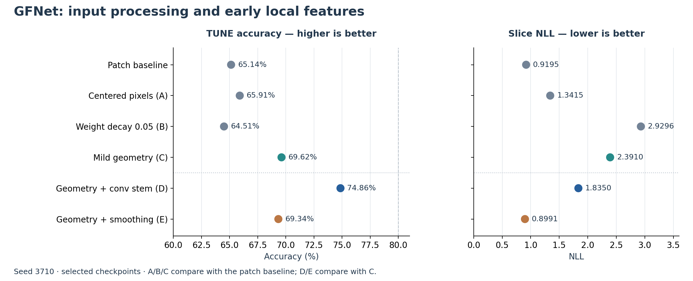

*Seed 3710, selected TUNE checkpoints. A/B/C compare with the patch baseline;
D/E compare with C, which already includes mild geometry. Values come from
the saved TUNE histories.*

The stem (**D**) raised accuracy from **69.62% to 74.86%**.
NLL fell from 2.3910 to 1.8350, supporting
local feature extraction before global mixing. The error changes were uneven:
high-confidence errors declined, but high-confidence AD misses
increased by about **11%**.

The smoothed patch model (**E**) remained near the control's accuracy at
**69.34%**, while NLL fell to **0.8991**. It improved the
probability loss without improving classification.

Meanwhile, the unchanged CNN reached **81.15–84.41% TUNE accuracy** across
the three seeds. I retained this baseline and
concentrated the remaining architecture experiments on GFNet.

### Six Blocks Reduced Confident AD Misses

The stem model still reached **99.91% online TRAIN accuracy**. TUNE epoch
19 improved accuracy by only **0.35 percentage points** over epoch 11,
while high-confidence AD misses increased by about **41%**. Further fitting
was producing little classification gain and more confident AD mistakes.

The stem had improved classification, but the later trajectory suggested
that the repeated Fourier/MLP stack could still be fitting training-specific
details. I retained the stem and tested **six blocks against twelve**.
Halving the stack makes a substantial capacity change while keeping the
256-channel representation and 15 × 16 grid fixed. Each remaining filter
still mixes the whole grid, so reducing depth preserves the spatial reach
of individual blocks. Parameters fell from **7.60 million to 4.03 million**, with
maximum DropPath unchanged at 0.1. E had improved NLL in the patch model,
so smoothing was also tested with the stronger stem representation.
D/F/G/H crossed both depths with smoothing 0 and 0.05 to separate their
effects. F also received a lower-LR comparison because the stem and soft
targets had changed optimization since the patch-model experiment.

| Fit | Blocks / smoothing / LR | TUNE accuracy | NLL | High-confidence AD misses |
| --- | --- | ---: | ---: | ---: |
| D: reference | 12 / 0 / 3e-4 | 74.86% | 1.8350 | 460 |
| F | 12 / 0.05 / 3e-4 | 75.42% | 0.7882 | 477 |
| G | 6 / 0 / 3e-4 | 75.80% | 0.9047 | 299 |
| H | 6 / 0.05 / 3e-4 | 73.50% | 0.8652 | 509 |
| I | 12 / 0.05 / 1e-4 | 74.20% | 0.7742 | 341 |

*All use the stem, geometry and seed 3710. Metrics come from the selected
TUNE checkpoints on the same images.*

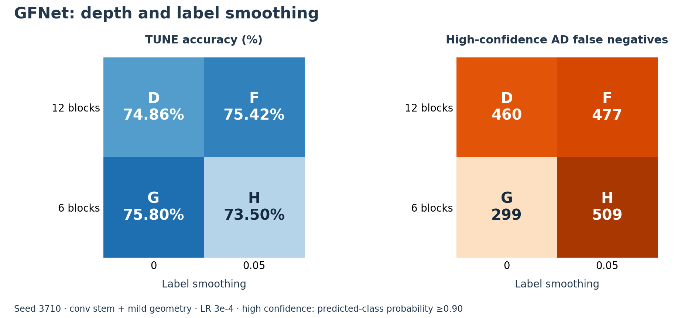

Six blocks without smoothing (**G**) gave the group's highest accuracy,
with **35% fewer high-confidence AD misses** than D.
AD recall rose from **62.73% to 66.82%**, favouring G as the next reference.

Smoothing helped twelve-block accuracy slightly, but cost the six-block model
**2.31 percentage points** and increased confident AD misses by about **70%**.
Its effect depended on depth. F's lower NLL than G also came with more
confident AD misses: reducing average probability loss had not improved
this error burden. Lowering F's learning rate to produce I lost another
**1.22 percentage points in accuracy**, with only a small NLL gain.
The six-block, unsmoothed, 3e-4 recipe offered the better balance of accuracy
and confident AD misses.

The smaller model still overfit. From selected epoch seven to final epoch
twenty, its online TRAIN accuracy rose from **94.02% to 99.45%**, while TUNE
accuracy fell from **75.80% to 70.63%**. NLL increased from **0.9047 to
2.5903**, and high-confidence AD misses increased by about **90%**. Reducing depth
improved the selected model, but further fitting still widened the gap
between TRAIN and other patients' images.

### The Hierarchical Model Remained Below the Flat Reference

The convolutional stem had gained **5.24 percentage points**; reducing depth
added **0.94**. This suggested investigating where global mixing occurred.
The flat model performs all Fourier processing after the image has already
been reduced to 15 × 16. Rao et al.'s GFNetPyramid, available in the
[course fork](https://github.com/shakes76/GFNet/blob/a0c7aefaf7109ceed284df77b415046466e5bc38/gfnet.py),
provided a way to mix features at finer resolutions between downsampling stages.

I adapted its four-stage structure to **three stages**, stopping at the
existing 15 × 16 grid. A fourth stage would add a wider 512-channel level and
require another reduction of the odd height 15. Early widths of **64 and
128** limit the feature-memory cost of larger grids; the final **256** channels
retain the previous classifier width. LayerScale starts at **0.001**, following
the reference Pyramid constructor, to keep the initial residual contributions
small. Maximum DropPath remains 0.1.

| Stage | Grid | Channels | Compact / extended blocks |
| --- | --- | ---: | --- |
| Fine | 60 × 64 | 64 | 2 / 2 |
| Intermediate | 30 × 32 | 128 | 2 / 2 |
| Coarse | 15 × 16 | 256 | 2 / 4 |

Two blocks per stage distribute six blocks across three resolutions, retaining
the flat reference's total block count. Adding two blocks only at the coarse
stage tests extra capacity on the smaller grid, limiting the
additional feature-memory cost. The variants contain **2,926,562 and 4,118,498
parameters**, counted from their trainable weights. The larger is close to
the flat reference's 4,025,058, making it useful to compare how capacity is
distributed across resolutions. Both depths were tested at **3e-4 and 1e-4**:
the changed stage widths and residual scaling gave a reason to reconsider
learning rate within this architecture.

| Fit | Stage blocks / LR | TUNE accuracy | NLL | High-confidence errors / AD misses |
| --- | --- | ---: | ---: | ---: |
| P1 | 2/2/2 / 3e-4 | 73.01% | 2.0468 | 624 / 493 |
| P2 | 2/2/2 / 1e-4 | 72.90% | 0.5658 | 0 / 0 |
| P3 | 2/2/4 / 3e-4 | 74.02% | 2.2614 | 642 / 443 |
| P4 | 2/2/4 / 1e-4 | 73.46% | 1.2533 | 493 / 425 |

*Selected-checkpoint TUNE results for the four Pyramid candidates, seed 3710.*

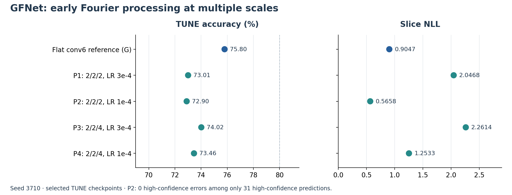

The best hierarchy reached **74.02%**, below flat G's **75.80%**. Additional
coarse blocks improved accuracy slightly but did not close the gap. P2 had
zero high-confidence errors, but only **1.08% of TUNE predictions** reached
confidence 0.90. Its lower NLL and cautious scores came with lower accuracy;
the zero-error group covered too little of the task to justify replacing G.

The hierarchy also kept fitting TRAIN while TUNE deteriorated. Final online
TRAIN accuracies ranged from **96.64% to 99.84%**, against **66.64–71.78%** on
TUNE. P3 ended with NLL **4.3301** and **97.37%** mean confidence on errors.
This hierarchical recipe still showed the generalization problem; the
simpler six-block flat model remained the reference.

### MixUp Helped the Weakest CNN Seed, but Not GFNet Consistently

Label smoothing had softened targets on the original images, sometimes
improving NLL without improving classification. [MixUp](https://arxiv.org/abs/1710.09412)
also changes the inputs: it interpolates images and labels with the same
weight, encouraging smoother predictions between training examples.
[Thulasidasan et al.](https://arxiv.org/abs/1905.11001) studied its confidence
benefits, and [Rao et al.'s training script](https://github.com/raoyongming/GFNet/blob/2de48b626ea805de82a7f389fed930af1ae0340d/main_gfnet.py)
also includes mixing augmentation.

I tested **MixUp alone at alpha 0.2**. A Beta(0.2, 0.2) draw favours weights
near the ends of the interval, keeping many mixtures closer to one original
image. This offered a relatively mild interpolation candidate without adding
CutMix at the same time. Images and target labels use the same mixing weight;
TUNE remains ordinary, unmixed slices.

GFNet was compared with and without MixUp at seeds 3710 and 3711, keeping
the initialization seed matched within each pair. CNN seed **3711** was tested first because its baseline TUNE accuracy was
lowest at **81.15%**, alongside persistent confident errors.

| Model / seed | MixUp alpha | TUNE accuracy | NLL | High-confidence errors / AD misses |
| --- | --- | ---: | ---: | ---: |
| GFNet / 3710 | 0 | 75.80% | 0.9047 | 409 / 299 |
| GFNet / 3710 | 0.2 | 74.09% | 0.9408 | 551 / 421 |
| GFNet / 3711 | 0 | 74.30% | 1.7818 | 572 / 420 |
| GFNet / 3711 | 0.2 | 75.03% | 0.8922 | 436 / 382 |
| CNN / 3711 | 0 | 81.15% | 0.7542 | 344 / 144 |
| CNN / 3711 | 0.2 | 83.22% | 0.4339 | 188 / 111 |

*Each row uses the saved selected TUNE epoch on all 2,860 slices. GFNet retains
the six-block stem model and geometry; CNN retains its unaugmented baseline.*

GFNet lost accuracy at seed 3710. Seed 3711 gained **0.73 percentage points**, but
AD recall fell from **62.58% to 58.56%**, despite improved NLL and fewer
confident errors. More AD images were classified as NC even as fewer mistakes
crossed the 0.90 confidence threshold. Softer errors improved that diagnostic
while more AD slices were missed. With accuracy moving in opposite directions
across the two seeds, MixUp was left out of GFNet.

CNN 3711 improved in accuracy, NLL and confident errors. The remaining seeds
were needed to see whether the gain extended beyond this initially weaker
run. The final comparison completed CNN MixUp seeds 3710 and 3712 alongside
the existing 3711 result.

### The Last Capacity Test Targeted the Channel MLP

After the Pyramid and GFNet MixUp comparisons, G remained the strongest
accuracy reference. About **78% of its parameters were in the six MLPs**,
counting the two linear layers and their biases
in each block. The earlier depth reduction had helped; shrinking this large
channel branch offered another capacity test while preserving every Fourier
filter and the local stem.

[Rao et al.'s GFNet implementation](https://github.com/raoyongming/GFNet/blob/2de48b626ea805de82a7f389fed930af1ae0340d/gfnet.py)
exposes the MLP expansion ratio. I compared the existing **ratio 4**
(256 → 1,024 → 256) with **ratio 2** (256 → 512 → 256), halving hidden width
while leaving token width and all six global filters intact. Total parameters
fell to **2,449,122**.

The final round had two questions left: whether CNN's MixUp gain persisted
across seeds, and whether a smaller GFNet MLP improved on G. Six new fits
completed the comparisons: two CNN MixUp seeds, one missing ratio-4 GFNet
control, and three ratio-2 GFNet seeds. Existing controls were reused.
Each candidate recipe is compared across seeds **3710–3712**, keeping the
configuration fixed so differences reflect initialization and training order.
Mean TUNE accuracy determines the final recipe, with mean NLL breaking an
exact tie.

| Recipe | Seed 3710 | Seed 3711 | Seed 3712 | Mean accuracy | Mean NLL |
| --- | ---: | ---: | ---: | ---: | ---: |
| CNN, unmixed | 84.41% | 81.15% | 82.80% | 82.79% | 0.7242 |
| CNN, MixUp 0.2 | 82.03% | 83.22% | 82.38% | 82.54% | 0.4257 |
| GFNet, MLP ratio 4 | 75.80% | 74.30% | 75.63% | 75.24% | 1.5748 |
| GFNet, MLP ratio 2 | 74.06% | 74.41% | 74.16% | 74.21% | 2.3100 |

*Every entry is the selected checkpoint's result on the same 2,860 TUNE slices.
Means average the three seed metrics. Each line in the figure joins a matching seed.*

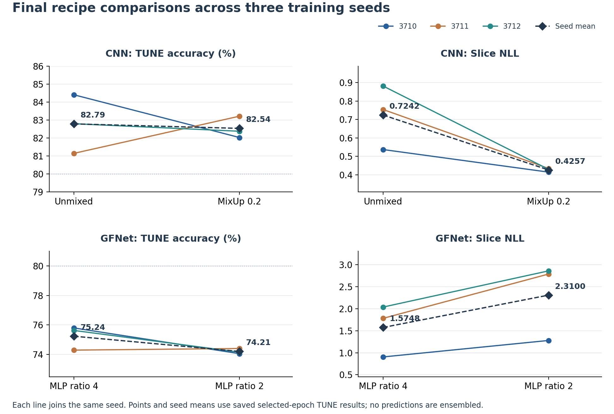

CNN MixUp improved NLL at all three seeds, but its accuracy gain at 3711 was
offset by losses at 3710 and 3712. Mean accuracy fell from **82.79% to
82.54%**, so the accuracy-first rule retained the unmixed CNN. MixUp was the
stronger probability-learning candidate; this small accuracy trade-off remains
relevant when choosing a confidence-aware model.

For GFNet, ratio 2 reduced parameters but gave lower mean accuracy and higher
mean NLL. The gain from reducing depth had not extended to reducing MLP width.
Ratio 4 was retained, although its **75.24% mean TUNE accuracy** still fell
short of 80%.

The selected recipes were the unmixed CNN and the six-block convolutional
GFNet with ratio 4 and mild geometry. Final evaluation asked whether GFNet's
global features offered a confidence or efficiency advantage despite its
lower TUNE accuracy.

## Evaluating Confidence and Selective Prediction

### Calibrate the Probability Scale

Development showed that accurate classification and useful probabilities
could favour different recipes. I kept the selected classifiers fixed and
used **temperature scaling** to adjust their confidence. This single-parameter
method follows [Guo et al. (2017)](https://proceedings.mlr.press/v70/guo17a.html),
keeping the same classification boundary while changing the probability scale.

Each model/seed has its own temperature, fitted on the **3,180 CALIBRATION
slices**. Separate patients keep this probability adjustment apart from
TUNE's model-selection role.

For the logit difference $m=z_{\mathrm{AD}}-z_{\mathrm{NC}}$,
calibrated predicted-class confidence is

$$
\operatorname{confidence}=\sigma\!\left(\frac{|m|}{T}\right),\qquad T>0.
$$

A temperature above one softens confidence; one below one sharpens it. The
search minimizes CALIBRATION slice NLL over **[0.05, 20]**, allowing both
directions on a reciprocal scale around one. The original value **T=1** is
also compared. Dividing by a positive temperature preserves the class decision,
so raw and calibrated results share the same accuracy and confusion matrix.

### Check Probability Quality and Error Recognition Separately

A model can have reasonable average calibration yet still assign high confidence
to individual errors. I use several views to examine both behaviours:

| Measure | Question it answers |
| --- | --- |
| Reliability diagram and ECE | Does confidence agree with observed correctness? |
| NLL and Brier score | How good are the assigned probabilities, including confident mistakes? |
| Confidence on correct versus wrong predictions | Does the model become less certain when it is wrong? |
| Error-detection AUROC | Does low confidence rank errors ahead of correct predictions? |
| High-confidence errors and AD misses | Which mistakes remain above confidence 0.90? |

Reliability diagrams use **ten equal-width bins over [0.5, 1]**, the range of
predicted-class confidence in binary classification. Ten bins give a readable
summary; ECE weights each bin's confidence–accuracy gap by the number of images
it contains. NLL strongly penalizes a very low probability for the true class;
Brier averages the squared error of the AD probability, $(p_{\mathrm{AD}}-y)^2$.
These scores complement the binned calibration summary.

The **0.90** threshold follows the high-confidence diagnostics used throughout
development. Its prediction count, error rate and AD misses are reported together,
so a reduction in errors can be read against the size of that confidence group.
Full-population accuracy, class recall, macro-F1 and AD AUROC describe classification.

### Retain Most Predictions and Examine the Remaining Errors

P2's zero confident errors came from just 1.08% of TUNE predictions.
That result made the amount of retained output as important as the error count.
[Selective classification](https://arxiv.org/abs/1705.08500) studies this trade-off
between coverage and risk.

I chose **80% CALIBRATION coverage** as a working point: retain most predictions
and leave roughly the least-confident fifth for review.
The highest confidence threshold meeting that proportion is selected; tied scores
stay together. This 80% is a retention choice, separate from the classification
accuracy target.

The temperature and threshold are then applied unchanged to TEST. Coverage
reports the retained fraction, and selective risk is the error rate within
that retained group. The observed TEST coverage can differ because its scores
have a different distribution.

The fixed threshold shows how the policy transfers to TEST; the
**risk–coverage curve** compares models at the same retained fraction.
Positive temperature scaling preserves score ordering, leaving this curve
unchanged. It adjusts the probabilities, not which predictions rank first.

### Compare Models on the Same Patients

Both architectures predict the same TEST patients. A difficult patient can
produce several correlated slices, so treating every slice as an independent
resampling unit would give too much weight to the apparent sample size.
I resample **patients with all their scans and slices together**, maintaining
the AD/NC patient counts in each draw. The same sampled patients are used for
both models and all three seeds, giving paired model comparisons.

**2,000 bootstrap draws**, fixed by seed **9001**, form an empirical distribution
for each metric and for **GFNet minus CNN**. The 2.5th and 97.5th percentiles
provide the reported **95% intervals**. Individual-seed results and their means
are kept visible alongside these intervals. Predictions and metrics remain
slice-based; patient grouping preserves the relationships among their images.

### Inspect the Errors Behind the Scores

Five case categories cover different failures: a high-confidence AD miss from
each model, an error unique to each model, and a GFNet error close to its decision
boundary. Seed **3710** supplies the reference selection, with one case per
patient; the other seeds show whether the same slice produces a consistent
mistake. This gives the case discussion both severe confident errors and
uncertain or model-specific errors.

Performance is also compared by position within each twenty-slice acquisition
and by the source slice-window start. These groups examine whether the data's
preparation patterns accompany changes in classification or confidence.

Finally, parameter count, training time and peak memory describe the cost of
learning each model. Inference compares synchronized model-forward time on the
same A100 at batch 64, separately from image loading and the complete prediction
loop. This distinguishes computational savings from differences in input I/O.

## Results

### Confidence Reliability

#### Both Models Were Confident When Wrong

All six selected models predict the same **5,920 TEST slices from 136
patients**. Correct predictions usually receive higher confidence, but the
wrong predictions are far from hesitant. CNN's errors average **86.16–89.94%
raw confidence** across seeds. GFNet's two most confident seeds exceed **93%**
even when wrong, close to their confidence on correct predictions.

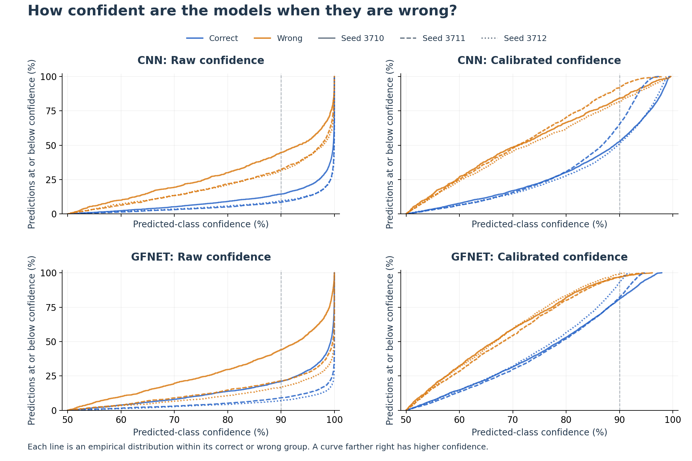

*Each curve shows the cumulative proportion of correct or wrong predictions
at or below a confidence value, normalized within that group. Curves farther
right indicate higher confidence. Colour separates correct and wrong predictions;
line style identifies the training seed. The dashed vertical line marks 0.90.*

| Model | Seed | Raw mean confidence: correct | Raw mean confidence: wrong | Error-detection AUROC |
| --- | --- | ---: | ---: | ---: |
| CNN | 3710 | 95.32% | 86.16% | 0.738 |
| CNN | 3711 | 97.12% | 89.80% | 0.756 |
| CNN | 3712 | 96.92% | 89.94% | 0.728 |
| GFNet | 3710 | 93.27% | 86.16% | 0.697 |
| GFNet | 3711 | 97.19% | 93.21% | 0.691 |
| GFNet | 3712 | 97.75% | 94.71% | 0.691 |

Overfitting may have contributed to this excessive confidence. Cross-entropy
rewards larger true-class margins even on correctly classified TRAIN images,
which can encourage stronger scores after generalization has stopped improving.
The development histories showed TRAIN accuracy approaching 100% while TUNE
performance deteriorated. Correlated TRAIN slices may have made patient-specific patterns easier to
learn, contributing to confident mistakes on other patients.

CNN separates errors from correct predictions better in each matched seed:
its error-detection AUROC is **0.728–0.756**, compared with **0.691–0.697**
for GFNet. Both are above random ordering at 0.5, but the overlapping
confidence distributions explain why a confident answer can still be wrong.

Comparing both models on the same boundary images helps explain what this
uncertainty represents. For each seed, I select slices where one model's
raw confidence lies in **[0.50, 0.55)**, then compare both models on those
images. The table averages the group accuracies across seeds.

| Boundary images selected by | CNN accuracy | GFNet accuracy |
| --- | ---: | ---: |
| GFNet | 77.3% | 43.9% |
| CNN | 49.7% | 52.1% |

CNN classifies many of GFNet's uncertain images correctly, suggesting that
useful class cues are present but may be poorly represented by GFNet.
CNN's boundary images are difficult for both architectures. A slice inherits
the patient's diagnosis while showing only one view of the brain; some views
may contain weak evidence for that label. Low confidence may thus reflect
either a model's representation or limited class information in the slice.

#### Calibration Improved Probability Quality

The CALIBRATION-fitted temperatures are all above one, reducing the scale
of the logits. GFNet's most overconfident seeds require the strongest
adjustments. Applying these temperatures to TEST
improves NLL, Brier and ECE in all six fits.

| Model | Seed | Temperature | NLL: raw → calibrated | Brier: raw → calibrated | ECE: raw → calibrated (pp) |
| --- | --- | ---: | ---: | ---: | ---: |
| CNN | 3710 | 2.954 | 0.6745 → 0.4121 | 0.1423 → 0.1277 | 11.01 → 1.95 |
| CNN | 3711 | 4.065 | 0.8547 → 0.4271 | 0.1655 → 0.1354 | 15.03 → 1.91 |
| CNN | 3712 | 3.893 | 0.9360 → 0.4275 | 0.1565 → 0.1324 | 13.86 → 2.50 |
| GFNet | 3710 | 3.793 | 0.9777 → 0.5454 | 0.2303 → 0.1847 | 19.60 → 2.65 |
| GFNet | 3711 | 7.622 | 1.9236 → 0.5550 | 0.2599 → 0.1882 | 24.84 → 4.17 |
| GFNet | 3712 | 10.652 | 2.3713 → 0.5461 | 0.2579 → 0.1841 | 24.79 → 2.22 |

*Temperatures minimize NLL on the separate 3,180-slice CALIBRATION set.
All scores in this table are measured on TEST; lower is better. ECE is
expressed in percentage points (pp).*

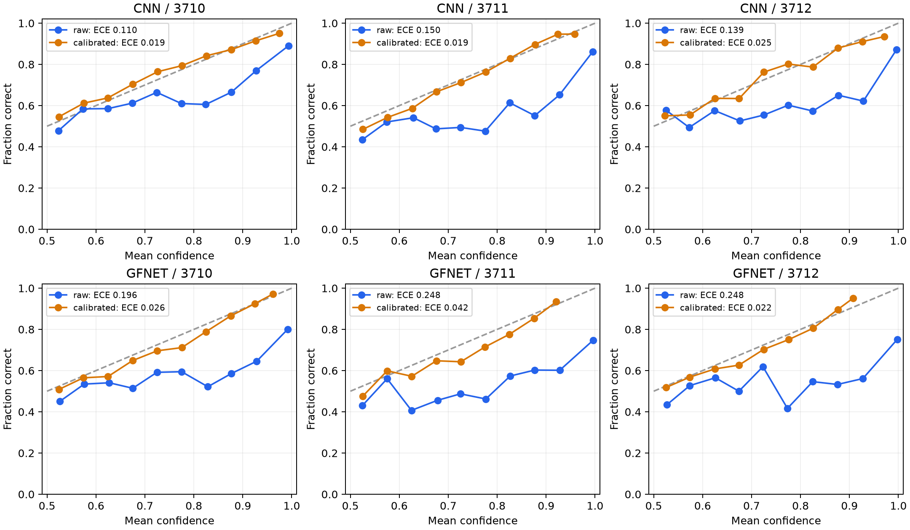

*Each point compares a bin's mean confidence with its observed correct
fraction. Points below the diagonal indicate overconfidence.*

Raw predictions sit below the diagonal, especially at high confidence.
Calibration brings them closer: mean ECE falls from **13.30 to 2.12 percentage
points for CNN**, and from **23.08 to 3.01 for GFNet**. GFNet now describes
its lower classification performance more faithfully; the probability scale
has improved while its class decisions stay the same.

Softening extreme wrong predictions gives the true class more probability
and can sharply reduce NLL. GFNet's raw NLL varies more than twofold across
seeds, while calibrated NLL stays close to **0.55** and accuracy remains
around **71–72%**. The runs differ substantially in score scale but share
a classification weakness that temperature scaling cannot change.

Paired comparisons after calibration average the three seeds and use
**2,000 shared patient resamples** for the difference intervals.

| Calibrated metric | CNN mean | GFNet mean | GFNet − CNN [95% interval] |
| --- | ---: | ---: | --- |
| NLL | 0.4222 | 0.5489 | 0.1266 [0.0586, 0.1875] |
| Brier | 0.1319 | 0.1857 | 0.0538 [0.0292, 0.0769] |
| ECE (pp) | 2.12 | 3.01 | 0.89 [−1.37, 4.32] |

CNN has lower calibrated NLL and Brier, with both difference intervals above
zero. The ECE interval spans zero, so that smaller point estimate gives a
less decisive comparison. ECE measures whether reported confidence matches
observed accuracy. GFNet can become better calibrated around its lower
accuracy while CNN still assigns more useful probabilities to the true labels,
as reflected in NLL and Brier.

#### Fewer Confident Errors Came with Fewer Confident Predictions

Before calibration, predictions above confidence 0.90 have error rates of
**11.87–15.03% for CNN and 21.89–25.90% for GFNet**. Even the models' most
confident answers frequently include mistakes.

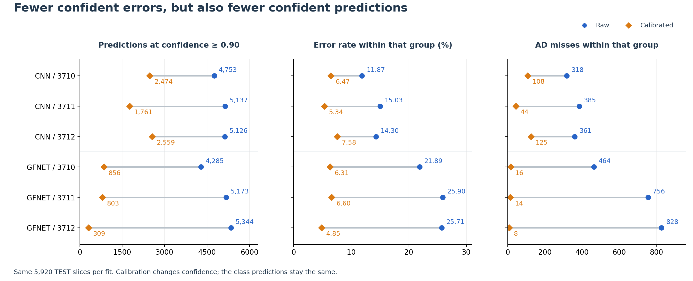

*Left: predictions reaching confidence 0.90. Middle: the error rate within
that group. Right: AD false negatives within the same group. Each row compares
raw and calibrated scores for one fit on all 5,920 TEST slices.*

After calibration, these error rates fall to **5.34–7.58% for CNN and
4.85–6.60% for GFNet**, alongside a smaller high-confidence group.
At seed 3712, only **5.22% of GFNet predictions** remain above 0.90,
compared with **43.23% for CNN**. Their error rates
are **4.85% and 7.58%**, respectively, at these very different retained
fractions. The risk–coverage analysis below compares the models at the same
retained fraction.

A single temperature softens correct and wrong predictions together.
An extreme wrong margin can remain above 0.90 after scaling, leaving
confident AD misses in every fit.

**CNN's confidence was a more useful guide to prediction errors than GFNet's.**
It combined better error ranking with lower probability losses. Calibration
improved both models' probability scales, while the confident misses above
showed where an average calibration score fell short.

### Selective Prediction

#### Rejecting Uncertain Slices Reduced Errors

CALIBRATION thresholds retained **80% of predictions** for every fit.
Applied unchanged to TEST, they retained **79.63–82.75%**. The resulting
error rates show how much confidence filtering helps.

Calibration and rejection contribute in different ways here. With a fixed
CALIBRATION coverage target, dividing all margins by a positive temperature
also divides the selected margin threshold by that temperature. The same
TEST images remain above the threshold. Calibration improves the reported
probabilities; the reduction in errors comes from the model's existing ranking.

| Model | Seed | Confidence cutoff | TEST coverage | Error rate: all → retained | Retained misses (% of all AD) |
| --- | --- | ---: | ---: | ---: | ---: |
| CNN | 3710 | 0.6658 | 81.62% | 17.23% → 12.29% | 12.19% |
| CNN | 3711 | 0.6643 | 82.69% | 19.32% → 14.03% | 12.67% |
| CNN | 3712 | 0.7009 | 79.63% | 18.04% → 12.30% | 11.07% |
| GFNet | 3710 | 0.6022 | 79.88% | 28.34% → 23.83% | 21.37% |
| GFNet | 3711 | 0.5975 | 82.75% | 28.80% → 25.11% | 25.56% |
| GFNet | 3712 | 0.5972 | 81.17% | 27.89% → 23.73% | 25.48% |

*Each row evaluates the fixed CALIBRATION cutoff on all 5,920 TEST slices.
The retained error rate is selective risk: errors divided by retained predictions.*

Both policies retain about **81% of TEST predictions**. Mean risk falls from
**18.20% to 12.88% for CNN**, and from **28.34% to 24.22% for GFNet**.
Rejecting roughly 19% of the images removes about **40–46% of CNN's original
errors** per seed, compared with **28–33% for GFNet**.

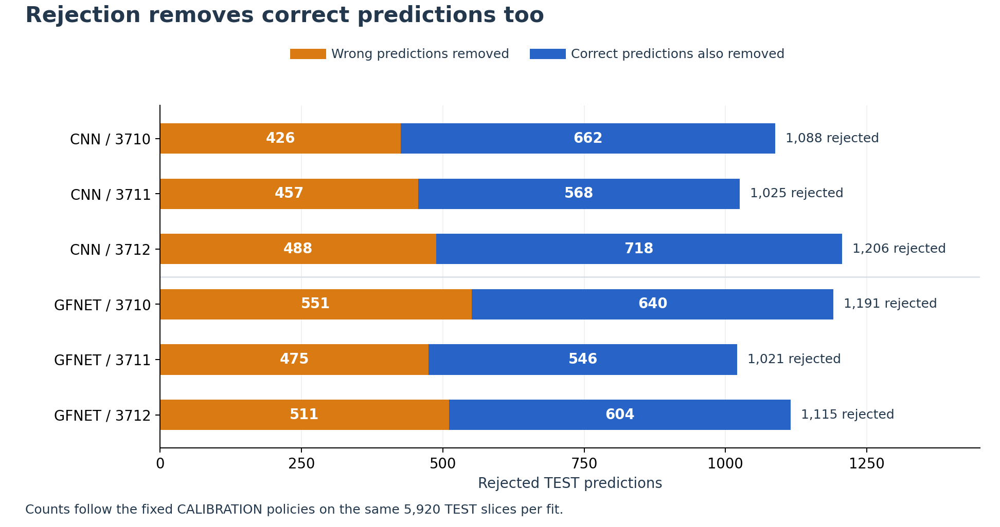

*Rejected errors equal all errors minus retained errors. The remaining part
of each rejected group consists of predictions that were originally correct.*

More than half the rejected predictions were originally correct in every fit;
for CNN-3710, the proportion is about **61%**. Errors are still more concentrated
in this group than in the full set, so rejection lowers retained risk while
sending many correct answers for review.

#### CNN Retained Fewer Errors at the Same Coverage

The fixed policies retain slightly different proportions of TEST. At common
**80% coverage**, mean risk is **12.54%
for CNN and 23.95% for GFNet**. CNN has lower risk in every matched seed at
the evaluated coverage levels from 20% to 100%.

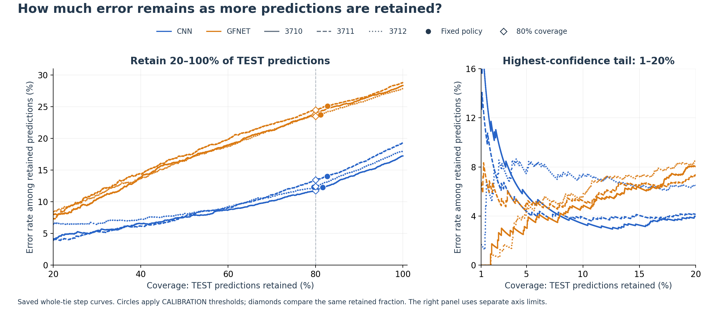

*Left: 20–100% coverage. Right: the highest-confidence 1–20%, with separate
axis limits. Circles mark the fixed CALIBRATION policies; diamonds mark
80% coverage. Curves use the saved score ordering and keep equal scores together.*

| Model | Seed | Risk at 10% coverage | Risk at 50% | Risk at 80% | Risk at 100% | AURC |
| --- | --- | ---: | ---: | ---: | ---: | ---: |
| CNN | 3710 | 3.38% | 7.57% | 11.76% | 17.23% | 0.0874 |
| CNN | 3711 | 3.89% | 7.67% | 13.45% | 19.32% | 0.0921 |
| CNN | 3712 | 7.26% | 8.07% | 12.42% | 18.04% | 0.0951 |
| GFNet | 3710 | 4.73% | 16.55% | 23.88% | 28.34% | 0.1582 |
| GFNet | 3711 | 5.24% | 17.26% | 24.47% | 28.80% | 0.1664 |
| GFNet | 3712 | 5.57% | 16.42% | 23.50% | 27.89% | 0.1596 |

CNN's lower retained risk reflects two advantages: fewer errors overall
and better separation of errors from correct predictions by confidence.
GFNet starts with more mistakes, and the greater overlap between its correct
and wrong scores makes those mistakes harder to filter.

The curves cross in the highest-confidence tail: at 10% coverage,
GFNet-3712 has **5.57% risk**, below CNN-3712's **7.26%**. A system accepting
only a small fraction of predictions would need to consider this end of the
curve separately from the working point near 80%.

The area under the risk–coverage curve, **AURC**, summarizes risk across
coverage levels. Mean AURC is **0.0916 for CNN and 0.1614 for GFNet**,
favouring CNN overall. It includes both the starting classification error
and the ordering of errors. The calculation uses the right-endpoint step
area over complete tied-score groups.

#### Many AD Misses Survived Rejection

Paired patient-bootstrap comparisons of the fixed policies give:

| Fixed-policy measure | CNN mean | GFNet mean | GFNet − CNN [95% interval], pp |
| --- | ---: | ---: | --- |
| TEST coverage | 81.31% | 81.27% | −0.05 [−2.30, 2.24] |
| Selective risk | 12.88% | 24.22% | 11.34 [6.45, 16.21] |
| Retained misses (% of all AD) | 11.98% | 24.14% | 12.16 [5.05, 18.59] |

At these similar coverages, GFNet's risk is **11.34 percentage points higher**,
with a paired interval of **6.45–16.21**. The difference in retained AD-miss
fractions also favours CNN.

Overall coverage also hides a difference between diagnoses:

| True-class measure | CNN | GFNet |
| --- | ---: | ---: |
| AD coverage | 80.5% | 78.4% |
| NC coverage | 82.0% | 83.6% |
| Error rate among retained AD slices | 14.9% | 30.8% |
| Error rate among retained NC slices | 11.3% | 19.1% |

*Values average the three seeds. Coverage uses all slices of the named true
class; each error rate uses only the retained slices of that class.*

GFNet rejects more AD than NC, yet nearly a third of its retained AD
predictions are still wrong. Confidence filtering removes some uncertain
AD decisions while leaving many strong NC decisions on true AD slices.
Similar overall coverage conceals this larger AD-error burden.

**Confidence-based rejection reduced errors, with a stronger benefit for CNN.**
At similar coverage, CNN retained fewer wrong predictions and fewer AD misses.
Confidently classifying AD as NC remained the main concern: these mistakes
could pass the filter even when less certain correct predictions were rejected.

### Full-Coverage Slice Classification

#### CNN Exceeded 80% Across Three Seeds

The six selected checkpoints give the following results on the complete
TEST partition.

| Model | Seed | Selected epoch | Accuracy | Macro-F1 | AD AUROC |
| --- | --- | ---: | ---: | ---: | ---: |
| CNN | 3710 | 14 | 82.77% | 0.8259 | 0.8952 |
| CNN | 3711 | 18 | 80.68% | 0.8057 | 0.8857 |
| CNN | 3712 | 16 | 81.96% | 0.8184 | 0.8856 |
| GFNet | 3710 | 7 | 71.66% | 0.7136 | 0.7965 |
| GFNet | 3711 | 13 | 71.20% | 0.7076 | 0.7908 |
| GFNet | 3712 | 19 | 72.11% | 0.7155 | 0.7967 |

Mean accuracy is **81.80% for CNN and 71.66% for GFNet**. CNN also has
higher macro-F1 and AD AUROC. All three CNN seeds exceed 80%, although the
weakest is close to the threshold at **80.68%**. GFNet's strongest result
is **72.11%**, leaving a substantial gap.

The paired patient-bootstrap accuracy difference, **GFNet minus CNN**, is
**−10.15 percentage points**, with a **95% interval of [−14.41, −5.69]**.
The comparison uses the same patients across all fits and supports a gap
between the selected recipes beyond the choice of one training seed.

#### GFNet Had the Larger Drop from TUNE to TEST

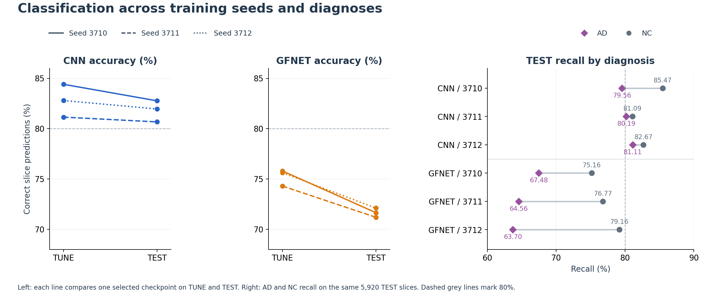

*Each line compares the same selected checkpoint on TUNE and TEST. The right
panel separates AD and NC recall. Dashed grey lines mark 80%.*

Every selected fit scores lower on TEST than on TUNE. CNN's mean falls from
**82.79% to 81.80%**, about one percentage point; GFNet falls from **75.24%
to 71.66%**, about 3.6 points. The larger GFNet drop may reflect greater
sensitivity to which patients and image-preparation patterns are present.
Repeated selection on the same 68 TUNE patients may also have favoured
configurations that worked particularly well for that group.

GFNet's TEST accuracies cluster around **71–72%**, suggesting a weakness
shared by the recipe rather than one poor initialization. The stem and depth
changes improved TUNE performance but left a substantial generalization gap.

#### GFNet Missed More AD Slices

Macro-F1 weights the two class F1 scores equally; separate precision and
recall expose which diagnosis bears the errors.

| Model | Seed | NC precision | NC recall | NC F1 | AD precision | AD recall | AD F1 |
| --- | --- | ---: | ---: | ---: | ---: | ---: | ---: |
| CNN | 3710 | 83.29% | 85.47% | 84.37% | 82.11% | 79.56% | 80.81% |
| CNN | 3711 | 82.99% | 81.09% | 82.03% | 78.05% | 80.19% | 79.10% |
| CNN | 3712 | 83.92% | 82.67% | 83.29% | 79.69% | 81.11% | 80.40% |
| GFNet | 3710 | 73.38% | 75.16% | 74.26% | 69.49% | 67.48% | 68.47% |
| GFNet | 3711 | 72.09% | 76.77% | 74.36% | 69.97% | 64.56% | 67.15% |
| GFNet | 3712 | 72.23% | 79.16% | 75.54% | 71.94% | 63.70% | 67.57% |

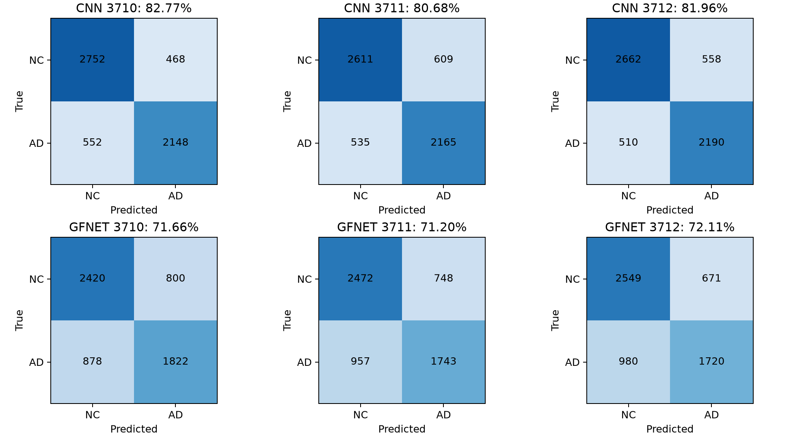

*Rows are true labels and columns are predictions, ordered NC then AD.
The lower-left cell counts AD slices classified as NC.*

CNN recognizes about **80% of AD slices**, compared with **64–67% for GFNet**.
GFNet recognizes NC more often, with recall around **75–79%**.

GFNet-3712 illustrates why overall accuracy needs this class breakdown.
It has the highest GFNet accuracy, **72.11%**, yet the lowest AD recall,
**63.70%**. Its higher overall score comes from better NC recognition,
while AD recall falls.

**CNN met the 80% slice-accuracy target in all three seeds; GFNet remained
below it in every fit.** GFNet's lower AD recall identifies a specific weakness
behind that gap: it recognized NC more readily and missed more AD images.

### Failure Cases and Preparation Sensitivity

#### Confident Misses and Model Disagreements

The five cases below cover confident AD misses, disagreement between models
and an error near GFNet's decision boundary. Seed 3710 supplies the reference
cases; the other seeds show whether each decision persists across training runs.

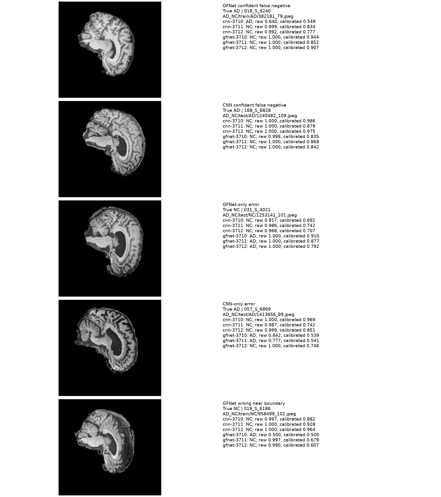

*Cases are numbered from top to bottom. The table summarizes seed 3710 using
calibrated predicted-class confidence and the fixed rejection policy.
Paths retain the supplied folder names; evaluation membership follows the
patient-disjoint split.*

| Case | True label | CNN-3710 | GFNet-3710 |
| --- | --- | --- | --- |
| 1: persistent GFNet miss | AD | AD, 54.9%; rejected | NC, 94.4%; retained |
| 2: shared AD miss | AD | NC, 98.6%; retained | NC, 83.5%; retained |
| 3: stable model disagreement | NC | NC, 69.2%; retained | AD, 91.0%; retained |
| 4: correct prediction rejected | AD | NC, 96.9%; retained | AD, 53.9%; rejected |
| 5: GFNet boundary error | NC | NC, 88.2%; retained | AD, 50.0%; rejected |

- **Case 1: the correct prediction is the uncertain one.** Every GFNet seed
  predicts NC and retains the error. CNN-3710 recognizes AD, but its low
  confidence leads to rejection; the other CNN seeds also predict NC. Weak
  or conflicting features in this view may make the CNN decision sensitive
  to training initialization, while the shared GFNet recipe consistently
  favours the wrong class.
- **Case 2: both architectures confidently miss AD.** Every model and seed
  predicts NC, and every fixed policy retains the prediction. CNN-3710 is
  still **98.6% confident after calibration**. Limited AD-specific information
  in this view, or misleading features learned from the common training
  population, may have pushed both architectures towards the same wrong answer.
- **Case 3: the architecture disagreement survives seed changes.** Every CNN
  correctly predicts NC; every GFNet predicts AD, and all predictions are
  retained. This persistent split may reflect different weighting of local
  texture and wider spatial patterns by the two model recipes.
- **Case 4: rejection keeps an error and discards a correct answer.** All CNN
  seeds miss AD. GFNet-3710 and 3711 recognize it with about **54% confidence**
  and are rejected; GFNet-3712 predicts NC with about **75% confidence** and
  is retained. The fitted boundaries vary across seeds, and the largest margins
  favour NC. Confidence filtering then keeps a wrong answer over a correct,
  uncertain alternative.
- **Case 5: uncertainty catches a boundary error.** GFNet-3710 predicts AD
  at approximately **50% confidence**, while the other fits correctly predict
  NC. The fixed policy rejects the error: here a seed-sensitive decision
  produces the low-confidence warning the filter needs.

The panels also differ in visible tissue extent, framing and black background.
These differences may change the patterns available to the models, motivating
the position and preparation-window comparisons below.

#### Performance Varied with Slice Position

Each prepared acquisition is divided into four consecutive groups of five
slices. The groups contain the same TEST patients and class proportions,
with each covering 25% of the images. The table averages the three seeds;
retained risk uses the original CALIBRATION policies.

| Slice positions, zero-based | CNN accuracy | GFNet accuracy | CNN retained risk | GFNet retained risk |
| --- | ---: | ---: | ---: | ---: |
| 0–4 | 83.20% | 72.59% | 11.91% | 22.94% |
| 5–9 | 82.43% | 72.50% | 12.17% | 22.82% |
| 10–14 | 79.91% | 69.95% | 14.23% | 26.14% |
| 15–19 | 81.67% | 71.58% | 13.24% | 24.94% |

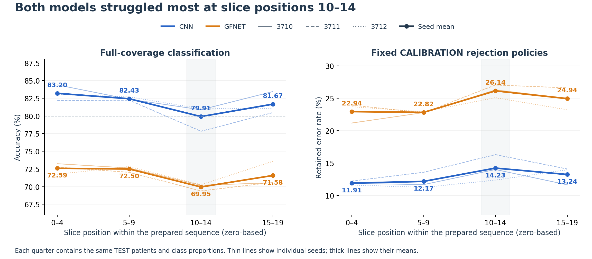

*Thin lines show individual seeds and thick lines their means. The shaded
region marks positions 10–14; positions follow the supplied twenty-slice sequence.*

Both models perform worst at **positions 10–14**, where retained error is
also highest. Patient and class composition are unchanged across groups,
pointing towards differences in visible content. Weaker AD-related cues or
changes in framing may help explain why both architectures struggle at
these positions.

#### Preparation Windows Also Differed in Diagnosis Mix

The source-window start is the first slice index in each prepared acquisition,
as in the initial data investigation. Five windows account for about **99%
of TEST**:

| Window start | Share of TEST | AD share within group | CNN accuracy | GFNet accuracy |
| --- | ---: | ---: | ---: | ---: |
| 75 | 8.45% | 100.00% | 90.00% | 68.87% |
| 78 | 39.19% | 54.31% | 82.63% | 68.48% |
| 88 | 26.01% | 46.75% | 78.61% | 74.39% |
| 94 | 19.59% | 17.24% | 82.30% | 76.44% |
| 95 | 5.74% | 5.88% | 78.43% | 68.14% |

*Accuracy is averaged across seeds. TEST shares describe group size; AD
shares describe the diagnosis composition within each group.*

GFNet's higher accuracy in window 94 may partly reflect its mostly NC
composition, given the model's stronger NC recall. Windows 78 and 88 show
opposite preferences: CNN performs better in 78, while GFNet performs better
in 88. Window groups mix preparation differences with changes in patients
and diagnosis proportions. The tiny window-89 group illustrates the problem:
GFNet reaches 100%, but the group contains just one NC patient.

The within-acquisition position comparison holds patients and diagnosis mix
fixed, making its shared performance dip more directly suggestive of
sensitivity to slice content. Window-associated framing and background may
also provide accidental class cues, especially when preparation and diagnosis
are strongly associated in TRAIN.

**Agreement and high confidence both accompanied wrong slice classifications.**
Some failures changed with the training seed; others persisted across all
fits. The position and window results suggest that available image content
and preparation cues may contribute to the errors.

### Computational Cost

#### More Parameters, Lower Memory Use

GFNet has about **3.4 times as many parameters as CNN**, yet its recorded
training memory is about **76% lower** and its batch forward time about
**36% shorter**. Parameter count alone gives a poor prediction of the GPU
resources these two implementations need.

| Measurement | CNN | GFNet |
| --- | ---: | ---: |
| Parameters, millions | 1.17 | 4.03 |
| Complete TRAIN + TUNE loops, mean minutes per selected fit | 22.46 | 18.67 |
| Mean peak allocated training memory, GiB | 8.70 | 2.05 |
| Mean peak allocated TEST memory, GiB | 2.78 | 0.44 |
| Batch-64 model forward, mean ms/slice | 0.539 | 0.343 |
| Complete TEST prediction loop, mean seconds | 7.78 | 5.75 |

*Costs come from the three selected fits per model. Inference uses the same
A100-PCIE-40GB with batch 64 and FP32/complex64. Forward time measures the
synchronized model call; the TEST prediction loop also includes image loading,
transfers and prediction-record construction. Training times sum the recorded
TRAIN and TUNE loops, excluding checkpoint writing.*

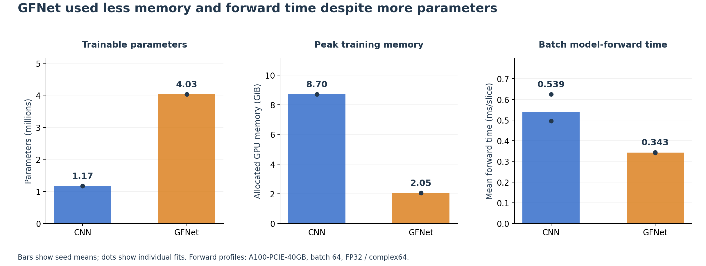

*Bars show seed means and dots show the individual fits.*

The memory difference may largely come from intermediate feature maps.
CNN performs two convolutions at each resolution before pooling and retains
large early feature maps for backpropagation. GFNet's stem downsamples at
every convolution; the Fourier/MLP stack then operates on the compact
15 × 16 grid. Much of GFNet's parameter count lies in its channel MLPs,
which can add weights without maintaining equally large spatial activations.

#### Faster Forwards and Complete Training Cost

GFNet's complete TEST prediction loop is about **26% shorter**, a smaller
saving than its model-only forward time. Loading, transfers and record
construction contribute to the loop alongside model computation.

The training totals combine per-epoch computation with early stopping:
CNN completes **24 epochs on average**, against about **22.7 for GFNet**.
They include epochs after the selected checkpoint, since this training was
part of finding it. The earlier architecture and recipe comparisons added
development cost beyond these six selected fits.

**Computational efficiency was GFNet's clearest advantage.** It used less
GPU memory and faster forwards, while CNN delivered stronger classification
and error recognition.

## Conclusions and Engineering Recommendation

**CNN provided the more useful confidence estimates.** It ranked errors better,
had lower calibrated NLL and Brier, and retained fewer mistakes at matched
coverage. GFNet used less memory and had faster forwards, but fell behind
in both classification and error recognition.

### Why GFNet Fell Behind on These Slices

Distributed AD-related changes motivated testing GFNet's ability to combine
separated image regions. Here, **"global" covers one prepared 2D slice**.
Complementary anatomical cues may lie in other slices, while framing and
background remain visible within this one. Its Fourier filters also apply
the same learned frequency responses to every image, rather than selecting
regions according to each input. Broad spatial mixing may amplify
preparation-related cues when those cues correlate with diagnosis.

The strongest architectural gain came from the convolutional stem, which
learns overlapping local features before Fourier mixing. CNN goes further:
two local convolutions precede each pooling step, while the GFNet stem
downsamples at every layer. With 408 TRAIN patients, this local hierarchy
may make subtle within-slice cues easier to learn. CNN's success on many
GFNet-boundary images supports that explanation: the image often contains
class information that GFNet has not separated well.

The trajectories also point to overfitting: continued TRAIN improvement came
with worse TUNE accuracy and more confident errors. Reducing twelve blocks
to six helped, but narrowing the embedding or MLP did not. The effective
reduction removed repeated blocks while preserving feature width;
shrinking the representations themselves was less successful.

These classification failures also explain the confidence result. Large NC
margins on AD slices made many errors look reliable. Temperature scaling
softened their probabilities but left the wrong decisions and score ordering
intact. Improving confidence now calls for better separation of the classes,
alongside calibration of the resulting scores.

### Recommended Model

**For the current prototype, I would choose the temperature-calibrated CNN.**
It exceeded 80% slice accuracy in all three seeds and retained fewer errors
at matched coverage. GFNet's lower memory use and faster forwards were its
clearest advantages, but its classification and AD-error burden weigh more
heavily in this task. The next experiment would add limited global processing
to CNN's stronger local features.

## Further Development

### Add a Small Global Branch to the CNN

The stem and depth experiments suggest combining strong local feature
extraction with a limited amount of global processing. My first hybrid
experiment would keep the CNN backbone and add **one learned Fourier filter
after its final convolutional stage, before global average pooling**. At
that point the feature map is already **15 × 16 × 256**, matching the grid
used by the final GFNet.

The added branch would normalize the features, apply FFT, learned complex
frequency weights and inverse FFT, then use GELU before adding its output
back through a small learnable residual scale. GELU matters here: spatial
averaging of a purely linear Fourier-filtered branch would retain only its
zero-frequency component. The nonlinearity lets other frequency responses
influence the pooled features, without adding the full six-block MLP stack.
The residual path would preserve the local representation while the small
initial scale lets the global branch enter gradually.
Comparing the unchanged CNN with this one-branch
variant under the same training recipe would show whether the global context
helps AD recall, confident errors and risk at matched coverage, alongside
accuracy and resource cost.

### Use the Models Where Their Predictions Complement Each Other

The cases include images recognized by one architecture and missed by the
other. One combination to test would average their **AD probabilities for
the same slice**, using a CNN-dominant weight selected on TUNE, then calibrate
the combined predictor on CALIBRATION. The weighting would be shared across
seeds. The combination would need to correct enough CNN mistakes to offset
the errors introduced by GFNet, especially AD misses.

A resource-conscious alternative would run GFNet first and send its uncertain
images to CNN. The boundary comparison supports this direction: CNN performs
well on many GFNet-boundary images, whereas GFNet provides little gain on
CNN-boundary images. The combined system would be compared with CNN alone
on retained risk and total processing time. Shared confident NC mistakes,
such as case 2, could bypass the second model and limit the benefit of
this cascade.

### Improve Confidence Learning and Input Consistency

CNN MixUp is another concrete candidate. It lowered mean TUNE NLL by about
**41%**, at a cost of about **0.25 percentage points in mean accuracy**.
A further development round could compare slice accuracy, AD recall and
probability quality jointly when selecting a recipe. The class-specific
rejection results also make retained AD errors a useful selection diagnostic.

For a further comparison, I would use a new patient cohort with preparation-
matched AD and NC groups. V1 TEST results had already been examined before
the V2 redesign, and TUNE was reused throughout development. Independent
patients would provide a cleaner assessment of the revised choices.

## Files and Reproduction

| File | Role |
| --- | --- |
| [dataset.py](dataset.py) | Read the patient-split CSV, load native grayscale slices and apply TRAIN augmentation. |
| [modules.py](modules.py) | Define the CNN, rectangular global filter, flat GFNet and Pyramid candidate. |
| [train.py](train.py) | Train on TRAIN, select on TUNE, and save weights and learning histories. |
| [predict.py](predict.py) | Load selected weights, fit calibration, evaluate slices and analyze saved predictions. |
| [README.md](README.md) | Explain the design decisions, experiments and findings. |
| [figures/](figures/) | Store the illustrations used in this report. |

### Environment and Input Data

The recorded environment used **Python 3.11.15, PyTorch 2.13.0+cu130,
NumPy 2.4.6, Pillow 12.3.0 and Matplotlib 3.9.4**. Training and evaluation
used one A100-PCIE-40GB with FP32 features, complex64 FFTs and 2/2 Torch
threads. The training and prediction entry points initialize these settings
inside an allocated A100 job; saved-record analysis runs on CPU.

Run the commands from this project directory. Keep data, weights and generated
results outside it, and replace the example paths below:

```bash
DATA_ROOT=/home/groups/comp3710/ADNI
MANIFEST=/path/to/split_manifest.csv
RUNS=/path/to/training-runs
RESULTS=/path/to/evaluation-results
```

The CSV supplies the fixed patient assignment described in the data section.
Required columns are `relative_image_path`, `subject_id`, `label` and
`partition`, with NC=0, AD=1 and partitions `train`, `tune`, `calibration`,
`test`. Paths are relative to `DATA_ROOT`, for example beneath `AD_NC/`.
The additional `slice_index` and `slice_rank` columns support the preparation
analysis. Prediction uses the same CSV as its training run.

### Train the Selected Recipes

These commands train one common recipe per architecture at all three seeds.
GFNet's stem, depth and augmentation are explicit because its defaults describe
the earlier patch-based model.

```bash
for SEED in 3710 3711 3712; do
  python train.py --model cnn --lr 3e-4 --seed "$SEED" \
    --manifest "$MANIFEST" --data-root "$DATA_ROOT" \
    --output "$RUNS/cnn-$SEED"

  python train.py --model gfnet --lr 3e-4 --seed "$SEED" \
    --gfnet-embedding conv --gfnet-depth 6 --gfnet-mlp-ratio 4 --augment \
    --manifest "$MANIFEST" --data-root "$DATA_ROOT" \
    --output "$RUNS/gfnet-$SEED"
done
```

Each run writes `best.pt` for prediction, `latest.pt` for continuation,
`history.json` for learning curves and `result.json` for its selected epoch
and stopping result. To continue a paused fit, repeat its command with
`--resume`; `--epochs N` limits that invocation to N additional epochs.

### Calibrate and Evaluate

After recipe selection, `evaluate` fits each model's temperature and rejection
threshold on CALIBRATION, then evaluates all TEST slices. Use a fresh output
directory for each model and seed.

```bash
for MODEL in cnn gfnet; do
  for SEED in 3710 3711 3712; do
    python predict.py evaluate --checkpoint "$RUNS/$MODEL-$SEED/best.pt" \
      --manifest "$MANIFEST" --data-root "$DATA_ROOT" --seed "$SEED" \
      --output "$RESULTS/$MODEL-$SEED"
  done
done
```

Each directory contains `calibration.json` and `test.json`, including
per-slice predictions, raw/calibrated metrics, the fixed policy and timing.

### Analyze Saved Predictions

The analysis combines the six saved TEST outputs to calculate paired patient
intervals, compare preparation groups and produce the core evaluation plots.
Supplying `DATA_ROOT` also renders the five selected failure-case images.

```bash
python predict.py analyze \
  --inputs "$RESULTS/cnn-3710/test.json" "$RESULTS/cnn-3711/test.json" \
           "$RESULTS/cnn-3712/test.json" "$RESULTS/gfnet-3710/test.json" \
           "$RESULTS/gfnet-3711/test.json" "$RESULTS/gfnet-3712/test.json" \
  --manifest "$MANIFEST" --data-root "$DATA_ROOT" \
  --output "$RESULTS/analysis"
```

Outputs include `analysis.json`, `FINDINGS.md`, and the reliability,
risk-coverage, confusion, cost and failure-case figures. This step reuses
the predictions rather than running the models again.

## Feasibility Review

**Practical check-off: completed.**

### A. User Need, Scope & Acceptance Criteria

This prototype helps imaging researchers compare GFNet and a simple CNN for
Alzheimer's disease (AD) versus cognitively normal (NC) classification of
individual MRI slices. Its primary question is whether confidence identifies
unreliable predictions near the decision boundary, including high-confidence
mistakes. Accuracy and computational cost support the engineering
recommendation; clinical deployment is outside scope.

Five acceptance criteria: (1) maintain zero patient overlap across data
partitions; (2) achieve at least 80% full-coverage TEST slice accuracy for
GFNet, aiming for both models above 80% at each of three seeds; (3) compare
raw/calibrated confidence using NLL, Brier score, ECE and high-confidence
false negatives; (4) quantify selective error at matched coverage and explain
3-5 real failure cases; (5) operate on one A100 within 80% of initially free
VRAM, recording runtime and supporting checkpoint resume. These are targets,
not achieved results.

### B. Model Choice & Course Concepts

The course-listed Hard-difficulty GFNet follows Rao et al., *Global Filter
Networks for Image Classification* (2021). Grayscale tensors retain native
shape 1 x 240 x 256. Patches of 16 x 16 form a 15 x 16 grid; a starting
design uses width 256 and twelve blocks. Learned complex filters mix spatial
features through 2D FFT and inverse FFT, with explicit rectangular
reconstruction. These are learned image features, not scanner k-space.

A four-stage CNN (32/64/128/256 channels) provides the baseline. Both start
from random weights and use the same partitions, preprocessing and slice
cross-entropy. Unequal capacities mean this compares complete models, not
Fourier filtering in isolation.

### C. Data Feasibility & Slice-Based Protocol

Metadata identify 680 patients, 1,526 scans and 30,520 JPEG slices. The
supplied folders share 216 patients, so the design uses patient-disjoint
TRAIN/TUNE/CALIBRATION/TEST partitions of 408/68/68/136 patients, containing
18,560/2,860/3,180/5,920 slices. Patient identity controls separation only;
predictions and classification metrics remain slice-level.

Each epoch shuffles every TRAIN slice once with equal loss weight: 290
updates at batch 64. Checkpoint and learning-rate selection prioritize
full-coverage TUNE slice accuracy, then lower slice NLL for an exact tie,
then the earlier epoch. Stopping follows accuracy improvement after a
minimum training period. Temperature and rejection thresholds are fitted
only on CALIBRATION; TEST uses fixed choices. Assessment accuracy is correct
slices divided by all TEST slices, without voting or probability aggregation.
Also report per-class precision/recall, macro-F1 and AUROC.

### D. Risks, Compute Budget & Next Experiment

The next step is a small TRAIN-only learning/resume check and a bounded A100
pilot measuring memory and epoch time. The initial search compares learning
rates 1e-4 and 3e-4 for each model at seed 3710; selected settings receive
seeds 3711 and 3712. This is at most eight fits, initially capped at 30 epochs
each (69,600 updates total). Warmup, cosine decay and accuracy-based patience
will be assessed on TUNE; further compute requires an explicit development
decision.

If memory is excessive, reduce microbatch size with gradient accumulation
to retain effective batch 64. If learning or generalization fails, inspect
labels, gradients, class recall and TRAIN/TUNE curves before changing one
factor. Correlated slices, preparation-related shortcuts and model capacity
remain limitations. Confidence is not medical certainty. Report every seed,
reliability and risk-coverage curves, representative errors and measured
costs; do not substitute selective accuracy or an above-80% mean for
full-coverage per-seed results.

## Artificial Intelligence Usage Disclosure

OpenAI Codex assisted with implementing and refactoring the data pipeline,
model components, training and evaluation code. It also helped interpret saved
experiment records, produce figures and edit this report.

The author is responsible for the submitted code, experimental choices and
reported results.

## References

- Geifman and El-Yaniv, *Selective Classification for Deep Neural Networks*, 2017.
  [Paper](https://arxiv.org/abs/1705.08500).
- Xiao et al., *Early Convolutions Help Transformers See Better*, NeurIPS 2021.
  [Paper](https://arxiv.org/abs/2106.14881).
- Müller, Kornblith and Hinton, *When Does Label Smoothing Help?*, NeurIPS 2019.
  [Paper](https://arxiv.org/abs/1906.02629).
- Simonyan and Zisserman, *Very Deep Convolutional Networks for Large-Scale
  Image Recognition*, ICLR 2015. [Paper](https://arxiv.org/abs/1409.1556).
- Lin, Chen and Yan, *Network in Network*, ICLR 2014.
  [Paper](https://arxiv.org/abs/1312.4400).
- Dickerson et al., *The Cortical Signature of Alzheimer's Disease*,
  Cerebral Cortex, 2009. [Article](https://pmc.ncbi.nlm.nih.gov/articles/PMC2638813/).
- Rao et al., *Global Filter Networks for Image Classification*, NeurIPS 2021.
  [Paper](https://arxiv.org/abs/2107.00645), [authors' code](https://github.com/raoyongming/GFNet),
  [course fork](https://github.com/shakes76/GFNet).
- Wu and He, *Group Normalization*, ECCV 2018.
  [Paper](https://arxiv.org/abs/1803.08494).
- Loshchilov and Hutter, *Decoupled Weight Decay Regularization*, ICLR 2019.
  [Paper](https://arxiv.org/abs/1711.05101).
- Guo et al., *On Calibration of Modern Neural Networks*, ICML 2017.
  [Paper](https://proceedings.mlr.press/v70/guo17a.html).
- Zhang et al., *mixup: Beyond Empirical Risk Minimization*, ICLR 2018.
  [Paper](https://arxiv.org/abs/1710.09412).
- Thulasidasan et al., *On Mixup Training: Improved Calibration and Predictive
  Uncertainty for Deep Neural Networks*, NeurIPS 2019.
  [Paper](https://arxiv.org/abs/1905.11001).
