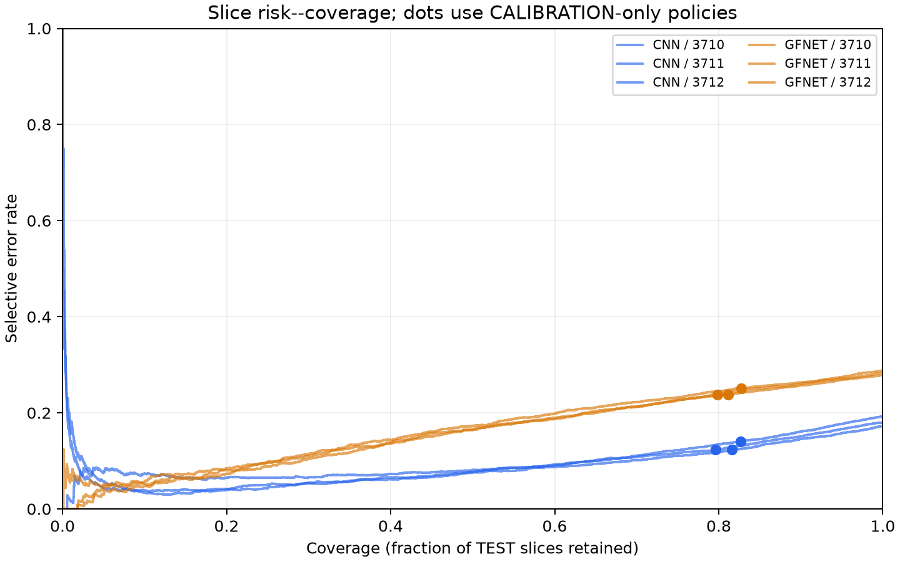
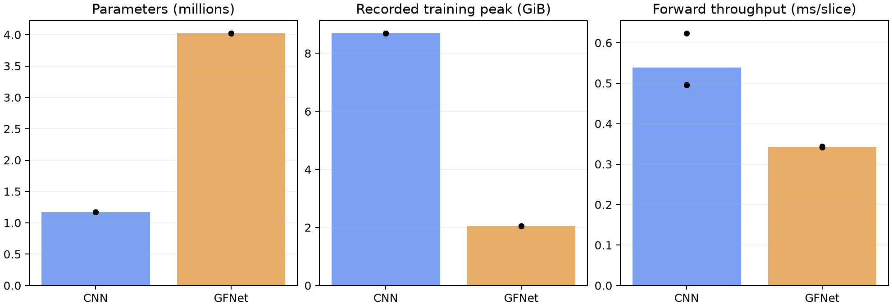

# GFNet and CNN for Confidence-Aware ADNI Slice Classification

COMP3710 · s4984179

## Research Motivation: AD Imaging Patterns and Global Feature Modelling

Structural MRI studies associate **Alzheimer's disease (AD)** with a distributed
pattern of regionally selective atrophy. For example,
[Dickerson et al. (2009)](https://pmc.ncbi.nlm.nih.gov/articles/PMC2638813/)
identified cortical thinning across medial temporal, temporoparietal and
precuneus regions. AD-related classification may depend on both local
structural features and their spatial relationships within the image.

**Global Filter Networks (GFNet)**, proposed by
[Rao et al. at NeurIPS 2021](https://arxiv.org/abs/2107.00645), offer a direct
mechanism for global spatial mixing. A two-dimensional FFT transforms learned
features into the frequency domain, trainable complex filters adjust the
frequency responses, and an inverse FFT returns them to the spatial grid.
By the convolution theorem, the filter acts as a per-channel circular
convolution spanning that grid. An MLP then combines channels through
nonlinear processing. FFT gives the spatial mixing operation log-linear
scaling in the number of positions.


*GFNet's patch-based architecture and global filter operation. Original animation
from the [authors' repository](https://github.com/raoyongming/GFNet).
Copyright © 2021 Yongming Rao; [MIT license](figures/gfnet_intro.LICENSE.txt).*

A **CNN** provides a useful baseline because its convolutional kernels emphasize
relationships between neighbouring locations. Local patterns are combined
through successive layers into larger-scale representations. GFNet instead
mixes spatially separated features directly within each global filter layer.
Within an MRI slice, direct global mixing could combine separated anatomical
features when a local region alone is ambiguous.

Both models are trained from scratch on the same ADNI slices. The comparison
asks whether **direct global mixing or a progressively constructed local
hierarchy** produces confidence that better reflects correctness, particularly
near the model decision boundary. Selective prediction measures how errors
change when low-confidence predictions are rejected. Slice accuracy and
computational cost are also compared.

## Data Partitioning: Preventing Patient Leakage

**216 of the 331 patients in the supplied test folder also appear in the
training folder: 65.3% of the original test patients.** The acquisition IDs
are different, but source metadata links them to the same people.

Different scans from one person retain related anatomical characteristics.
A model trained on that person's images may exploit familiar individual
features when classifying their other scans. The resulting accuracy and
confidence can then give an optimistic impression of performance on new
patients.

I split **patients first**, keeping every acquisition and slice
from a patient together. The complete dataset of 680 patients, 1,526
acquisitions and 30,520 slices is retained; only partition membership changes.


*Left: 216 patients occur in both supplied folders. Right: each patient is
assigned to one experimental role, together with all their scans and slices.*

The new split uses four roles. TRAIN learns model weights; TUNE supports
architecture and checkpoint selection. CALIBRATION is kept separate because
the project also fits confidence scaling and rejection thresholds. TEST is
reserved for comparing the selected models and policies.

A **60/10/10/20 patient allocation** gives most of the cohort to learning
while supporting these three evaluation tasks. Patients are stratified by
diagnosis with seed 2026, and the same assignment is used for both
architectures and every training seed.

| Partition | Purpose | Patients (AD / NC) | Acquisitions | Slices |
| --- | --- | ---: | ---: | ---: |
| TRAIN | Learn model weights | 408 (133 / 275) | 928 | 18,560 |
| TUNE | Compare recipes and select checkpoints | 68 (22 / 46) | 143 | 2,860 |
| CALIBRATION | Fit temperature and rejection thresholds | 68 (22 / 46) | 159 | 3,180 |
| TEST | Compare selected models and policies | 136 (44 / 92) | 296 | 5,920 |
| **Total** | | **680 (221 / 459)** | **1,526** | **30,520** |

## Model Design for Native MRI Slices

Both models take a **240 × 256 single-channel image**, scaled to `[0,1]`.
Keeping the native canvas preserves its aspect ratio and avoids interpolation
before feature extraction. Unlike the paper's 224 × 224 RGB input, the
network is adapted to the supplied grayscale rectangle, avoiding square
resizing or redundant colour channels. The CNN builds a local hierarchy;
GFNet adapts global filtering to the same rectangular geometry.

### CNN: A Compact Local Feature Hierarchy

Each stage contains two padded **3 × 3 convolutions**, followed by 2 × 2 max
pooling. Stacking small kernels expands local context while adding a second
nonlinear transformation, following the design principle used in
[VGG (Simonyan and Zisserman, 2015)](https://arxiv.org/abs/1409.1556).
Two stride-one 3 × 3 layers cover a 5 × 5 neighbourhood before pooling.
Four stages reduce the native image to a 15 × 16 feature map, while channels
increase from 32 to 256 as the spatial grid shrinks.

| Stage | Output channels | Spatial size |
| --- | ---: | --- |
| Input | 1 | 240 × 256 |
| CNN block 1 | 32 | 120 × 128 |
| CNN block 2 | 64 | 60 × 64 |
| CNN block 3 | 128 | 30 × 32 |
| CNN block 4 | 256 | 15 × 16 |
| Global average pooling | 256 | 1 × 1 |
| Linear head | 2 | NC / AD logits |

Convolutions use **GroupNorm with eight groups and GELU**. GroupNorm computes
statistics within each example, keeping normalization independent of batch
composition ([Wu and He, 2018](https://arxiv.org/abs/1803.08494)). Eight groups
divide all four channel widths consistently.

Global average pooling keeps the classifier compact, following the approach
introduced in [Network in Network (Lin et al., 2014)](https://arxiv.org/abs/1312.4400).
The final 256-to-2 head has **514 parameters**, compared with 122,882 for a
flattened 15 × 16 × 256 feature map connected directly to two outputs. The
complete CNN has **1,173,154 parameters**.

### GFNet: Adapting Global Filtering to a Rectangular Grid

The initial GFNet projects non-overlapping **16 × 16 patches** into 256
channels. This patch size divides both image dimensions exactly, producing
a **15 × 16 grid of 240 tokens**. It retains the paper's patch size but adapts
the original 14 × 14 grid to the native MRI dimensions. The grid dimensions
are carried explicitly through the Fourier layer.

A real FFT reduces the stored frequency grid to **15 × 9**, with a learned
complex response for each frequency and channel. The core implementation in
[GlobalFilter](modules.py) is:

```python
grid = tokens.reshape(tokens.shape[0], height, width, self.dim)
spectrum = torch.fft.rfft2(grid, dim=(1, 2), norm="ortho")
weight = torch.view_as_complex(self.complex_weight.contiguous())
grid = torch.fft.irfft2(
    spectrum * weight, s=(height, width), dim=(1, 2), norm="ortho",
)
```

The transform operates on the two spatial axes. The inverse uses the original
height and width, so the tokens return to their rectangular layout. Learned
responses let different layers and channels emphasize different frequency
patterns, as illustrated in the authors' visualization below.


*Learned filters from the authors' GFNet-XS model, arranged by layer.
Source: [official GFNet repository](https://github.com/raoyongming/GFNet#visualization).
Copyright © 2021 Yongming Rao; [MIT license](figures/gfnet_intro.LICENSE.txt).*

Each flat block retains the paper's single residual branch. Its core forward
path in [GFNetBlock](modules.py) is:

```python
branch = self.mlp(self.norm2(self.filter(self.norm1(tokens))))
return tokens + self.drop_path(branch)
```

LayerNorm controls feature scale before filtering and channel processing.
The MLP expands **256 → 1,024 → 256** with GELU, giving each globally mixed
token a nonlinear channel representation. Learned position embeddings retain
location information. DropPath increases from 0 to 0.1 across the blocks as
training regularization; final normalization, token averaging and a linear
head produce the class logits.

### From the Initial Architecture to the Selected Model

The starting point used twelve GFNet blocks and width 256, matching
**GFNet-Ti**, the paper's smallest flat variant
([Table 2](https://arxiv.org/pdf/2107.00645)). For a cohort of 680 patients,
I started with this smaller variant rather than the wider ImageNet models.

Later experiments favoured a **convolutional stem and six blocks**. The stem
applies four overlapping 3 × 3 stride-two convolutions with 32, 64, 128 and
256 channels. It builds local features before global filtering and reaches
the same 15 × 16 token grid. Compared with the paper's non-overlapping patch
projection, it lets neighbouring regions interact before the Fourier layers.

Reducing depth lowers capacity while retaining width 256 and MLP ratio 4.
The final ratio choice follows the three-seed comparison with ratio 2;
the development section presents those results alongside the stem and depth
experiments. DropPath reaches 0.1 as added regularization, compared with 0
for the paper's GFNet-Ti ([Appendix B](https://arxiv.org/pdf/2107.00645)).

| Configuration | Input embedding | GFNet blocks | Width / MLP ratio | Parameters |
| --- | --- | ---: | --- | ---: |
| Initial GFNet | 16 × 16 patch projection | 12 | 256 / 4 | 7,276,802 |
| Selected GFNet | Four-layer convolutional stem | 6 | 256 / 4 | 4,025,058 |


## Training and Model Selection

### Learn from the Slice Distribution

Each epoch shuffles all **18,560 TRAIN slices once**, giving every image
equal weight in cross-entropy. AD accounts for **51.08%** of these slices,
so ordinary sampling already provides near-balanced class exposure.
Patient-balanced sampling changes that distribution because patients
contribute different numbers of scans; its consequences are examined in
the development section.

Both models start from random initialization and learn from the same MRI
data, using cross-entropy to learn class decisions and probabilities.

### Address Generalization, Not Just Training Loss

TRAIN loss fell while TUNE performance stalled. I compared learning rate,
weight decay and augmentation separately to investigate this generalization
gap.

[AdamW](https://arxiv.org/abs/1711.05101) separates weight decay from adaptive
gradient updates, making regularization strength a distinct choice. In the
initial learning-rate comparison, CNN reached **84.41% TUNE accuracy at
3e-4**, against **81.71% at 1e-4**. GFNet gained a little accuracy at the
lower rate but produced worse NLL and more confident errors. Subsequent
experiments kept 3e-4 while investigating its input representation and capacity.

Small TRAIN rotations (±5°) and translations (±2%) improved GFNet's TUNE
accuracy and were retained to introduce positional variation. CNN continued
with the established unaugmented baseline during this investigation.

| Setting | Final recipe |
| --- | --- |
| Optimizer | AdamW; peak learning rate 3e-4; weight decay 0.01 |
| Batch size | 64 |
| Schedule | Two warm-up epochs, then cosine decay to 1% of peak |
| Training limit | 30 epochs; early stopping from epoch 20 |
| Patience | Eight epochs without improved TUNE accuracy |
| Loss | Cross-entropy, without label smoothing or MixUp |
| Training seeds | 3710, 3711, 3712 |

Native-resolution memory measurements supported batch 64 for both models.
The thirty-epoch ceiling balances learning time against the cost of multiple
comparisons, permitting **556,800 TRAIN presentations**: slightly more than
the earlier sixty sampled epochs. Warm-up softens the initial learning-rate
increase; cosine decay makes later updates smaller. A minimum of twenty
epochs leaves an initial learning period, followed by patience-based stopping
when TUNE accuracy remains stalled.

### Accuracy and Confidence Can Favour Different Models

Checkpoint selection follows the slice-accuracy assessment criterion: choose
the highest TUNE accuracy, with lower slice NLL breaking ties. Confidence
reliability remains the central research question, evaluated alongside
classification performance.

In the three-seed CNN comparison, MixUp improved
mean TUNE NLL from **0.7242 to 0.4257**, while mean accuracy fell from
**82.79% to 82.54%**. The accuracy-first rule retained the unmixed CNN.
The final recommendation also considers MixUp's better probability quality.

Final recipe comparisons use training seeds **3710–3712** to check whether
an improvement persists across initializations.

## Development: From Patient Balancing to Slice-Level Learning

### Repeated Scans Motivated Patient-Balanced Sampling

AD patients contributed **3.56 scans each in TRAIN, compared with 1.65 for
NC controls**: just over twice as many. Repeat scans are fine; the model
does not need to hand out loyalty points. V1 sampled one acquisition per
patient each epoch, retaining its twenty slices. Each of the 408 TRAIN
patients contributed equally, producing **8,160 images per epoch**.

The intention was to limit the influence of frequently scanned patients.
The overlooked consequence was a change in class exposure: AD made up
**51.08% of all TRAIN slices but only 32.60% of the sampled stream**.
Balancing patients had also made the image-level training population
NC-heavy. Patient independence was needed between partitions; equal patient
contributions within TRAIN were a separate choice.

### Confidence Was Evaluated at the Wrong Unit

With reliability as the research focus, V1 selected checkpoints using NLL.
It first averaged the twenty slice probabilities in each scan, then weighted
scans so each patient contributed equally. This favoured confident, correct
scan averages, although the network was asked to classify individual images.

Averaging can hide a wrong slice prediction among stronger predictions from
the same scan. A checkpoint could improve the scan average while
misclassifying more individual images. V1's NLL measured the quality of
those averages, leaving slice errors less visible in model selection.

V1 compared peaks of **1e-4, 3e-4 and 1e-3** for each model, then trained two
additional seeds at the selected 3e-4 rate. Across those ten fits, every
GFNet run selected epoch one under the aggregated NLL rule.

### Training Loss Fell While TUNE Errors Became More Confident

GFNet's TRAIN cross-entropy fell to **0.0076–0.0143** across the five fits.
Retrospective best TUNE slice accuracy remained **62.87–67.94%**, and mean
confidence on TUNE mistakes reached **95.8–97.4%** by the final epoch.
It was fitting the training images while becoming more certain about wrong
predictions on other patients.


*Five V1 GFNet fits: three learning rates at seed 3710, plus seeds 3711 and
3712 at 3e-4. The falling TRAIN loss contrasts with rising TUNE NLL and
confidence on errors. In the legend, lr0/lr1/lr2 denote 1e-4/3e-4/1e-3.*

CNN learned a stronger classifier, but its probability quality also worsened
late in training. For seed 3711, the original rule selected epoch 42, with
**80.70% TUNE slice accuracy and 288 high-confidence AD false negatives**.
Looking back at the same history, epoch 33 had **82.24% accuracy and 146**
such false negatives. The scan-NLL rule selected a later checkpoint with
lower slice accuracy and more confident AD misses.


*CNN at 3e-4 across three seeds. TRAIN fitting continues after TUNE accuracy
levels off, while TUNE NLL and confidence on mistakes rise. The epoch-33
comparison above is a retrospective TUNE diagnosis.*

The original selected models produced these TEST slice accuracies:

| V1 model | Seed 3710 | Seed 3711 | Seed 3712 | Mean |
| --- | ---: | ---: | ---: | ---: |
| CNN | 82.40% | 79.49% | 81.17% | 81.02% |
| GFNet | 54.39% | 58.70% | 54.75% | 55.95% |

CNN's mean concealed a seed below 80%; GFNet was far below the target.
V1 exposed the models to an NC-heavy sample and selected them on scan
averages. These choices changed the influence of individual slice errors
on learning and selection. GFNet also had a generalization problem beyond
checkpoint choice: even its retrospective best TUNE epochs stayed below 68%.

CNN reached much higher accuracy under the same sampling scheme. Reduced AD
exposure could contribute to the errors, but the architectural gap also
suggested investigating GFNet's feature representation and capacity.

A smaller **width-128 GFNet** tested the capacity hypothesis before the
redesign. Over fifteen sampled epochs, its maximum TUNE accuracy was only
**63.99%**, within the range already seen in the wider model. Reducing width
had not improved the best observed TUNE accuracy.

### V2 Aligned Learning and Selection with Individual Images

V2 retained the patient-disjoint split, native grayscale geometry and initial
CNN/GFNet architectures. Training restarted from random weights with all
TRAIN slices included each epoch. Selection moved to TUNE slice accuracy,
using slice NLL to break ties. Confidence analysis also moved to individual
images.

| Decision | V1 | V2 |
| --- | --- | --- |
| TRAIN exposure | One scan per patient each epoch | Every TRAIN slice once per epoch |
| Images / updates per epoch | 8,160 / 128 | 18,560 / 290 |
| AD share of TRAIN stream | 32.60% | 51.08% |
| Checkpoint selection | Patient-weighted scan NLL | Slice accuracy, then slice NLL |
| Training ceiling | 60 sampled epochs | 30 full-slice epochs |
| Confidence evaluation | Scan-aggregated policies alongside slice diagnostics | Slice probabilities and slice errors |

### GFNet Still Struggled After Full-Slice Training

The first V2 comparison used the patch-based twelve-block GFNet and the
unchanged CNN, testing two learning rates without augmentation. All values
below are measured at the selected TUNE checkpoint.

| Model | Peak LR | TUNE accuracy | Slice NLL | High-confidence errors / AD false negatives |
| --- | --- | ---: | ---: | ---: |
| CNN | 3e-4 | 84.41% | 0.5368 | 245 / 154 |
| CNN | 1e-4 | 81.71% | 0.4581 | 175 / 113 |
| GFNet | 3e-4 | 65.14% | 0.9195 | 424 / 178 |
| GFNet | 1e-4 | 66.78% | 2.7912 | 892 / 372 |

*High confidence means raw predicted-class probability ≥0.90.*

CNN achieved higher accuracy at 3e-4 but lower NLL at 1e-4. GFNet still
showed a large gap between fitting and generalization: at 3e-4, TRAIN
accuracy reached **99.91%**, while final TUNE accuracy fell to **61.36%**.
Full-slice training and accuracy-based selection had not closed that gap.
Lowering the learning rate added only 47 correct TUNE images at selection
and more than doubled high-confidence errors.

I kept the patch-based architecture for three comparisons: centering pixels
from [0,1] to [-1,1] to test input scale; increasing weight decay from 0.01 to
0.05 to constrain fitting; and adding small rotations and translations to
test positional sensitivity.

### Small Position Changes Helped More Than Centering or Stronger Decay

GFNet fitted TRAIN almost perfectly, while TUNE accuracy stayed near 65%.
The reference recipe uses normalized natural images; these grayscale slices
were scaled to [0,1]. I tested [-1,1] input to see whether changing the
numerical scale and offset helped optimization, keeping the image content
and architecture unchanged.

The widening TRAIN–TUNE gap also motivated stronger weight decay. I tested
**0.05**, the value in Rao et al.'s reference training script, against 0.01:
a fivefold increase on the same model weights.
CNN showed late overfitting too, so it received the same comparison. For
GFNet, learned positions on a fixed grid raised another possibility:
sensitivity to exact image placement. Small **±5° rotations and ±2%
translations** introduced positional variation while limiting anatomical
changes; crops and flips were left out of this comparison.

| Model / change | TUNE accuracy | Slice NLL | High-confidence errors / AD misses |
| --- | ---: | ---: | ---: |
| GFNet baseline | 65.14% | 0.9195 | 424 / 178 |
| A: centered input | 65.91% | 1.3415 | 681 / 346 |
| B: weight decay 0.05 | 64.51% | 2.9296 | 932 / 620 |
| C: mild geometry | 69.62% | 2.3910 | 734 / 414 |
| CNN baseline | 84.41% | 0.5368 | 245 / 154 |
| CNN: weight decay 0.05 | 83.32% | 0.9516 | 362 / 176 |

*Saved selected-epoch TUNE results: seed 3710, LR 3e-4, all 2,860 slices.
High-confidence errors use predicted-class probability ≥0.90; AD misses are
its AD-to-NC error subset. Each candidate changes one baseline setting.*

Centering added only **22 correct predictions**, or 0.77 percentage points,
with worse NLL. Stronger decay hurt both models. Overfitting was visible,
but increasing this penalty alone did not improve held-out performance.
The original [0,1] scale and decay 0.01 were retained.

Geometry gave the largest classification gain: **128 additional correct
slices, or 4.48 percentage points**. NLL and confident errors still rose.
I kept the positional variation for subsequent GFNet experiments. C became
the common comparison for two questions: whether a local stem improved
classification, and whether soft targets reduced the confident errors.

### Local Features Improved Accuracy; Soft Targets Improved NLL

CNN's advantage suggested that useful local structure might be harder to
learn through GFNet's single 16 × 16 patch projection. Overlapping **3 × 3
convolutions** let neighbouring regions interact across the original patch
boundaries before global filtering. Four stride-two layers produce the same
overall reduction as stride 16, ending at **15 × 16 × 256**; the remaining
twelve Fourier blocks can stay unchanged. Convolutional stems have also
improved ViT optimization
([Xiao et al., 2021](https://arxiv.org/abs/2106.14881)).

C's **734 high-confidence errors** motivated a separate label-smoothing
experiment. Hard targets keep rewarding increasingly certain predictions
on TRAIN; soft targets reduce that pressure
([Müller et al., 2019](https://arxiv.org/abs/1906.02629)). The mild coefficient
**0.05** mixes 95% hard label with 5% uniform probability, giving binary
targets **0.975/0.025**. The labelled class retains most of the supervision,
without demanding probability one. This experiment kept patch embedding,
so the effect of soft targets could be distinguished from the stem change.


*Seed 3710, selected TUNE checkpoints. A/B/C compare with the patch baseline;
D/E compare with C, which already includes mild geometry. Values come from
the saved TUNE histories.*

The stem (**D**) raised accuracy from **69.62% to 74.86%**: 2,141 correct
slices versus 1,991, a gain of 150. NLL fell from 2.3910 to 1.8350, supporting
local feature extraction before global mixing. The error changes were uneven:
high-confidence errors fell from 734 to 654, but high-confidence AD misses
rose from **414 to 460**.

The smoothed patch model (**E**) remained near the control's accuracy at
**69.34%** (1,983 correct), while NLL fell to **0.8991**. It improved the
probability loss without improving classification.

Meanwhile, the unchanged CNN scored **84.41%, 81.15% and 82.80%** at the
selected TUNE epochs of seeds 3710–3712. I retained this baseline and
concentrated the remaining architecture experiments on GFNet.

### Six Blocks Reduced Confident AD Misses

The stem model still reached **99.91% online TRAIN accuracy**. TUNE epoch
11 already had 2,131 correct predictions; selected epoch 19 added only ten,
while high-confidence AD misses rose from **327 to 460**. Further fitting
was producing little classification gain and more confident AD mistakes.

The stem had improved classification, but the later trajectory suggested
that the repeated Fourier/MLP stack could still be fitting training-specific
details. I retained the stem and tested **six blocks against twelve**.
Halving the stack makes a substantial capacity change while keeping the
256-channel representation and 15 × 16 grid fixed. Each remaining filter
still mixes the whole grid, so reducing depth preserves the spatial reach
of individual blocks. Parameters fell from **7,599,330 to 4,025,058**, with
maximum DropPath unchanged at 0.1. E had improved NLL in the patch model,
so smoothing was also tested with the stronger stem representation.
D/F/G/H crossed both depths with smoothing 0 and 0.05: D versus G compares
depth, D versus F compares smoothing at twelve blocks, and G versus H repeats
that smoothing comparison at six. A lower rate was tested on F as well:
its stem and soft targets
had changed the optimization conditions since the earlier patch-model LR
comparison.

| Fit | Blocks / smoothing / LR | TUNE accuracy | NLL | High-confidence AD misses |
| --- | --- | ---: | ---: | ---: |
| D: reference | 12 / 0 / 3e-4 | 74.86% | 1.8350 | 460 |
| F | 12 / 0.05 / 3e-4 | 75.42% | 0.7882 | 477 |
| G | 6 / 0 / 3e-4 | 75.80% | 0.9047 | 299 |
| H | 6 / 0.05 / 3e-4 | 73.50% | 0.8652 | 509 |
| I | 12 / 0.05 / 1e-4 | 74.20% | 0.7742 | 341 |

*All use the stem, geometry and seed 3710. Saved TUNE metrics are taken from
the selected epochs D/F/G/H/I = 19/17/7/21/13 over the same 2,860 images.
Parameter totals are counts of the trainable weights in each architecture.*


Six blocks without smoothing (**G**) gave the group's highest accuracy,
adding **27 correct slices** over D and removing **161 high-confidence AD
misses**. AD recall rose from **62.73% to 66.82%**. Both classification and
this error measure favoured the smaller model, which became the next
flat-GFNet reference.

Smoothing helped twelve-block accuracy slightly, but cost the six-block model
**66 correct predictions** and increased confident AD misses from **299 to
509**. Two plausible improvements had not combined successfully. F also had
lower NLL than G but more confident AD misses; its better average probability
loss did not reflect a lower AD-error burden. Reducing F's learning rate
produced I, losing **35 correct predictions** for another small NLL gain.
The six-block, unsmoothed, 3e-4 recipe was retained.

The smaller model still overfit. From selected epoch seven to final epoch
twenty, its online TRAIN accuracy rose from **94.02% to 99.45%**, while TUNE
accuracy fell from **75.80% to 70.63%**. NLL increased from **0.9047 to
2.5903**, and high-confidence AD misses from **299 to 569**. Reducing depth
improved the selected model, but further fitting still widened the gap
between TRAIN and other patients' images.

### The Hierarchical Model Remained Below the Flat Reference

The convolutional stem had gained **5.24 percentage points**; reducing depth
added **0.94**. This suggested investigating where global mixing occurred.
The flat model performs all Fourier processing after the image has already
been reduced to 15 × 16. Rao et al.'s GFNetPyramid, available in the
[course fork](https://github.com/shakes76/GFNet/blob/a0c7aefaf7109ceed284df77b415046466e5bc38/gfnet.py),
provided a way to mix features at finer resolutions between downsampling stages.

I adapted its four-stage structure to **three stages**, stopping at the
existing 15 × 16 grid. A fourth stage would add a wider 512-channel level and
require another reduction of the odd height 15. Early widths of **64 and
128** limit the feature-memory cost of larger grids; the final **256** channels
retain the previous classifier width. LayerScale starts at **0.001**, following
the reference Pyramid constructor, to keep the initial residual contributions
small. Maximum DropPath remains 0.1. Four candidates combine two final-stage
depths with two learning rates, using the same three-stage structure.

| Stage | Grid | Channels | Compact / extended blocks |
| --- | --- | ---: | --- |
| Fine | 60 × 64 | 64 | 2 / 2 |
| Intermediate | 30 × 32 | 128 | 2 / 2 |
| Coarse | 15 × 16 | 256 | 2 / 4 |

Two blocks per stage distribute six blocks across three resolutions, retaining
the flat reference's total block count. Adding two blocks only at the coarse
stage tests extra capacity on the smaller grid, limiting the
additional feature-memory cost. The variants contain **2,926,562 and 4,118,498
parameters**, counted from their trainable weights. The larger is close to
the flat reference's 4,025,058, making it useful to compare how capacity is
distributed across resolutions. Both depths were tested at **3e-4 and 1e-4**:
the changed stage widths and residual scaling gave a reason to reconsider
learning rate within this architecture.

| Fit | Stage blocks / LR | TUNE accuracy | NLL | High-confidence errors / AD misses |
| --- | --- | ---: | ---: | ---: |
| P1 | 2/2/2 / 3e-4 | 73.01% | 2.0468 | 624 / 493 |
| P2 | 2/2/2 / 1e-4 | 72.90% | 0.5658 | 0 / 0 |
| P3 | 2/2/4 / 3e-4 | 74.02% | 2.2614 | 642 / 443 |
| P4 | 2/2/4 / 1e-4 | 73.46% | 1.2533 | 493 / 425 |

*Saved selected-epoch TUNE results, seed 3710, 2,860 slices. P1–P4 select
epochs 14/2/14/12, with 2,088/2,085/2,117/2,101 correct predictions.*


The best hierarchy reached **74.02%**, below flat G's **75.80%**. Additional
coarse blocks improved accuracy slightly but did not close the gap. P2's zero
high-confidence errors looked promising until the denominator was examined:
only **31 predictions**, or **1.08% of TUNE**, reached confidence 0.90. It
rarely made a high-confidence decision. The later rejection analysis includes
coverage to show how many predictions remain when errors are reduced.

The hierarchy also kept fitting TRAIN while TUNE deteriorated. Final online
TRAIN accuracies ranged from **96.64% to 99.84%**, against **66.64–71.78%** on
TUNE. P3 ended with NLL **4.3301** and **97.37%** mean confidence on errors.
This hierarchical recipe still showed the generalization problem; the
simpler six-block flat model remained the reference.

### MixUp Helped the Weakest CNN Seed, but Not GFNet Consistently

Label smoothing had softened targets on the original images, sometimes
improving NLL without improving classification. [MixUp](https://arxiv.org/abs/1710.09412)
also changes the inputs: it interpolates images and labels with the same
weight, encouraging smoother predictions between training examples.
[Thulasidasan et al.](https://arxiv.org/abs/1905.11001) studied its confidence
benefits, and [Rao et al.'s training script](https://github.com/raoyongming/GFNet/blob/2de48b626ea805de82a7f389fed930af1ae0340d/main_gfnet.py)
also includes mixing augmentation.

I tested **MixUp alone at alpha 0.2**. A Beta(0.2, 0.2) draw favours weights
near the ends of the interval, keeping many mixtures closer to one original
image. This offered a relatively mild interpolation candidate without adding
CutMix at the same time. Images and target labels use the same mixing weight;
TUNE remains ordinary, unmixed slices.

GFNet was compared with and without MixUp at seeds 3710 and 3711, keeping
the initialization seed matched within each pair. CNN seed **3711** was
tested first because it had the
lowest baseline TUNE accuracy, **81.15%**, and **344 confident errors**.

| Model / seed | MixUp alpha | TUNE accuracy | NLL | High-confidence errors / AD misses |
| --- | --- | ---: | ---: | ---: |
| GFNet / 3710 | 0 | 75.80% | 0.9047 | 409 / 299 |
| GFNet / 3710 | 0.2 | 74.09% | 0.9408 | 551 / 421 |
| GFNet / 3711 | 0 | 74.30% | 1.7818 | 572 / 420 |
| GFNet / 3711 | 0.2 | 75.03% | 0.8922 | 436 / 382 |
| CNN / 3711 | 0 | 81.15% | 0.7542 | 344 / 144 |
| CNN / 3711 | 0.2 | 83.22% | 0.4339 | 188 / 111 |

*Each row uses the saved selected TUNE epoch on all 2,860 slices. GFNet retains
the six-block stem model and geometry; CNN retains its unaugmented baseline.*

GFNet lost accuracy at seed 3710. Seed 3711 gained **21 correct slices**, but
AD recall fell from **62.58% to 58.56%**, despite improved NLL and fewer
confident errors. Its smaller error counts did not mean better AD recognition.
The two seeds gave little reason to adopt MixUp for GFNet.

CNN 3711 improved in accuracy, NLL and confident errors. The remaining seeds
were needed to see whether the gain extended beyond this initially weaker
run. The final comparison completed CNN MixUp seeds 3710 and 3712 alongside
the existing 3711 result.

### The Last Capacity Test Targeted the Channel MLP

After the Pyramid and GFNet MixUp comparisons, G remained the strongest
accuracy reference. **3,153,408 of its 4,025,058 parameters—about 78%—were in
its six MLPs**. This count comes from the two linear layers and their biases
in each block. The earlier depth reduction had helped; shrinking this large
channel branch offered another capacity test while preserving every Fourier
filter and the local stem.

[Rao et al.'s GFNet implementation](https://github.com/raoyongming/GFNet/blob/2de48b626ea805de82a7f389fed930af1ae0340d/gfnet.py)
exposes the MLP expansion ratio. I compared the existing **ratio 4**
(256 → 1,024 → 256) with **ratio 2** (256 → 512 → 256), halving hidden width
while leaving token width and all six global filters intact. Total parameters
fell to **2,449,122**. This reduced the largest parameter component while
preserving the local features and all six global-filter layers.

The final round had two questions left: whether CNN's MixUp gain persisted
across seeds, and whether a smaller GFNet MLP improved on G. Six new fits
completed the comparisons: two CNN MixUp seeds, one missing ratio-4 GFNet
control, and three ratio-2 GFNet seeds. Existing controls were reused.
Each complete recipe uses seeds 3710–3712. Mean TUNE accuracy determines
the final choice, with mean NLL breaking an exact tie.

| Recipe | Seed 3710 | Seed 3711 | Seed 3712 | Mean accuracy | Mean NLL |
| --- | ---: | ---: | ---: | ---: | ---: |
| CNN, unmixed | 84.41% | 81.15% | 82.80% | 82.79% | 0.7242 |
| CNN, MixUp 0.2 | 82.03% | 83.22% | 82.38% | 82.54% | 0.4257 |
| GFNet, MLP ratio 4 | 75.80% | 74.30% | 75.63% | 75.24% | 1.5748 |
| GFNet, MLP ratio 2 | 74.06% | 74.41% | 74.16% | 74.21% | 2.3100 |

*Every entry is the selected checkpoint's result on the same 2,860 TUNE slices.
Means average the three seed metrics. Each line in the figure joins a matching seed.*


CNN MixUp improved NLL at all three seeds, but its accuracy gain at 3711 was
offset by losses at 3710 and 3712. Across the three evaluations it classified
**21 fewer slices correctly**, with mean accuracy falling from **82.79% to
82.54%**. The unmixed CNN was retained for its higher mean accuracy.
MixUp's substantially better probability loss remains part of the final
comparison of accuracy and confidence.

For GFNet, ratio 2 reduced parameters but gave lower mean accuracy and higher
mean NLL. The gain from reducing depth had not extended to reducing MLP width.
Ratio 4 was retained, although its **75.24% mean TUNE accuracy** still fell
short of 80%.

The models taken forward were the unmixed CNN and the six-block convolutional
GFNet with ratio 4 and mild geometry. Their selected epochs for seeds
3710–3712 were **14/18/16 for CNN and 7/13/19 for GFNet**. These fixed models
supplied the subsequent calibration and TEST evaluation.

## Evaluating Confidence and Selective Prediction

### Calibrate the Probability Scale

Development showed that accurate classification and useful probabilities
could favour different recipes. I kept the selected classifiers fixed and
used **temperature scaling** to adjust their confidence. This single-parameter
method follows [Guo et al. (2017)](https://proceedings.mlr.press/v70/guo17a.html),
keeping the same classification boundary while changing the probability scale.

Each model/seed has its own temperature, fitted on the **3,180 CALIBRATION
slices**. TUNE had already guided model selection; a separate population lets
probability adjustment follow that choice without fitting again to the same
development images.

For an AD-minus-NC logit difference $m$, calibrated predicted-class confidence is

$$
\operatorname{confidence}=\sigma\!\left(\frac{|m|}{T}\right),\qquad T>0.
$$

A temperature above one softens confidence; one below one sharpens it. The
search minimizes CALIBRATION slice NLL over **[0.05, 20]**, allowing both
directions on a reciprocal scale around one. The original value **T=1** is
also compared. Dividing by a positive temperature preserves the class decision,
so raw and calibrated results share the same accuracy and confusion matrix.

### Check Probability Quality and Error Recognition Separately

A model can have reasonable average calibration yet still assign high confidence
to individual errors. I use several views to examine both behaviours:

| Measure | Question it answers |
| --- | --- |
| Reliability diagram and ECE | Does confidence agree with observed correctness? |
| NLL and Brier score | How good are the assigned probabilities, including confident mistakes? |
| Confidence on correct versus wrong predictions; confidence–correctness correlation | Does the model become less certain when it is wrong? |
| Error-detection AUROC | Does low confidence rank errors ahead of correct predictions? |
| High-confidence errors and AD misses | Which mistakes remain above confidence 0.90? |

Reliability diagrams use **ten equal-width bins over [0.5, 1]**, the range of
predicted-class confidence in binary classification. Ten bins give a readable
summary; ECE weights each bin's confidence–accuracy gap by the number of images
it contains. NLL strongly penalizes a very low probability for the true class;
Brier records average squared probability error. Together they show more than
a single binned calibration score.

The **0.90** threshold follows the high-confidence diagnostics used throughout
development. Its prediction count, error rate and AD misses are reported together,
so a reduction in errors can be read against the size of that confidence group.
Full-population accuracy, class recall, macro-F1 and AD AUROC describe classification.

### Retain Most Predictions and Examine the Remaining Errors

P2's zero confident errors came from only 31 high-confidence predictions.
That result made the amount of retained output as important as the error count.
[Selective classification](https://arxiv.org/abs/1705.08500) studies this trade-off
between coverage and risk.

I chose **80% CALIBRATION coverage** as a working point: retain most predictions
and leave roughly the least-confident fifth for review. Among the 3,180
CALIBRATION slices, this requires at least **2,544 retained predictions**.
The highest confidence threshold meeting that count is selected; tied scores
stay together. This 80% is a retention choice, separate from the classification
accuracy target.

The temperature and threshold are then applied unchanged to TEST. Coverage
reports the retained fraction, and selective risk is the error rate within
that retained group. The observed TEST coverage can differ because its scores
have a different distribution.

Two comparisons are useful. The fixed threshold shows how the chosen policy
transfers to TEST; the **risk–coverage curve** compares models at the same
retained fraction. Positive temperature scaling preserves confidence ordering,
so it leaves this ranking curve unchanged. Calibration adjusts what the
probabilities mean; the curve shows how well the model orders its mistakes.

### Compare Models on the Same Patients

Both architectures predict the same TEST patients. A difficult patient can
produce several correlated slices, so treating every slice as an independent
resampling unit would give too much weight to the apparent sample size.
I resample **patients with all their scans and slices together**, maintaining
the AD/NC patient counts in each draw. The same sampled patients are used for
both models and all three seeds, giving paired model comparisons.

**2,000 bootstrap draws**, fixed by seed **9001**, form an empirical distribution
for each metric and for **GFNet minus CNN**. The 2.5th and 97.5th percentiles
provide the reported **95% intervals**. Individual-seed results and their means
are kept visible alongside these intervals. Predictions and metrics remain
slice-based; patient grouping preserves the relationships among their images.

### Inspect the Errors Behind the Scores

Five case categories cover different failures: a high-confidence AD miss from
each model, an error unique to each model, and a GFNet error close to its decision
boundary. Seed **3710** supplies the reference selection, with one case per
patient; the other seeds show whether the same slice produces a consistent
mistake. This gives the case discussion both severe confident errors and
uncertain or model-specific errors.

Performance is also compared by position within each twenty-slice acquisition
and by the source slice-window start. These groups examine whether the data's
preparation patterns accompany changes in classification or confidence.

Finally, parameter count, training time and peak memory describe the cost of
learning each model. Inference compares synchronized model-forward time on the
same A100 at batch 64, separately from image loading and the complete prediction
loop. This distinguishes computational savings from differences in input I/O.

## Results

### Record final full-coverage TEST slice classification

Job **699939 completed with exit 0:0**, zero restarts and elapsed time
**1 minute 59 seconds**. Accounting and saved outputs were inspected at
**26 October 2026, 21:56:28 Brisbane**. All six fixed model/seed calls and
the saved-record analysis exited 0. Each call recorded an A100-PCIE-40GB on
a100-1, partition comp3710, with two intra-op/two inter-op threads. Completed
inference totals are 19,080 CALIBRATION and 35,520 TEST presentations;
these are not independently measured image-decode counts. No neural weights
were updated during evaluation.

Every selected model classifies the same **5,920 TEST slices from 136
patients**, comprising **3,220 NC and 2,700 AD slices**. Accuracy is the
number of correct slice predictions divided by 5,920, including every final
partial batch and every low-confidence prediction. NC is class 0 and AD is
class 1; the AD-minus-NC logit margin decides the class, with an exact zero
assigned to AD. There is no scan or patient voting, probability aggregation,
seed ensemble or rejection in this accuracy denominator. Positive temperature
scaling preserves these class decisions and confusion counts.

| Model | Seed | Selected epoch | Correct / TEST slices | Accuracy | Macro-F1 | AD AUROC |
| --- | --- | --- | --- | --- | --- | --- |
| CNN | 3710 | 14 | 4,900 / 5,920 | 82.77% | 0.8259 | 0.8952 |
| CNN | 3711 | 18 | 4,776 / 5,920 | 80.68% | 0.8057 | 0.8857 |
| CNN | 3712 | 16 | 4,852 / 5,920 | 81.96% | 0.8184 | 0.8856 |
| GFNet | 3710 | 7 | 4,242 / 5,920 | 71.66% | 0.7136 | 0.7965 |
| GFNet | 3711 | 13 | 4,215 / 5,920 | 71.20% | 0.7076 | 0.7908 |
| GFNet | 3712 | 19 | 4,269 / 5,920 | 72.11% | 0.7155 | 0.7967 |

The arithmetic means across the three fitted seeds are **81.80% accuracy,
0.8167 macro-F1 and 0.8888 AUROC for CNN**, versus **71.66%, 0.7122 and
0.7947 for GFNet**. These means summarize separate fits evaluated on the
same population, rather than combining their predictions or treating them
as three independent patient cohorts. At this denominator, exactly 80%
requires 4,736 correct slices. All three CNN fits exceed that count; none
of the GFNet fits reaches it. Completion of the evaluation does not resolve
GFNet's unmet accuracy goal.

Per-class metrics expose whether an overall result hides a weak diagnosis.
Precision divides correct predictions of a class by all predictions of that
class; recall divides them by its true support; F1 is their harmonic mean.
Macro-F1 averages the NC and AD F1 values equally. AUROC uses the continuous
AD logit margin, with average ranks for ties, rather than thresholded labels.

| Model | Seed | NC precision | NC recall | NC F1 | AD precision | AD recall | AD F1 |
| --- | --- | --- | --- | --- | --- | --- | --- |
| CNN | 3710 | 83.29% | 85.47% | 84.37% | 82.11% | 79.56% | 80.81% |
| CNN | 3711 | 82.99% | 81.09% | 82.03% | 78.05% | 80.19% | 79.10% |
| CNN | 3712 | 83.92% | 82.67% | 83.29% | 79.69% | 81.11% | 80.40% |
| GFNet | 3710 | 73.38% | 75.16% | 74.26% | 69.49% | 67.48% | 68.47% |
| GFNet | 3711 | 72.09% | 76.77% | 74.36% | 69.97% | 64.56% | 67.15% |
| GFNet | 3712 | 72.23% | 79.16% | 75.54% | 71.94% | 63.70% | 67.57% |


Rows are true labels and columns are predicted labels, ordered NC then AD.
The lower-left cells are AD false negatives: CNN misses 552/535/510 slices
across the three seeds, while GFNet misses 878/957/980. In every GFNet fit,
AD recall is below NC recall. Its difficulty therefore includes substantial
AD under-detection, rather than only a small loss near the 80% threshold.
These errors also motivate examining confidence on wrong predictions;
accuracy and class recall cannot establish whether the model recognizes
its unreliable decisions.

The complete twelve prediction/calibration files, analysis and original
confusion figure are archived outside Git. Published output hashes and the
full manifest joins agree; confusion counts, class metrics and AUROC were
checked directly from saved predictions without another inference or
bootstrap run. The previously disclosed cohort exposure, repeated TUNE
development and within-patient slice correlation still limit generalization
claims. Three CNN point estimates above 80% do not guarantee that accuracy
on a new patient population.

### Evaluate whether slice confidence reflects correctness

The core investigation asks whether the model knows when its prediction is
unreliable, including slices near its decision boundary. For two logits,
the predicted-class confidence is `sigmoid(abs(z_AD - z_NC))`. Confidence
is therefore a model score whose reliability must be measured against actual
correctness, rather than assumed from its numerical size. Every result below
uses the same full TEST population as the classification table.

NLL penalizes assigning little probability to the true diagnosis, especially
when the prediction is confidently wrong. The binary Brier score is the mean
of `(p_AD - label)^2`; this definition does not double the score by summing
both class probabilities. Both scores depend on classification as well as
probability quality. ECE measures the slice-weighted absolute difference
between mean confidence and accuracy within ten fixed equal-width bins on
[0.5, 1]. The last bin includes confidence 1. Lower values are better, but
small ECE alone does not establish good error detection or high accuracy.

Each temperature was fitted on its model's 3,180 CALIBRATION slices by NLL,
then applied unchanged to TEST. All six optima are inside the predeclared
0.05--20 bounds. Temperatures above one soften the excessive logit magnitude;
neither TEST labels nor TEST ECE choose these temperatures. The table uses
**raw → calibrated** values; ECE is displayed as a percentage-point gap.

| Model | Seed | Temperature | NLL | Binary Brier | ECE |
| --- | --- | --- | --- | --- | --- |
| CNN | 3710 | 2.954 | 0.6745 → 0.4121 | 0.1423 → 0.1277 | 11.01% → 1.95% |
| CNN | 3711 | 4.065 | 0.8547 → 0.4271 | 0.1655 → 0.1354 | 15.03% → 1.91% |
| CNN | 3712 | 3.893 | 0.9360 → 0.4275 | 0.1565 → 0.1324 | 13.86% → 2.50% |
| GFNet | 3710 | 3.793 | 0.9777 → 0.5454 | 0.2303 → 0.1847 | 19.60% → 2.65% |
| GFNet | 3711 | 7.622 | 1.9236 → 0.5550 | 0.2599 → 0.1882 | 24.84% → 4.17% |
| GFNet | 3712 | 10.652 | 2.3713 → 0.5461 | 0.2579 → 0.1841 | 24.79% → 2.22% |


Each point compares mean confidence with the observed correct fraction in
one occupied bin. Points below the diagonal indicate overconfidence. Raw
predictions lie well below it, particularly at high confidence; calibration
brings the occupied bins closer to the diagonal. The seed-mean ECE decreases
from **13.30 to 2.12 percentage points for CNN**, and from **23.08 to 3.01
for GFNet**. Each plotted bin is a descriptive group, not an independent
patient sample, and the point markers do not display uncertainty or bin size.

Confidence also needs to distinguish errors from correct predictions. The
Pearson correlation below compares slice confidence with a binary correctness
indicator. Error-detection AUROC treats an incorrect prediction as the positive
case and uses negative absolute logit margin as its score; 0.5 represents
random ordering. It is distinct from the AD-versus-NC classification AUROC.

| Model | Seed | Raw mean confidence, correct | Raw mean confidence, wrong | Correctness correlation, raw → calibrated | Error-detection AUROC, both |
| --- | --- | --- | --- | --- | --- |
| CNN | 3710 | 95.32% | 86.16% | 0.295 → 0.327 | 0.738 |
| CNN | 3711 | 97.12% | 89.80% | 0.291 → 0.366 | 0.756 |
| CNN | 3712 | 96.92% | 89.94% | 0.262 → 0.326 | 0.728 |
| GFNet | 3710 | 93.27% | 86.16% | 0.241 → 0.307 | 0.697 |
| GFNet | 3711 | 97.19% | 93.21% | 0.186 → 0.296 | 0.691 |
| GFNet | 3712 | 97.75% | 94.71% | 0.157 → 0.293 | 0.691 |

The positive correlations show useful but limited association with correctness.
CNN's error-detection AUROC is descriptively higher in each matched seed.
GFNet seeds 3711/3712 average over 93% raw confidence even when wrong,
leaving little separation from their correct predictions. At the other end,
the raw [0.50, 0.55) confidence bins contain only 53--173 slices per fit,
with observed accuracy 43.08--57.78%. Low-confidence predictions are thus
unreliable here, but these model-boundary slices have no clinical ambiguity
annotations; this does not identify medically ambiguous patients.

Positive temperature scaling preserves absolute-margin ordering and all class
decisions. Consequently the error-detection AUROC is unchanged in every fit.
The increase in Pearson correlation reflects the changed confidence scale,
not a newly learned ability to rank errors. Calibration improves the meaning
of probability values without repairing GFNet's accuracy or removing errors.

To inspect the dangerous tail, define **high confidence as at least 0.90**
for both raw and calibrated scores. Error rate divides errors by the number
of high-confidence slices in the same column; a false negative is a true AD
slice predicted NC. All entries again show raw → calibrated.

| Model | Seed | High-confidence slices | Errors among them | False negatives among them | Error rate among them |
| --- | --- | --- | --- | --- | --- |
| CNN | 3710 | 4,753 → 2,474 | 564 → 160 | 318 → 108 | 11.87% → 6.47% |
| CNN | 3711 | 5,137 → 1,761 | 772 → 94 | 385 → 44 | 15.03% → 5.34% |
| CNN | 3712 | 5,126 → 2,559 | 733 → 194 | 361 → 125 | 14.30% → 7.58% |
| GFNet | 3710 | 4,285 → 856 | 938 → 54 | 464 → 16 | 21.89% → 6.31% |
| GFNet | 3711 | 5,173 → 803 | 1,340 → 53 | 756 → 14 | 25.90% → 6.60% |
| GFNet | 3712 | 5,344 → 309 | 1,374 → 15 | 828 → 8 | 25.71% → 4.85% |

Fewer predictions now qualify as highly confident; the underlying mistakes
have not been corrected. For example, GFNet-3712 retains only 309/5,920
slices (5.22%) above 0.90 after calibration, versus CNN-3712's 2,559/5,920
(43.23%). Its smaller high-confidence error count cannot by itself establish
better reliability at the same coverage. Even after calibration, every fit
still makes high-confidence false negatives.

The existing 2,000 paired, diagnosis-stratified patient-bootstrap draws
(seed 9001) quantify uncertainty while retaining all slices and sampled
patient multiplicities. The table reports the arithmetic seed mean and
95% percentile interval, followed by the paired GFNet-minus-CNN difference.
All six metrics have 2,000 valid replicates. ECE uses fractions here, so
0.01 is a one-percentage-point gap; all listed metrics favor lower values.

| Metric | CNN mean [95% interval] | GFNet mean [95% interval] | GFNet − CNN [95% interval] |
| --- | --- | --- | --- |
| Raw NLL | 0.8217 [0.5743, 1.1218] | 1.7576 [1.3285, 2.2113] | 0.9358 [0.5781, 1.3052] |
| Calibrated NLL | 0.4222 [0.3451, 0.5113] | 0.5489 [0.4780, 0.6220] | 0.1266 [0.0586, 0.1875] |
| Raw Brier | 0.1548 [0.1171, 0.1959] | 0.2494 [0.1972, 0.3030] | 0.0946 [0.0534, 0.1343] |
| Calibrated Brier | 0.1319 [0.1041, 0.1622] | 0.1857 [0.1560, 0.2162] | 0.0538 [0.0292, 0.0769] |
| Raw ECE | 0.1330 [0.0969, 0.1749] | 0.2308 [0.1792, 0.2846] | 0.0978 [0.0538, 0.1391] |
| Calibrated ECE | 0.0212 [0.0203, 0.0483] | 0.0301 [0.0212, 0.0779] | 0.0089 [-0.0137, 0.0432] |

The paired differences support lower NLL and Brier for CNN both before and
after calibration on this cohort. The calibrated ECE difference includes
zero, so its smaller CNN point estimate does not establish a clear ECE
advantage. The intervals condition on the six selected models, their fixed
calibration and this cohort; they omit refitting, model-selection and
external-population uncertainty. They do not make the seeds independent
cohorts, and no interval for the correlations or error-detection AUROCs is
claimed here.

The evidence therefore does not support the selected GFNet as a more reliable
judge of its own errors than the CNN baseline. Both raw models are overconfident,
and both benefit from separate probability calibration. Neither low ECE nor
the presence of a confidence score establishes clinical trustworthiness.
These findings reuse the saved evaluation and bootstrap outputs. Direct
saved-record arithmetic checks agree for all six raw/calibrated metric sets
and 120 reliability bins; no model, fitting or bootstrap run was repeated.

### Test whether rejecting uncertain slices reduces errors

Confidence is useful operationally only if abstaining on uncertain predictions
reduces the error burden among those retained. **Coverage** is retained slices
divided by all 5,920 TEST slices; **selective risk** is wrong predictions divided
by retained slices. Reducing risk by retaining very few predictions has a cost,
so both quantities must be shown. Rejected slices remain unresolved rather than
being counted as correct or assigned NC. The full-coverage assessment accuracy
reported above is unchanged.

The deployed policy was fixed before TEST: each model/seed retains at least
80% of its CALIBRATION slices by absolute temperature-scaled logit margin,
including complete score ties. All six saved policies retain exactly 2,544
of 3,180 CALIBRATION slices. Apply the same score threshold to TEST without
retuning it to force 80% coverage. Confidence cutoffs below are readable
equivalents; the saved absolute-margin thresholds determine membership.
This policy is separate from the fixed 0.90 high-confidence audit above.

| Model | Seed | Fixed calibrated confidence cutoff | TEST coverage | Retained errors / retained slices | Full → selective risk | Retained AD FNs / all AD slices |
| --- | --- | --- | --- | --- | --- | --- |
| CNN | 3710 | 0.6658 | 81.62% | 594 / 4,832 | 17.23% → 12.29% | 329 / 2,700 |
| CNN | 3711 | 0.6643 | 82.69% | 687 / 4,895 | 19.32% → 14.03% | 342 / 2,700 |
| CNN | 3712 | 0.7009 | 79.63% | 580 / 4,714 | 18.04% → 12.30% | 299 / 2,700 |
| GFNet | 3710 | 0.6022 | 79.88% | 1,127 / 4,729 | 28.34% → 23.83% | 577 / 2,700 |
| GFNet | 3711 | 0.5975 | 82.75% | 1,230 / 4,899 | 28.80% → 25.11% | 690 / 2,700 |
| GFNet | 3712 | 0.5972 | 81.17% | 1,140 / 4,805 | 27.89% → 23.73% | 688 / 2,700 |

Mean CNN risk falls from **18.20% to 12.88%**, retaining **81.31%** of TEST
slices. GFNet falls from **28.34% to 24.22%**, retaining **81.27%**. These
are arithmetic seed means, not pooled or ensembled predictions. Rejection
helps both recipes, but does not turn GFNet into an accurate retained classifier:
its retained accuracy remains only 74.89--76.27%. CNN's retained accuracy is
85.97--87.71%, alongside the cost of leaving about one fifth of slices unresolved.



The curves describe the ranking of saved TEST scores, admitting whole groups
with equal absolute margin. Their thresholds are descriptive coordinates,
not replacements for the frozen operating policies marked by dots. Positive
temperature scaling preserves this ranking, so it does not improve the curve.
To compare models independently of their achieved policy coverage, use the
predeclared common coverage coordinates. The selected coordinates below are
exactly 592, 2,960, 4,736 and 5,920 retained slices in every fit; no tie causes
an overshoot here.

| Model | Seed | Risk at 10% coverage | Risk at 50% | Risk at 80% | Risk at 100% | AURC |
| --- | --- | --- | --- | --- | --- | --- |
| CNN | 3710 | 3.38% | 7.57% | 11.76% | 17.23% | 0.0874 |
| CNN | 3711 | 3.89% | 7.67% | 13.45% | 19.32% | 0.0921 |
| CNN | 3712 | 7.26% | 8.07% | 12.42% | 18.04% | 0.0951 |
| GFNet | 3710 | 4.73% | 16.55% | 23.88% | 28.34% | 0.1582 |
| GFNet | 3711 | 5.24% | 17.26% | 24.47% | 28.80% | 0.1664 |
| GFNet | 3712 | 5.57% | 16.42% | 23.50% | 27.89% | 0.1596 |

At common 80% coverage, the mean risk is **12.54% for CNN versus 23.95%
for GFNet**. CNN is lower in every matched seed at each of the nine saved
20--100% coordinates. It does not dominate at every possible coverage:
GFNet-3712 has lower risk than CNN-3712 at 10%, and the curves cross near
the low-coverage end. With very few retained slices, a single error produces
a large risk change; the most extreme confidence is not a guarantee of correctness.

AURC is the right-endpoint step sum of risk times the coverage increment
over complete tied-score groups, including the first group from zero coverage.
Lower is better; the means are **0.0916 for CNN and 0.1614 for GFNet**.
The plotted steps use this same convention. AURC reflects both overall
classification error and error ranking, so its difference cannot be attributed
solely to uncertainty estimation. The common-coverage results and AURCs are
descriptive; the saved bootstrap did not compute their confidence intervals.

The existing paired patient-bootstrap intervals do cover the frozen-policy
quantities below. Entries are seed means with 95% percentile intervals,
reusing the same 2,000 diagnosis-stratified draws. Model columns use percentages;
the GFNet-minus-CNN column uses percentage-point differences.

| Frozen-policy quantity | CNN mean [95% interval] | GFNet mean [95% interval] | GFNet − CNN [95% interval] |
| --- | --- | --- | --- |
| TEST coverage | 81.31 [78.35, 84.29] | 81.27 [78.66, 84.03] | -0.05 [-2.30, 2.24] |
| Selective risk | 12.88 [8.92, 17.41] | 24.22 [18.09, 30.71] | 11.34 [6.45, 16.21] |
| Retained FNs / all AD slices | 11.98 [7.13, 18.02] | 24.14 [16.41, 32.01] | 12.16 [5.05, 18.59] |

GFNet's higher frozen-policy risk is supported by a paired difference interval
above zero, at similar but nonidentical achieved coverages. This interval is
not an equal-coverage comparison; that is supplied separately by the descriptive
curve coordinates. The retained-FN fraction uses all 2,700 AD slices as its
denominator, not only retained AD slices, and is not a conventional recall
after assigning a diagnosis to rejected cases.

The policy still retains **299--342 AD false negatives per CNN seed and
577--690 per GFNet seed**. The separate 0.90 audit also retains calibrated
high-confidence false negatives in every fit. A useful reduction in average
risk therefore does not demonstrate safe automatic acceptance, a validated
review workflow, or removal of the most consequential errors. The results
support CNN as the stronger selective predictor for these recipes and this
cohort, while preserving the shared cohort and fixed-fit uncertainty limits.

All policy counts, saved tied-score curve groups, sixty common coordinates
and AURC sums agree with direct saved-record arithmetic. The original figure
and bootstrap summaries are reused; no inference, calibration fitting,
bootstrap rerun or TEST threshold optimization was performed for this report.

### Investigate real slice errors and preparation sensitivity

Summary metrics cannot explain which mistakes survive calibration and rejection.
The five error slots were specified before final evaluation: GFNet confident
false negative, CNN confident false negative, GFNet-only error, CNN-only error,
and a GFNet error nearest its decision boundary. Seed 3710 supplies the paired
reference predictions; the other seeds provide context rather than an ensemble.
Select slots sequentially, exclude patients already used, and break exact score
ties by image path. All five slots found eligible cases without fallback.
These deliberately selected errors illustrate failure mechanisms; their frequency
cannot estimate population error rates.


The panels show the saved native grayscale slices with their manifest labels,
paths and six model predictions. The compact table refers to seed 3710 and
reports **predicted class; raw → calibrated confidence**. Confidence is in the
predicted class, including when that class is wrong. Values rounded to 100.00%
are not evidence of certainty; the complete margins remain in saved records.

| Case | True label | CNN-3710 prediction and confidence | GFNet-3710 prediction and confidence |
| --- | --- | --- | --- |
| 1: GFNet confident FN | AD | AD; 64.00% → 54.85% | NC; 100.00% → 94.38% |
| 2: CNN confident FN | AD | NC; 100.00% → 98.55% | NC; 99.79% → 83.51% |
| 3: GFNet-only error | NC | NC; 91.66% → 69.24% | AD; 99.98% → 91.02% |
| 4: CNN-only error | AD | NC; 100.00% → 96.93% | AD; 64.25% → 53.86% |
| 5: GFNet wrong near boundary | NC | NC; 99.74% → 88.18% | AD; 50.01% → 50.00% |

1. **A confident GFNet miss persists across seeds.** Case 1 is slice
   `382181_79.jpeg`, patient `018_S_5240`. All three GFNet fits predict NC
   for this AD slice, and all pass their frozen rejection thresholds;
   GFNet-3710 remains above 0.90 even after calibration. CNN-3710 is correct
   but uncertain enough to be rejected. CNN-3711/3712 instead also miss it.
   This illustrates both persistent GFNet overconfidence and CNN seed instability,
   rather than an error that one temperature parameter repairs.
2. **Agreement can be confidently wrong.** For case 2, `1240482_109.jpeg`,
   patient `168_S_6828`, every one of the six fits predicts NC and every
   fixed policy retains the prediction. CNN-3710's calibrated confidence is
   still 98.55%. Repeating a recipe across seeds therefore does not ensure
   that a shared error becomes uncertain; agreement is not an external diagnosis.
3. **Architecture disagreement persists across seeds.** Case 3,
   `1253141_101.jpeg`, patient `031_S_4021`, is NC. All CNN fits classify
   it correctly, while all GFNet fits predict AD; every policy retains it.
   GFNet-3710 remains 91.02% confident after calibration. This is evidence
   of different learned decisions, but without feature attribution or a
   controlled intervention it does not identify which image feature caused them.
4. **A correct alternative may be rejected while an error is retained.**
   Case 4, `1413656_89.jpeg`, patient `057_S_6869`, is AD. All three CNNs
   miss it and retain the miss. GFNet-3710/3711 predict AD correctly with
   calibrated confidence near 54%, so their fixed policies reject it.
   GFNet-3712 instead predicts NC at 74.75% calibrated confidence and retains
   that wrong prediction. The label "CNN-only error" describes the reference
   seed, not every fitted seed.
5. **A model boundary is not a clinical ambiguity label.** Case 5,
   `958499_102.jpeg`, patient `019_S_6186`, is NC. GFNet-3710's positive
   raw margin is only 0.0002827: the 50.00% calibrated display is rounded,
   not an exact class tie. Its policy rejects this false positive. Both other
   GFNet seeds and all CNNs classify it correctly. This is uncertainty in one
   fitted model's decision; the records do not establish medical ambiguity.

The visible tissue extent and prepared black backgrounds differ between panels.
These observations motivate checking preparation and slice position, but do
not establish an anatomical cause of an error. A single prepared 2D slice,
without clinical review or feature attribution, cannot justify claims that a
specific visible structure caused the network's prediction. Also, paths with
`AD_NC/train/` identify the supplied source folder: cases 1 and 5 belong to
the frozen TEST manifest, and none of the five patients belongs to TRAIN.
This membership check does not undo the previously disclosed cohort exposure.

#### Examine slice position using the unchanged population and policies

The saved sensitivity report groups each acquisition's twenty prepared slices
by zero-based rank: 0--4, 5--9, 10--14 and 15--19. Every group contains
1,480 slices from all 136 TEST patients, with 805 NC and 675 AD slices.
The table gives arithmetic means over the three seeds. Retained risk applies
each fit's original CALIBRATION threshold; no subgroup temperature or cutoff
is fitted. Accuracy still counts every slice in the subgroup.

| Slice ranks | Slices / patients | CNN accuracy | GFNet accuracy | CNN retained risk | GFNet retained risk |
| --- | --- | --- | --- | --- | --- |
| 0--4 | 1,480 / 136 | 83.20% | 72.59% | 11.91% | 22.94% |
| 5--9 | 1,480 / 136 | 82.43% | 72.50% | 12.17% | 22.82% |
| 10--14 | 1,480 / 136 | 79.91% | 69.95% | 14.23% | 26.14% |
| 15--19 | 1,480 / 136 | 81.67% | 71.58% | 13.24% | 24.94% |

Both recipes perform worst at ranks 10--14, despite identical class counts
and patient membership across rank groups. This supports position-associated
performance variation within the supplied preparation. Rank is not a registered
anatomical coordinate across subjects, and no subgroup intervals were computed,
so it does not establish a particular anatomical explanation or a stable
population effect. No rank group is removed to improve the main accuracy.

#### Keep source-window and diagnosis confounding visible

Define a source-window start as `slice_index - slice_rank`, using the supplied
filename index and within-acquisition rank. This is a preparation descriptor,
not an input to the network or a clinical variable. Its TEST strata have very
different class proportions and patient counts:

| Source-window start | Slices | Patients | AD slice share | CNN mean accuracy | GFNet mean accuracy |
| --- | --- | --- | --- | --- | --- |
| 67 | 20 | 1 | 0.00% | 85.00% | 40.00% |
| 70 | 20 | 1 | 0.00% | 48.33% | 85.00% |
| 75 | 500 | 8 | 100.00% | 90.00% | 68.87% |
| 78 | 2,320 | 48 | 54.31% | 82.63% | 68.48% |
| 88 | 1,540 | 33 | 46.75% | 78.61% | 74.39% |
| 89 | 20 | 1 | 0.00% | 85.00% | 100.00% |
| 94 | 1,160 | 43 | 17.24% | 82.30% | 76.44% |
| 95 | 340 | 13 | 5.88% | 78.43% | 68.14% |

The start-75 group contains only AD slices, while several groups contain only
NC. An apparent model advantage in one group can therefore reflect diagnosis
mix, different patients or acquisition preparation together. The start-89
GFNet result of 100% covers just twenty slices from one NC patient; it is
not evidence of perfect generalization. Patients can appear in multiple
source-window groups through different acquisitions, so these patient counts
must not be summed as independent cohorts.

The network receives pixels, not source-window indices or diagnosis directories.
Potential shortcut information would come from image characteristics associated
with preparation. These descriptive associations neither prove that the network
uses such a shortcut nor establish disease-specific features independent of it.
Preparation-matched and external-data validation would be needed to distinguish
these explanations. Neither the cohort, selected models nor the frozen policies
are changed by this inspection.

All five cases, their thirty saved predictions and the 72 model/subgroup count
reports agree with the manifest and saved predictions. The original case panel
is reused without opening source medical images or running another model,
calibration fit, bootstrap or case-selection pass.

### Weigh computational cost against reliability and accuracy

Efficiency is a measured trade-off, not a consequence of counting parameters
alone. The selected CNN has **1,173,154 parameters**, while the selected
six-block convolutional GFNet has **4,025,058**, about **3.43 times as many**.
Nevertheless GFNet uses substantially less recorded GPU memory and has faster
batch forwards in these implementations. Its compact token representation
and the CNN's spatial feature maps differ; this comparison does not isolate
the cost of a Fourier filter from the rest of either architecture.

The following table reuses saved histories and the final TEST profiles.
"Terminal / selected epoch" separates the full training effort from the
earlier weights chosen by TUNE. Training time sums every recorded TRAIN
and TUNE loop through termination, rather than stopping the sum at the best
epoch. All memory columns are **allocated / reserved GiB**, using 2^30 bytes
per GiB. Reserved memory is the PyTorch allocator pool, not an additional
amount to add to allocated memory or a measurement of whole-card use.

| Model | Seed | Terminal / selected epoch | TRAIN + TUNE loops (min) | Training peak (GiB) | TEST loop wall (s) | Forward (ms/slice) | TEST peak (GiB) |
| --- | --- | --- | --- | --- | --- | --- | --- |
| CNN | 3710 | 22 / 14 | 20.49 | 8.697 / 13.762 | 9.854 | 0.624 | 2.777 / 4.832 |
| CNN | 3711 | 26 / 18 | 24.19 | 8.697 / 13.762 | 6.693 | 0.496 | 2.777 / 4.832 |
| CNN | 3712 | 24 / 16 | 22.69 | 8.697 / 13.762 | 6.793 | 0.496 | 2.777 / 4.832 |
| GFNet | 3710 | 20 / 7 | 16.03 | 2.048 / 2.576 | 5.688 | 0.342 | 0.437 / 0.734 |
| GFNet | 3711 | 21 / 13 | 18.05 | 2.048 / 2.576 | 5.791 | 0.344 | 0.437 / 0.734 |
| GFNet | 3712 | 27 / 19 | 21.92 | 2.048 / 2.576 | 5.756 | 0.342 | 0.437 / 0.734 |



Bars show seed means and black dots show the individual observations;
identical parameter and training-memory values overlap. Mean recorded
TRAIN-plus-TUNE time is **22.46 minutes for CNN and 18.67 for GFNet**.
These are complete histories for the six selected fits, not the total cost
of the development search. Training-loop timers include data handling and
training/evaluation work but exclude checkpoint persistence, job setup and
queue waiting. Different terminal epochs and historical allocations also
affect their totals, so this is not a matched fixed-epoch training benchmark.

All final inference profiles come from the same A100-PCIE-40GB on a100-1,
with FP32/complex64, batch size 64 and two intra-op/two inter-op threads.
Each TEST loop covers 5,920 slices in 93 batches, retaining the final 32.
The mean synchronized forward-call cost is **0.539 ms/slice for CNN versus
0.343 for GFNet**, a **36.37% reduction** in this pass. The timer surrounds
the model call and its completion synchronization, excluding host-to-device
transfer and image loading. It is batch-amortized forward time, not the
latency of an isolated clinical request.

TEST-loop wall time includes image loading, transfers and prediction-record
construction; its means are 7.780 and 5.745 seconds respectively. It excludes
checkpoint loading, model construction, the preceding CALIBRATION pass and
temperature fitting, later metric calculation, output persistence and figures.
The first TEST batch is included, but TEST follows CALIBRATION in the same
process. There is no separate repeated latency benchmark or uncertainty
interval for timing; order, caching and runtime variation can affect it.

Recorded peak allocated training memory is **8.697 GiB for CNN versus
2.048 GiB for GFNet**, a **76.45% reduction**. Final TEST allocated peaks
are 2.777 versus 0.437 GiB. GFNet therefore has real measured memory and
throughput benefits here, despite its larger parameter count. These benefits
must remain visible even when the scientific recommendation favors CNN.

#### Engineering recommendation from the complete evidence

For this **confidence-aware slice-classification prototype**, prefer the
**CNN with its frozen CALIBRATION-only temperature scaling** over the
selected GFNet recipe. This recommendation prioritizes probability reliability
and the usefulness of error rejection, then classification and cost:

| Decision evidence | Observation | Consequence |
| --- | --- | --- |
| Probability reliability | Calibrated mean NLL 0.4222 vs 0.5489 and Brier 0.1319 vs 0.1857, CNN vs GFNet; paired differences favor CNN | CNN gives better probability scores on this cohort. |
| Calibration gap | Mean calibrated ECE 0.0212 vs 0.0301; the paired difference interval includes zero | Do not claim a clear calibrated-ECE advantage from the point estimates alone. |
| Useful rejection | At common 80% coverage, mean risk is 12.54% vs 23.95%; the frozen-policy risk difference also favors CNN | CNN leaves a smaller error burden at the examined operating range. |
| Classification | All CNN seeds exceed 80%; GFNet seeds remain 71.20--72.11% | GFNet's assessment accuracy goal remains unmet. CNN's result does not substitute for it. |
| Consequential failures | Both retain confident AD misses, including one case missed by all six fits | Neither is established as a safe automatic diagnostic system. |
| Resource trade-off | GFNet has lower measured GPU memory and forward time, but 3.43 times the parameters | Its efficiency advantage is real, but does not establish comparable reliability or accuracy. |

The mean slice-accuracy difference is **GFNet minus CNN = -10.15 percentage
points**, with the existing paired 95% interval **[-14.41, -5.69]**. Together
with the probability-score and selective-risk evidence, this supports the
baseline preference for these frozen recipes. It does not imply every CNN
is better than every GFNet, or that global filtering itself causes the gap:
the models differ in architecture and training recipe, including augmentation,
and this is not an otherwise identical operator ablation.

The experiments also explain why a single appealing metric is insufficient.
Temperature scaling makes confidence numerically more realistic but leaves
classifications and error ranking unchanged. Fewer high-confidence errors can
come with far fewer high-confidence predictions. A faster, smaller-memory fit
can still miss more AD slices. The engineering choice must consider these
effects together rather than use calibration or resource savings to excuse
the unmet classification target.

This recommendation is bounded by prior cohort exposure, repeated TUNE
development, correlated slices, preparation/diagnosis associations and the
absence of external-site or clinical-ambiguity validation. The bootstrap
conditions on the selected fits and fixed calibration, not the whole model
development process. Before any diagnostic use, evidence addressing those
limits and the retained false negatives would be required. The present result
is a coursework prototype comparison, not a clinical deployment claim.

The cost figure and measurements were reused from saved outputs. Time sums,
unit conversions, per-slice forward arithmetic and the six profile/history
bindings agree; no new training, inference, benchmarking or bootstrap run
was needed to make this recommendation.

## Artificial Intelligence Usage Disclosure

OpenAI Codex assisted with implementation, code organization, interpretation
of saved experiment records and documentation. Model choices and results remain
the author's responsibility. Saved measurements are identified by their run or
job; writing or simplifying code does not reproduce those experiments.

## References

- Geifman and El-Yaniv, *Selective Classification for Deep Neural Networks*, 2017.
  [Paper](https://arxiv.org/abs/1705.08500).
- Xiao et al., *Early Convolutions Help Transformers See Better*, NeurIPS 2021.
  [Paper](https://arxiv.org/abs/2106.14881).
- Müller, Kornblith and Hinton, *When Does Label Smoothing Help?*, NeurIPS 2019.
  [Paper](https://arxiv.org/abs/1906.02629).
- Simonyan and Zisserman, *Very Deep Convolutional Networks for Large-Scale
  Image Recognition*, ICLR 2015. [Paper](https://arxiv.org/abs/1409.1556).
- Lin, Chen and Yan, *Network in Network*, ICLR 2014.
  [Paper](https://arxiv.org/abs/1312.4400).
- Dickerson et al., *The Cortical Signature of Alzheimer's Disease*,
  Cerebral Cortex, 2009. [Article](https://pmc.ncbi.nlm.nih.gov/articles/PMC2638813/).
- Rao et al., *Global Filter Networks for Image Classification*, NeurIPS 2021.
  [Paper](https://arxiv.org/abs/2107.00645), [authors' code](https://github.com/raoyongming/GFNet),
  [course fork](https://github.com/shakes76/GFNet).
- Wu and He, *Group Normalization*, ECCV 2018.
  [Paper](https://arxiv.org/abs/1803.08494).
- Loshchilov and Hutter, *Decoupled Weight Decay Regularization*, ICLR 2019.
  [Paper](https://arxiv.org/abs/1711.05101).
- Guo et al., *On Calibration of Modern Neural Networks*, ICML 2017.
  [Paper](https://proceedings.mlr.press/v70/guo17a.html).
- Zhang et al., *mixup: Beyond Empirical Risk Minimization*, ICLR 2018.
  [Paper](https://arxiv.org/abs/1710.09412).
- Thulasidasan et al., *On Mixup Training: Improved Calibration and Predictive
  Uncertainty for Deep Neural Networks*, NeurIPS 2019.
  [Paper](https://arxiv.org/abs/1905.11001).
